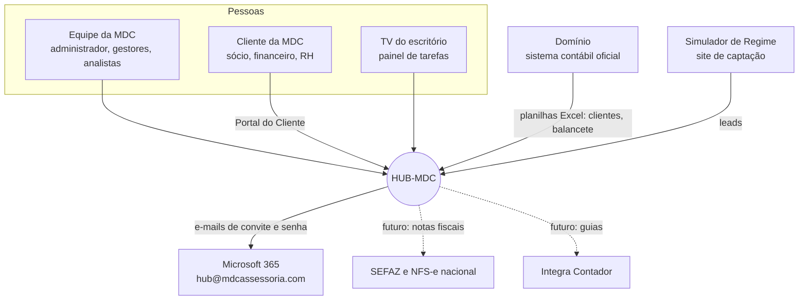

# 1. Visão geral

> **Resumo:** o HUB-MDC reúne num único login as ferramentas internas da MDC (tarefas, societário,
> demonstrativos, atendimento, vencimentos, comercial) e o Portal do Cliente. Cada pessoa vê só as ferramentas
> que o perfil dela libera. Endereço: `mdcassessoria.com/hub-mdc` (hoje também `mdc-tarefas.vercel.app/hub-mdc`).

## 1.1 Quem usa e com o que o HUB conversa

## 1.2 Módulos que existem hoje

| Módulo | Para quem | O que faz | Rotas |
| --- | --- | --- | --- |
| Início | Equipe | Resumo das tarefas da pessoa, gráfico semanal | `/` |
| Tarefas | Equipe, TV | Tarefas e rotinas mensais por cliente, quadro, relatório PDF/Excel, painel da TV | `/tarefas`, `/tarefas/relatorio`, `/tv` |
| Configurações | Gestores | Organização, setores, clientes (segmento, grupos), obrigações recorrentes, feriados | `/config` |
| Clientes | Gestores | Importar a carteira do Domínio | `/clientes/importar` |
| Societário | Equipe | Alterações, aberturas e baixas, fase a fase, com exigências e taxas | `/societario`, `/societario/[id]` |
| Demonstrativos | Equipe | Importa o balancete do Domínio, gera BP/DRE/DFC, índices, fragilidades, parecer e PDF assinado | `/demonstrativos/...` |
| Atendimento | Equipe | Chat com os clientes do Portal | `/atendimento` |
| Vencimentos | Equipe | Certificados, alvarás, procurações com avisos | `/vencimentos` |
| Comercial (CRM) | Equipe comercial | Funil, leads, contratos com modelo | `/comercial/...` |
| Pessoas e acessos | Administrador | Equipe, perfis, acessos do Portal, transferência de trabalho, histórico | `/hub/acessos` |
| Portal do Cliente | Cliente | Demonstrativos publicados, rotinas do mês, processos, documentos, chat | `/portal` |

Os módulos planejados (Pacotes, Financeiro, Entradas, Saídas, Fiscal, Contabilidade) estão desenhados em
[`futuro/hub-gestao-desenho.md`](futuro/hub-gestao-desenho.md).

## 1.3 Clientes-piloto

A própria **MDC** e o **Grupo Greencore** (matriz e filial, Lucro Real, Extrema/MG) são os clientes de teste do
HUB. No cadastro de clientes eles estão no grupo **"Piloto HUB"**, o que permite filtrá-los nas telas e nas
rotinas. Toda funcionalidade nova é validada primeiro com eles.

## 1.4 Princípios que guiam o projeto

1. **Feito para quem não é técnico:** telas simples, linguagem do dia a dia, filtros fáceis, exportação em PDF e
   Excel do que está na tela, boa aparência. Termo técnico só com explicação.
2. **A segurança mora no banco:** a tela esconde botões, mas quem decide o acesso são as regras RLS.
3. **O Domínio é o livro oficial:** o HUB importa do Domínio e, no futuro, exporta lançamentos para ele.
4. **Tudo auditado:** a cada implementação, um agente independente audita e registra um parecer em
   [`auditoria/`](auditoria/) (veja a rotina em [`08-convencoes.md`](08-convencoes.md#86-rotina-de-auditoria)).
