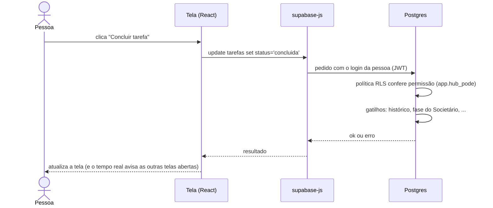

# 2. Arquitetura

> **Resumo:** o HUB é um site (Next.js) que roda **inteiro no navegador** e conversa direto com o Supabase
> (banco Postgres + login + arquivos + funções). Não existe servidor próprio: a Vercel só entrega os arquivos do
> site, e a Cloudflare faz o endereço `mdcassessoria.com/hub-mdc` apontar para a Vercel.

## 2.1 As peças

```mermaid
flowchart LR
    U[Navegador<br/>equipe, cliente, TV] -->|mdcassessoria.com/hub-mdc| CF[Cloudflare Worker<br/>infra/cloudflare]
    CF --> V[Vercel<br/>arquivos do site Next.js<br/>basePath /hub-mdc]
    U -->|supabase-js<br/>chave publicável + login do usuário| SB
    subgraph SB[Supabase · projeto bulqqdgfrrpqquqvjjfa · São Paulo]
        API[API REST e RPC<br/>PostgREST]
        DB[(Postgres<br/>tabelas + RLS + funções)]
        AUTH[Login e convites]
        RT[Tempo real<br/>tarefas, sino, chat]
        ST[Arquivos<br/>bucket hub-arquivos]
        VA[Cofre<br/>certificado A1]
        CRON[Agendador pg_cron<br/>tarefas do mês, avisos]
        EF[Funções Edge<br/>convite · certificado · demonstrativo-pdf]
        API --> DB
        EF --> DB
        EF --> VA
        CRON --> DB
    end
    AUTH -->|SMTP| M365[hub@mdcassessoria.com]
```

| Peça | Onde está no repositório | Papel |
| --- | --- | --- |
| Site (front-end) | `web/` | Todas as telas; roda no navegador |
| Banco | `supabase/migrations/` | Tabelas, regras de acesso (RLS), funções e gatilhos |
| Funções Edge | `supabase/functions/` | Só o que precisa de chave secreta: enviar convite, guardar certificado, gerar PDF assinado |
| Modelos de e-mail | `supabase/templates/` | Convite e troca de senha (copiados para o painel do Supabase) |
| Endereço do site | `infra/cloudflare/` | Worker que repassa `/hub-mdc` para a Vercel |

## 2.2 Como um clique vira dado gravado



Duas formas de falar com o banco:

1. **Direto na tabela** (`supabase().from("tarefas")...`): para listar e editar registros simples. Quem protege é a RLS.
2. **Função RPC** (`supabase().rpc("hub_convidar", {...})`): para operações com regra de negócio ou que mexem em
   várias tabelas de uma vez (tudo ou nada). A função confere a permissão na primeira linha.

## 2.3 Onde fica cada tipo de regra

| Se a regra... | Fica em | Exemplo |
| --- | --- | --- |
| decide quem vê ou altera um dado | RLS e funções `app.*` no banco | `app.hub_pode`, `app.portal_pode` |
| muda várias tabelas ou estados | Função RPC `public.*` | `soc_mudar_fase`, `portal_publicar_balancete` |
| não pode ser quebrada por nenhuma tela | Gatilho no banco | Último administrador, balancete publicado travado |
| calcula para mostrar (gráficos, índices) | TypeScript em `web/src/lib/` | `balancete.ts`, `demonstracoes.ts` |
| usa segredo (chave de serviço, certificado) | Função Edge | `convite`, `demonstrativo-pdf` |
| lê arquivo de terceiro (Excel do Domínio) | TypeScript, função pura testável | `lerBalancete`, `importacao.ts` |

> **Ponto de atenção registrado na auditoria:** hoje o resultado do balancete é calculado no navegador e
> gravado como JSON; o PDF assinado usa esse JSON. Antes dos módulos Financeiro/Fiscal/Contabilidade, o cálculo
> que vira documento deve passar a rodar no servidor. Veja [`decisoes/0003-calculo-no-servidor.md`](decisoes/0003-calculo-no-servidor.md).

## 2.4 Implantação

- **Site:** cada `git push` na branch `main` do GitHub (`MdcAssessoria/mdc-tarefas`) publica automaticamente na
  Vercel (projeto `mdc-tarefas`, pasta raiz `web`).
- **Banco:** migrações aplicadas no Supabase pelo SQL Editor ou pela ferramenta de migração; ver capítulo 7.
- **Funções Edge:** publicadas uma a uma (ver capítulo 7). Sempre com `deno.json` como mapa de importação.
- **Domínio:** Cloudflare na frente da Hostinger (site institucional); só o caminho `/hub-mdc` vai para a Vercel.
