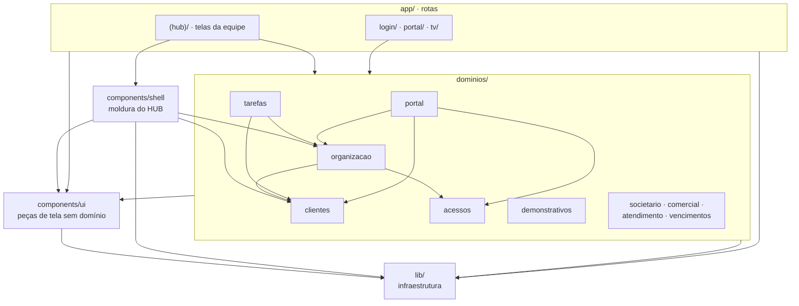

# 3. Estrutura do código

> **Resumo:** o repositório tem o site (`web/`), o banco e as funções (`supabase/`), o Worker do endereço (`infra/`)
> e esta documentação (`docs/`). No site, `app/` só tem rotas, `dominios/` guarda as regras de cada assunto e `lib/`
> só infraestrutura; a dependência anda num sentido só: `app → dominios → lib` (o ESLint barra o contrário).

O guia prático do site (comandos, padrão de tela, como criar uma tela nova) fica em [`web/README.md`](../web/README.md).
Este capítulo dá a visão de conjunto.

## 3.1 O repositório

```
hub-mdc/
├── CLAUDE.md                regras do repositório para qualquer pessoa ou IA
├── README.md                o que é o HUB e links
├── web/                     o site (Next.js), publicado na Vercel a cada push na main      → seção 3.2
├── supabase/
│   ├── migrations/          001…0NN_*.sql: o banco, em ordem; nunca editar uma migração já aplicada (cap. 4)
│   ├── functions/           funções Edge (Deno): convite, certificado, demonstrativo-pdf
│   ├── templates/           e-mails de convite e de recuperação de senha
│   ├── simulador/           SQL do simulador de regime (encaminhamento de leads para o CRM)
│   └── seed_mdc.sql         dados iniciais da MDC
├── scripts/
│   ├── sync-funcoes.sh      copia o núcleo de cálculo do site para a função demonstrativo-pdf (seção 3.6)
│   └── nucleo_balancete.py  o recorte usado pelo sync-funcoes.sh
├── infra/cloudflare/        Worker que serve mdcassessoria.com/hub-mdc a partir da Vercel
├── docs/                    este manual, auditorias, decisões e desenhos futuros
├── .github/workflows/       web.yml: roda "npm run verificar" em todo push e pull request que mexe em web/
└── .claude/                 agente e rotina de auditoria independente (cap. 8.6)
```

## 3.2 O site (`web/src`)

```
web/src/
├── app/                        ROTAS (uma pasta por endereço, cada uma com page.tsx)
│   ├── layout.tsx, globals.css layout raiz, cores e classes base
│   ├── (hub)/                  telas da equipe; o grupo "(hub)" não aparece no endereço
│   │   ├── layout.tsx          OrgProvider + Moldura, montados uma vez para todas as telas do grupo
│   │   ├── page.tsx            Início
│   │   ├── tarefas/  config/_abas/  clientes/  societario/  demonstrativos/
│   │   ├── atendimento/  vencimentos/  comercial/
│   │   └── hub/acessos/_componentes/   Pessoas e acessos (/hub/acessos)
│   ├── login/                  fora do grupo: sem menu
│   ├── portal/                 fora do grupo: Portal do Cliente (o cliente não é membro da equipe)
│   └── tv/                     fora do grupo: Painel TV em tela cheia
├── components/
│   ├── ui/                     Modal, Abas, Aviso, Carregando, EstadoVazio, Etiquetas, MultiSelecao, Icone
│   └── shell/                  Moldura, MenuLateral, BarraSuperior, BuscaRapida, Sino, Guarda, navegacao.ts
├── dominios/                   REGRAS DE NEGÓCIO, um assunto por pasta (tipos, cálculos, acesso ao banco, componentes/)
│   ├── organizacao/            OrgProvider (useOrg), tipos de organização, membro, setor, papel
│   ├── tarefas/                tipos, useTarefas, componentes/ (TarefaEditor, PainelTV, Badges, RitmoSemanal)
│   ├── clientes/               tipos, nomeCliente, importação do Domínio, "Colar lista", grupos
│   ├── acessos/                níveis por ferramenta, ferramentas do HUB, convite, texto do histórico
│   ├── portal/                 permissões do Portal do Cliente e a gestão dos acessos de clientes
│   ├── societario/             processos, fases e órgãos
│   ├── demonstrativos/         balancete/ (leitura, classificacao, resumo, indices, fragilidades), calculosDemonstracoes,
│   │                           periodos, tendencia, parecer, repositorio, componentes/ (painel, gráficos, índices…)
│   ├── comercial/              CRM e contrato em PDF
│   ├── atendimento/            chat e componentes/ChatMensagens
│   └── vencimentos/            tipos de vencimento
└── lib/                        INFRAESTRUTURA sem regra de negócio
    ├── supabase.ts, database.types.ts, exigir.ts, useConsulta.ts, erros.ts
    ├── caminho.ts, datas.ts, formato/ (datas, moeda, numero), texto.ts, markdown.ts
    ├── identidade.ts, marca.ts, armazenamentoLocal.ts, useAgora.ts
    └── arquivos/               armazenamento (Storage), excel, relatorioPdf, planilha, baixar
```

Convenções de pasta:

- **`_pasta`** dentro de `app/` não vira rota (regra do App Router). Use para pedaços de uma tela grande que só ela
  usa: `config/_abas/`, `hub/acessos/_componentes/`.
- **`(grupo)`** organiza rotas e compartilha um layout sem mudar o endereço.
- **Testes** ficam ao lado do código, com o mesmo nome e `.test.ts` (ex.: `lib/caminho.test.ts`).
- **Todo arquivo** começa com um comentário curto dizendo para que serve.

## 3.3 Dependências entre pastas



As regras:

1. **`app` → `dominios` → `lib`.** A tela compõe; o domínio sabe as regras; `lib` só sabe técnica.
2. **`components/ui` → `lib`.** Peça de tela não conhece domínio; recebe tudo por props.
3. **Nada em `lib/` importa de `dominios/`, `components/` ou `app/`.** `dominios/` não importa `app/` nem `components/shell/`.
4. **Domínio pode usar outro domínio, sem ciclo.** Hoje as setas entre domínios são só as do diagrama.

As regras 1 a 3 são verificadas pelo ESLint (`web/eslint.config.mjs`, `no-restricted-imports` por pasta): um
import proibido quebra o `npm run verificar` com a explicação.

## 3.4 Onde fica cada coisa

| Assunto | Onde |
| --- | --- |
| Menu lateral, abas de cada módulo, módulo ativo por rota | `web/src/components/shell/navegacao.ts` |
| Sessão, organização, membros, clientes e permissões na tela (`useOrg`) | `web/src/dominios/organizacao/OrgProvider.tsx` |
| Leitura e classificação do balancete, índices, fragilidades | `web/src/dominios/demonstrativos/balancete/` |
| Balanço, DFC, saúde financeira | `web/src/dominios/demonstrativos/calculosDemonstracoes.ts` |
| Gravar e recalcular balancete no banco | `web/src/dominios/demonstrativos/repositorio.ts` |
| Permissões do Portal do Cliente | `web/src/dominios/portal/permissoes.ts` |
| Dinheiro, datas, números | `web/src/lib/formato/` |
| Dados oficiais da MDC (CNPJ, telefone, responsável técnico) | `web/src/lib/identidade.ts` |
| Excel e PDF de relatório | `web/src/lib/arquivos/` |
| Regras de acesso de verdade (quem lê e grava o quê) | banco: RLS e funções `app.*` em `supabase/migrations/` (cap. 5) |

A tabela completa, tela por tela, está em `web/README.md` (seção 4).

## 3.5 Padrão de uma tela

Toda tela da equipe fica em `web/src/app/(hub)/<modulo>/…/page.tsx` e **não** monta organização nem menu (o layout
do grupo faz isso). Dentro dela:

1. **Ler:** `useConsulta(useCallback(async () => exigir(await supabase()…), [deps]))` devolve `dados`, `erro`,
   `carregando` e `recarregar`.
2. **Gravar:** `exigir(await supabase()…)` dentro de `try/catch`, avisando com `useAviso()` e chamando `recarregar()`.
3. **Mostrar:** `Aviso`, `Carregando`, `EstadoVazio`, `Modal` e `Abas` de `components/ui/`; formatos de `lib/formato/`.
4. **Regras e tipos** em `dominios/<modulo>/`, com teste quando for função pura.

O exemplo completo, que compila, está em `web/README.md` (seção 5). As regras de tela para público leigo continuam
valendo (cap. 8.3).

## 3.6 Código compartilhado com o servidor

A função `supabase/functions/demonstrativo-pdf` (Deno) gera o PDF oficial dos demonstrativos e precisa dos mesmos
tipos, índices e formatos do site. Como o Deno não enxerga `web/src`, `scripts/sync-funcoes.sh` recorta esses trechos
de `dominios/demonstrativos/balancete/`, `dominios/demonstrativos/calculosDemonstracoes.ts`, `lib/texto.ts` e
`lib/formato/` e grava `supabase/functions/demonstrativo-pdf/{balancete,demonstracoes}.ts`.

- Mudou algum desses arquivos do site? Rode `sh scripts/sync-funcoes.sh` na raiz, confira o `git diff` da função e
  publique a função (cap. 7).
- Na cópia, `brl(v)` mostra sempre reais inteiros (no site é `brl(v, { centavos: false })`).
- A auditoria de arquitetura de 31/10/2026 propõe trocar essa cópia por um núcleo único importado pelos dois lados.

## 3.7 Como criar uma tela nova

Passo a passo em `web/README.md` (seção 6): rota em `app/(hub)/`, entrada em `navegacao.ts`, regras em
`dominios/<modulo>/`, dados de exemplo para o `npm run telas`, e `npm run verificar && npm run telas` antes do commit.
