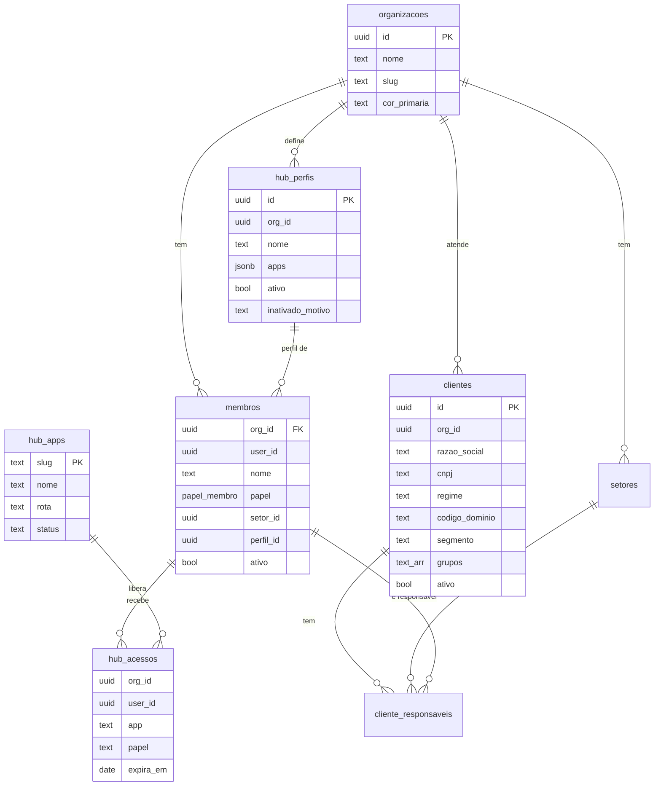
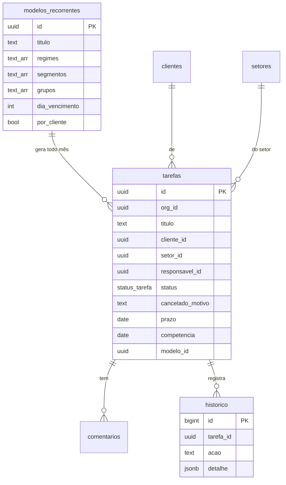
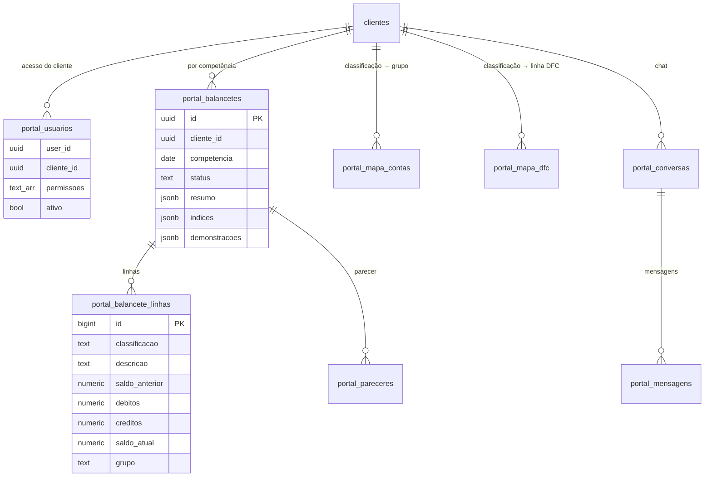
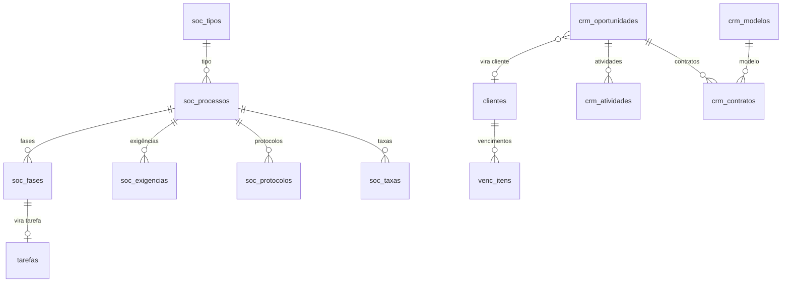

# 4. Banco de dados

> **Resumo:** o banco é um Postgres no Supabase (projeto `bulqqdgfrrpqquqvjjfa`, região São Paulo).
> Todas as tabelas de negócio ficam no esquema `public` e têm RLS ligado. Funções internas de apoio
> (permissões, gatilhos, rotinas) ficam no esquema `app`, que o navegador não acessa.
> As telas falam com o banco de duas formas: leitura/gravação direta nas tabelas (protegida por RLS)
> e chamadas a funções `public.*` (RPC) para operações com regra de negócio.

## 4.1 Como o banco está organizado

| Domínio | Tabelas | Para que serve |
| --- | --- | --- |
| Organização e acesso | `organizacoes`, `membros`, `setores`, `feriados`, `hub_apps`, `hub_acessos`, `hub_perfis`, `app.convites`, `app.convite_envios` | Quem é a empresa (MDC), quem trabalha nela, que ferramentas cada um vê |
| Infra do HUB | `hub_auditoria`, `hub_notificacoes`, `hub_arquivos`, `hub_certificados` | Registro de ações, sino de avisos, arquivos no Storage, certificado digital (cofre) |
| Clientes | `clientes`, `cliente_responsaveis` | Carteira de clientes (vinda do Domínio) e responsável por setor |
| Tarefas | `tarefas`, `comentarios`, `historico`, `modelos_recorrentes` | Tarefas, rotinas mensais geradas automaticamente, histórico |
| Societário | `soc_tipos`, `soc_processos`, `soc_fases`, `soc_exigencias`, `soc_protocolos`, `soc_taxas`, `soc_eventos` | Alterações contratuais e aberturas, fase a fase |
| Portal e demonstrativos | `portal_usuarios`, `portal_convites`, `portal_conversas`, `portal_mensagens`, `portal_balancetes`, `portal_balancete_linhas`, `portal_mapa_contas`, `portal_mapa_dfc`, `portal_pareceres` | Área do cliente: balancetes, demonstrações, parecer, chat |
| Marca de ex-cliente (esquema `app`, sem acesso pela API) | `app.ex_clientes` | E-mails que já foram acesso de cliente; nunca entram na equipe (027). Para retirar uma marca feita por engano, o administrador roda no SQL do Supabase: `delete from app.ex_clientes where email = '...'` e registra o motivo |
| Integrações e importações | `hub_integracoes`, `hub_importacoes` | Pasta do SharePoint lida pelo agente (só administrador) e histórico de tudo o que foi importado (tela, lote, pasta) |
| Financeiro | `fin_plano_contas`, `fin_plano_importacoes`, `fin_contas_bancarias`, `fin_extrato_lotes`, `fin_extrato_linhas`, `fin_pessoas`, `fin_categorias`, `fin_centros_custo`, `fin_titulos`, `fin_baixas`, `fin_transferencias` (034), `fin_conciliacoes` e `fin_conciliacao_itens` (051) | Plano de contas do Domínio, bancos, extratos, fornecedores/clientes, despesas/receitas ligadas ao plano, centros de custo, contas a pagar/receber, pagamentos e transferências entre contas de cada cliente ([módulo](modulos/financeiro.md)) |
| Estoque | `est_itens`, `est_locais`, `est_parametros`, `est_movimentos`, visão `est_saldos` | Produtos e serviços (com "controla estoque"), estoques (locais), regra de estoque negativo, movimentos e saldo por item e local ([módulo](modulos/financeiro.md#6-itens-e-estoque)) |
| Licenças | `lic_produtos`, `lic_planos`, `lic_plano_produtos`, `lic_contratos`, `lic_contrato_produtos`, `lic_cobrancas`, `lic_baixas`, `lic_reajustes`, `lic_bloqueios`, `lic_parametros`, `lic_ledgra_chaves` | Módulos do HUB e do ERP Ledgra vendidos aos clientes: contratos (gratuita, pacote ou full), mensalidades, recebimentos, reajustes, bloqueio manual e a chave que liga a empresa no Ledgra (067) ([módulo](modulos/licencas.md)) |
| Ledgra Link (043) | `link_config`, `link_cobrancas`, `link_eventos` | Boleto/Pix das mensalidades da Cobrança Ledgra pelo Ledgra Link (add-on bancário da MDC) e avisos de pagamento aplicados uma vez só ([módulo](modulos/licencas.md#7-boleto-e-pix-pelo-ledgra-link-migração-043)) |
| Estoque | `est_itens`, `est_grupos`, `est_locais`, `est_parametros`, `est_movimentos`, visão `est_saldos` | Produtos e serviços (com "controla estoque", grupo, unidade de compra, custo médio), estoques (locais), regra de estoque negativo, movimentos com saldo e custo médio depois de cada um (ficha/kardex) e saldo por item e local ([módulo](modulos/estoque.md)) |
| Gestão só da MDC (042) | `organizacoes.gestao_cliente_id`; gatilho `gestao_so_empresa` nas tabelas `fin_*`, `fis_*`, `est_*` | A gestão vale só para a empresa da própria organização (MDC); ver [5.7](05-seguranca-e-acessos.md) |
| Contratos (041/045) | `fin_recorrentes`, `fin_recorrente_reajustes`, `fin_recorrente_eventos`, `fin_indices`, `app.fin_indices_pedidos`; `fin_titulos.recorrente_id` + `competencia` (índice único por contrato e mês entre as contas não canceladas, 043); `fin_faturas` (fatura numerada AAAA/NNNNN de cada conta a receber do contrato) e `fin_envios` (fila de envio por canal: e-mail, WhatsApp, Portal) (043; próxima tentativa, falhas, id da mensagem e reenvios na 053) e `fin_envio_canais` (canal ligado ou não, gravado pela Função `fatura-enviar`, 053) | Contratos fixos a receber/a pagar com vigência, anexos (`hub_arquivos` app `contratos`) e histórico; a conta de cada mês nasce no Financeiro; reajuste anual pelo índice do Banco Central ([módulo](modulos/contratos.md)) |
| Regras fiscais (057) | `fis_regras_servico` (uma ativa por código de serviço; NBS, ISS, retenção por município, IBS/CBS) gravada só por `fis_regra_servico_salvar` (Contratos: gerir; inativar com motivo); `app.nfse_dados` lê a regra (NBS e pendência de ISS retido); `app.fis_chave_municipio` compara Cidade/UF sem acento |
| Receita por sistema (059) | `fin_sistemas` (sistemas que a MDC licencia; nome único por empresa; nada se apaga, gestão só da MDC) gravada só por `fin_sistema_salvar` (Contratos: gerir); `fin_recorrentes.sistema_id` (contrato a receber); painel `fin_receita_sistemas` (Contratos: ver). Estoque, Entradas e Saídas com status `desligado` em `hub_apps` |
| NBS oficial (062) | `fis_lc116_nbs` (Anexo VIII da NFS-e: item LC 116 × NBS × atividade do Simples) e `fis_tabelas` (versão, conferência); leitura para quem tem login, gravação só pela Função `fiscal-tabelas` (chave de serviço: `fis_tabela_carregar`, `fis_tabela_conferida`, `fis_tabela_versao`, `fis_tabelas_token_confere`); consulta `fis_nbs_do_servico`; agendador `fiscal-tabelas` toda segunda 07h10 |
| NFS-e automática (052) | `nfse_auto_tentativas` | Uma tentativa por fatura por dia da emissão automática (emitida, rejeitada, erro, pendência + motivo); nada se apaga ([módulo](modulos/contratos.md#6-emissão-automática-da-nfs-e-migração-052-04112026)) |
| Papel timbrado (052) | `org_papel_timbrado` | Telefone, site, e-mail, Instagram, responsável técnico e CRC do escritório nos documentos (PDF do Demonstrativo) |
| NFS-e emitida (046) | `nfse_parametros`, `nfse_numeracao`, `nfse_emissoes` | Emissão da NFS-e das faturas pelo Emissor Nacional: parâmetros (ambiente, modo, série, Simples, IM, município, NBS, % tributos), próximo nDPS sem repetir e cada DPS enviada com o resultado ([módulo](modulos/contratos.md#5-nota-fiscal-de-serviço-pelo-emissor-nacional-migração-046-03112026)) |
| Boleto das faturas (049) | `link_contas_banco`, `fin_fatura_boletos` | Conta da MDC no Ledgra Link por banco (Itaú, Santander) e cada boleto emitido para uma fatura, com a situação que o banco avisa ([módulo](modulos/contratos.md#regras-e-boleto-migrações-048-e-049-03112026)) |
| Pedidos (Saídas e Entradas) | `est_pedidos`, `est_pedido_itens`, `est_pedido_titulos` | Pedidos de venda e de compra: confirmar/receber mexe no estoque e gera contas a receber/pagar ([módulo](modulos/estoque.md)) |
| Notas fiscais (Entradas) | `fis_parametros`, `fis_certificados`, `fis_dfe_controle`, `fis_notas`, `fis_nota_itens`, `fis_eventos`, `fis_depara_itens`, `fis_tipos_entrada`, `fis_regras_credito`; bucket privado `fiscal` | Certificado A1 por empresa (cofre), captura de NF-e/NFS-e com controle de NSU, notas e itens, manifestação e eventos com protocolo, de-para de itens do fornecedor, tipos de entrada e regras de crédito por regime com vigência ([módulo](modulos/notas-fiscais.md)) |
| Vencimentos | `venc_itens` | Certificados, alvarás, procurações e outros itens que vencem |
| Cadastro no Ledgra Link (064) | função `link_pode_cadastrar` (sem tabela nova) | Contratos › Ledgra Link: a Função Edge `ledgra-link` confere Contratos › gerir antes de cadastrar empresa, termo, conta, certificado e credencial no Ledgra Link ([módulo](modulos/contratos.md#cadastro-no-ledgra-link-pelo-hub-migração-064-09112026)) |
| Notas de saída (065) | `nfse_notas` (uma por fatura com NFS-e, nasce pelo gatilho `nota_saida` em `fin_faturas`; guarda só os ajustes: código do serviço, NBS, texto, tributos aproximados); `app.nfse_dados` passa a usar os ajustes; funções `nfse_nota_salvar` (Contratos operar; trava nota emitida, cancelada ou com envio em aberto) e `nfse_saidas` (lista com situação simples); leitura com Contratos (ver), nada se apaga |
| Retransmissor da NFS-e (066) | segredo `nfse_relay_token` no Vault (gerado pelo banco); `nfse_relay_token()` só service_role (a Função lê) e `nfse_relay_confere(p_token)` para o site conferir (só verdadeiro/falso). O envio à Sefin passa por `web/src/app/api/nfse-relay` (Node): a Sefin pede o certificado por renegociação TLS 1.2, que o Deno não faz |
| Painel de certificados (044) | funções `cert_painel`, `link_pode_ver_certificados` (sem tabela nova) | Vencimentos › Certificados digitais: lista os certificados do cofre do HUB (`hub_certificados` e `fis_certificados`, só dados públicos) e, pela Função Edge `ledgra-link` (ação `certificados`), os certificados bancários do Ledgra Link. O HUB não lê o banco do Ledgra Link direto: o add-on é independente e só fala pela API |
| Comercial (CRM) | `crm_oportunidades`, `crm_atividades`, `crm_modelos`, `crm_contratos` | Funil de vendas, leads e contratos |

Regra de ouro: **toda tabela de negócio tem `org_id`**. É por ele que o RLS separa uma organização da outra.
Tabelas ligadas a um cliente também têm `cliente_id`, e o gatilho `app.tg_cliente_mesma_org` impede que um
registro aponte para um cliente de outra organização.

## 4.2 Diagramas por domínio

Os diagramas mostram as tabelas e as ligações principais (não todas as colunas). Versões em imagem estão em
[`imagens/`](imagens/) para quem lê fora do GitHub.

### Organização, acesso e clientes



### Tarefas e rotinas



### Portal do cliente e demonstrativos



### Societário, vencimentos e CRM



## 4.3 Funções que as telas chamam (RPC)

Toda função `public.*` é `SECURITY DEFINER`: roda com permissão do dono e **confere por dentro** se quem chamou
pode fazer aquilo (normalmente com `app.hub_pode(org, app, nível)` ou `app.portal_pode(cliente, permissão)`).

| Área | Funções |
| --- | --- |
| Equipe e acessos | `hub_convidar`, `hub_editar_membro`, `hub_definir_perfil`, `hub_definir_acesso`, `hub_cancelar_convite`, `hub_transferir_trabalho`, `hub_pendencias_membro`, `hub_situacao_contas`, `hub_meus_apps`, `hub_pode_enviar_convite` |
| Clientes | `importar_clientes`, `inativar_cliente`, `reativar_cliente` |
| Tarefas | `gerar_competencia`, `prever_rotina` |
| Societário | `soc_abrir_processo` (cliente do cadastro, ou nome/CNPJ de empresa ainda não cadastrada), `soc_vincular_cliente` (037: liga depois ao cliente cadastrado, com as tarefas das fases), `soc_mudar_fase`, `soc_registrar_exigencia`, `soc_concluir_processo`, `soc_cancelar_processo` |
| Portal | `portal_convidar` (036: lista fechada de permissões), `portal_minhas_empresas`, `portal_rotinas`, `portal_processos`, `portal_abrir_conversa`, `portal_conversa_para_tarefa`, `portal_publicar_balancete`, `portal_publicar_parecer` |
| Vencimentos | `venc_renovar`, `venc_encerrar` (036) |
| Tarefas e configurações (036, nada se apaga) | `tarefa_cancelar`, `feriado_inativar`, `hub_inativar_perfil`, `portal_cancelar_convite` |
| CRM | `crm_receber_lead` (página pública de leads), `crm_converter_cliente`, `crm_arquivar`, `crm_excluir` (054: só gerir, com motivo, nunca cliente/contrato assinado, retrato na auditoria), `crm_salvar_contrato`, `crm_marcar_contrato`, `crm_registrar_atividade` (038) |
| Certificado | `cert_salvar`, `cert_obter`, `cert_remover` (segredos no Supabase Vault) |
| Licenças | `lic_salvar_produto`, `lic_salvar_plano`, `lic_salvar_contrato`, `lic_encerrar_contrato`, `lic_reajustar_contrato`, `lic_gerar_cobrancas`, `lic_baixar_cobranca`, `lic_desfazer_baixa`, `lic_cancelar_cobranca`, `lic_bloquear`, `lic_desbloquear`, `lic_definir_parametros`, `lic_ledgra_chave_gerar`, `lic_ledgra_chave_revogar`, `lic_ledgra_validar` (anon, chamada pelo servidor do Ledgra), `portal_licenca_situacao` |
| Ledgra Link | `link_salvar_config`, `link_pode_emitir` (tela); `link_registrar_emissao`, `link_aplicar_evento` (só `service_role`, chamadas pelas Funções Edge `ledgra-link` e `ledgra-link-webhook`) |
| Contratos (041/045) | `fin_recorrente_salvar` (045: campos de faturamento), `fin_recorrente_suspender`, `fin_recorrente_reativar`, `fin_recorrente_encerrar`, `fin_recorrente_proposta`, `fin_recorrente_reajustar`, `fin_recorrente_anexo`, `fin_indices_atualizar`, `fin_fatura_cancelar`, `fin_fatura_gerar_agora` (045); Portal: `portal_minhas_faturas` (045), `portal_faturas_detalhe` (050: PDF, NFS-e emitida e boleto) |
| Correções da reauditoria (047) | `hub_arquivo_retirar` (administrador, com motivo), `org_definir_empresa_gestao` (administrador; motivo ao trocar), `fin_recorrente_opcoes` (Contratos ver: cadastros só com nome) |
| NFS-e automática (052) | Só a Função Edge `nfse-automatica` (service_role): `nfse_token_confere`, `nfse_auto_pendentes`, `nfse_auto_registrar`. `nfse_parametros_salvar` passa a exigir `confirmo_automatico` ao ligar o automático. Agendador `nfse-automatica` (pg_cron, 06h45) |
| Papel timbrado (052) | Tela: `org_papel_timbrado_salvar(p_org, p)` (só administrador; e-mail validado, auditado) |
| NFS-e (046) | Tela: `nfse_preparar` (Contratos ver), `nfse_parametros_salvar` (gerir). Só Função Edge `nfse-emitir` (service_role): `nfse_reservar`, `nfse_registrar_resultado` (portas para `app.nfse_reservar`/`app.nfse_registrar_resultado`; `app.nfse_dados` monta a DPS e as pendências) |
| Contratos: regras (048) e boleto (049) | 048: nova versão de `fin_recorrente_salvar`, `fin_recorrente_reativar`, `fin_fatura_gerar_agora`, `fin_recorrente_proposta`, `fin_recorrente_reajustar` (internas `app.fin_reajuste_candidato`, `app.fin_reajuste_contas`, `app.contratos_lanca_pode`, `app.contratos_quem_avisar`). 049: tela `link_salvar_banco` (gerir), `fatura_boleto_preparar` (operar, pela Função Edge com o login); só service_role: `fatura_boleto_registrar`, `link_aplicar_evento` |
| Conciliação do extrato (051) | `fin_conciliacao_dados` (ver), `fin_conciliar`, `fin_conciliar_lancar`, `fin_conciliar_transferir`, `fin_extrato_ignorar`, `fin_conciliacao_desfazer` (operar); nova versão de `fin_estornar_transferencia` (recusa conciliada); interna `app.fin_conciliar_ligar` (sem execute para o site) |
| Estoque e pedidos (033) | `est_salvar_item`, `est_importar_itens`, `est_inventario`, `est_movimentar`, `est_estornar_movimento`, `est_pedido_salvar`, `est_pedido_confirmar`, `est_pedido_receber`, `est_pedido_faturar`, `est_pedido_cancelar` |
| Notas fiscais (Entradas, 032) | Tela: `fis_processar_nota`, `fis_desfazer_lancamento`, `fis_registrar_upload`, `fis_salvar_parametros`, `fis_salvar_tipo_entrada`, `fis_pode`, `fis_pode_certificado`. Só Funções Edge (service_role): `fis_cert_salvar`, `fis_cert_obter`, `fis_cert_remover`, `fis_gravar_documento`, `fis_registrar_evento`, `fis_captura_reservar`, `fis_captura_concluir`, `fis_token_confere` |

## 4.4 Funções internas e gatilhos (`app.*`)

- **Permissão:** `hub_pode` (só a ferramenta pedida), `hub_pode_algum` (alguma das ferramentas), `papel`, `eh_gestor`,
  `portal_pode`, `minhas_orgs`, `meu_setor`, `hub_peso`; módulos pagos do Portal: `cliente_tem_modulo(cliente, módulo)`
  (módulo ativo, contrato vigente, sem bloqueio) e `cliente_bloqueado(cliente)` (031); dados de gestão:
  `gestao_pode(cliente, nível, módulos[])`, `fin_pode(cliente, nível)`, `portal_gestao`, `modulos_gestao`,
  `modulos_operar` (036, ver [5.7](05-seguranca-e-acessos.md)); módulo Contratos: `contratos_pode(cliente, nível)` (041; 042 exige a empresa da gestão); empresa da gestão: `empresa_gestao(cliente)` (042); permissões do Portal: `portal_perm_validas` (036).
- **Rotinas:** `gerar_tarefas_recorrentes` (pg_cron diário), `venc_avisar` (avisos de vencimento), `lic_rotina_diaria`
  (mensalidades de licença e avisos de atraso), `fin_recorrentes_rotina` (041: contas do mês dos contratos, renovação,
  encerramento e avisos de reajuste/fim de vigência; 043: gera no dia de gerar com fatura e fila de envio, só a empresa da
  gestão e erro tratado contrato a contrato — `fin_recorrentes_gerar` → `fin_recorrente_lancar_mes`, `fin_fatura_processar`,
  `fin_fatura_situacao`, datas em `fin_recorrente_data_geracao`/`fin_recorrente_vencimento`) e `fin_indices_pedir`/`fin_indices_ler` (índices do Banco Central por pg_net),
  `vencimento` e `dia_util` (calculam prazo útil com feriados).
- **Gatilhos que guardam regras** (não dá para contornar pela tela):

| Gatilho | Tabela | Regra |
| --- | --- | --- |
| `cliente_mesma_org` | 11 tabelas com `cliente_id` | O cliente precisa ser da mesma organização |
| `membros_ultimo_admin` | `membros` | Não deixa a organização ficar sem administrador |
| `membros_sem_pendencias` | `membros` | Não inativa quem ainda tem trabalho aberto |
| `membros_perfil` / `hub_perfis_propagar` | `membros`, `hub_perfis` | Mantém `hub_acessos` igual ao perfil |
| `publicacao_protegida` | `portal_balancetes`, `portal_pareceres` | Publicar só pela função de publicação |
| `portal_mensagens_antes` | `portal_mensagens` | Autor e tipo da mensagem vêm do usuário logado |
| `tarefas_historico` | `tarefas` | Registra cada mudança da tarefa |
| `nada_se_apaga` | `tarefas`, `venc_itens`, `crm_oportunidades`, `crm_atividades`, `crm_contratos`, `feriados`, `hub_perfis`, `portal_convites`, `clientes` | Recusa apagar (036); o DELETE também foi revogado da API. Use cancelar/encerrar/inativar/arquivar |
| `est_pedido_permissao` | `est_pedidos` | Venda grava com Saídas ou Financeiro; compra com Entradas ou Financeiro (036) |
| `lic_contrato_produto_unico` | `lic_contrato_produtos` | Trava o cliente e recusa o mesmo módulo em dois contratos ativos, mesmo ao mesmo tempo (036) |
| `portal_perm_valida` | `portal_usuarios`, `portal_convites` | Só permissões da lista; liberar Financeiro exige Financeiro (gerir) (036) |
| `cliente_cnpj` | `clientes` | CNPJ não muda se há certificado ou nota fiscal (salvo administrador); mudança vai para a auditoria (036) |
| `perfil_ativo` | `membros` | Pessoa só recebe perfil ativo (036) |
| `est_item_valida_v2` | `est_itens` | Custo médio só o HUB grava; grupo da mesma empresa; foto só na pasta da empresa (033) |
| `fis_depara_valida` | `fis_depara_itens` | O item do estoque do de-para é da mesma empresa |
| `nfse_emissao_fixa` | `nfse_emissoes` | Fatura, ambiente, série, nDPS e Id não mudam; emitida/rejeitada não voltam (046) |
| `fatura_nfse_aberta` | `fin_faturas` | Não cancela fatura com NFS-e sendo enviada ou com resultado incerto em produção (046) |
| `fatura_boleto_fixo` | `fin_fatura_boletos` | Fatura, banco, cobrança e tentativa do boleto não mudam; pago não volta (049) |
| `fatura_boleto_valendo` | `fin_faturas` | Não cancela fatura com boleto registrado no banco (049) |

Funções internas das notas (032): `app.fis_gravar_nota` (grava ou completa a nota a partir do XML lido),
`app.fis_gravar_evento` (evento aceito muda manifestação/cancelamento), `app.fis_tipo_efetivo` (regra do tipo de
entrada: empresa › organização › geral), `app.fis_caminho_pode` (acesso ao bucket `fiscal`), `app.fis_org_visivel`,
`app.fis_direcao`, `app.fis_digitos`, `app.fis_manifestacao_do_tipo`; 036: `app.fis_modelo_da_chave` e
`app.fis_dv_chave` (confere a chave da nota enviada à mão), `app.fin_lancar_titulos` (lança contas sem conferir
permissão; usada por `fin_lancar`, pelas notas e pelos pedidos).

Colunas novas da 036 ("nada se apaga" e auditoria): `tarefas.cancelado_em/por/motivo`, `venc_itens.encerrado_em/por/motivo`,
`feriados.ativo` e `inativado_em/por/motivo` (o índice único de data vale só entre os ativos), `hub_perfis.ativo` e
`inativado_em/por/motivo`, `portal_convites.cancelado_em/por/motivo`, `fin_extrato_lotes.desfeito_em/por/motivo` (linhas
do lote ficam com situação `desfeita`; a chave do extrato só impede duplicidade entre as que valem),
`lic_cobrancas.aviso_bloqueio_em` (aviso de sugerir bloqueio sai uma vez só).

## 4.5 Migrações: onde está a versão que vale

As migrações ficam em `supabase/migrations/` e são aplicadas **em ordem numérica**. Várias funções foram
redefinidas em migrações posteriores (`create or replace`), então **a versão que vale é a do arquivo de
número mais alto** em que a função aparece. Para ver a versão em produção sem caçar arquivos:

```sql
select pg_get_functiondef('public.hub_convidar'::regprocedure);   -- troque pelo nome e assinatura
```

Regras para migração nova:

1. Arquivo `NNN_assunto_curto.sql`, número seguinte ao último. Nunca edite uma migração já aplicada.
2. Cabeçalho explicando o porquê, e `comment on table/function` para tudo que for criado.
3. Tabela nova: `org_id` + RLS ligado + políticas por `app.hub_pode` (equipe) ou `app.portal_pode` (cliente).
4. Função `security definer`: sempre `set search_path = public, app` e checagem de permissão na primeira linha.
5. Depois de aplicar, rode os avisos de segurança do Supabase (Advisors) e corrija o que aparecer.
