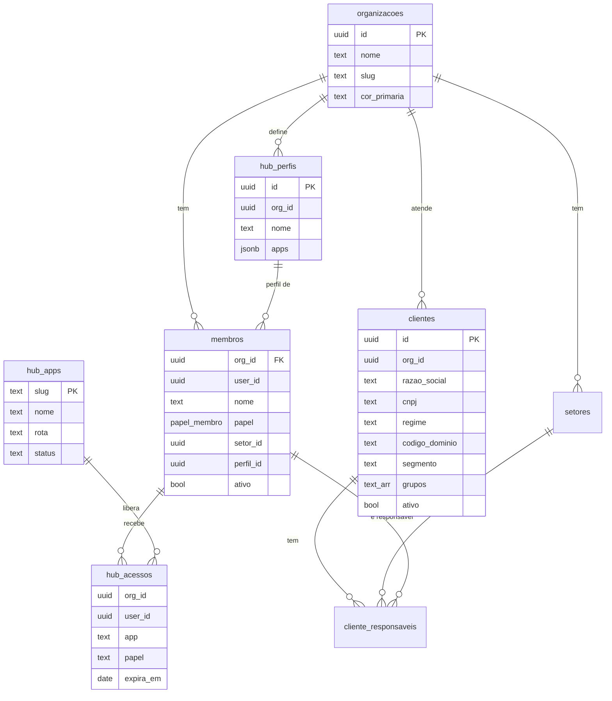
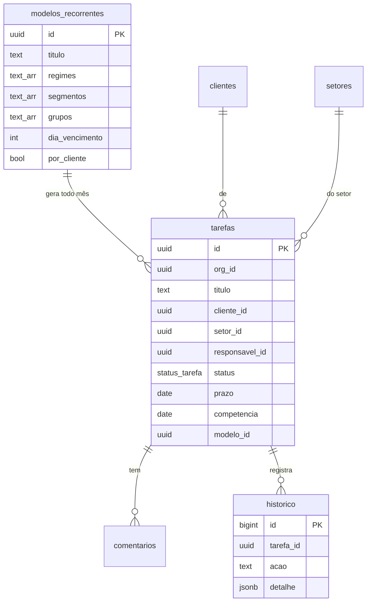
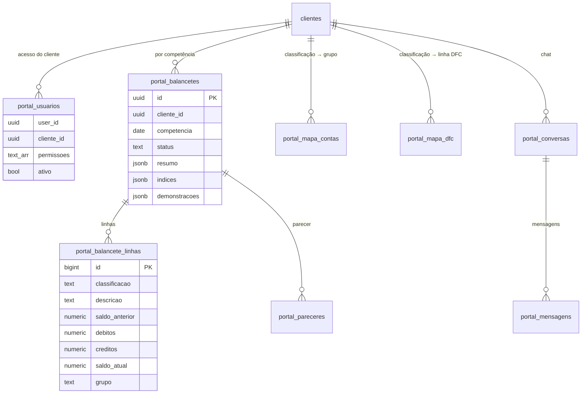
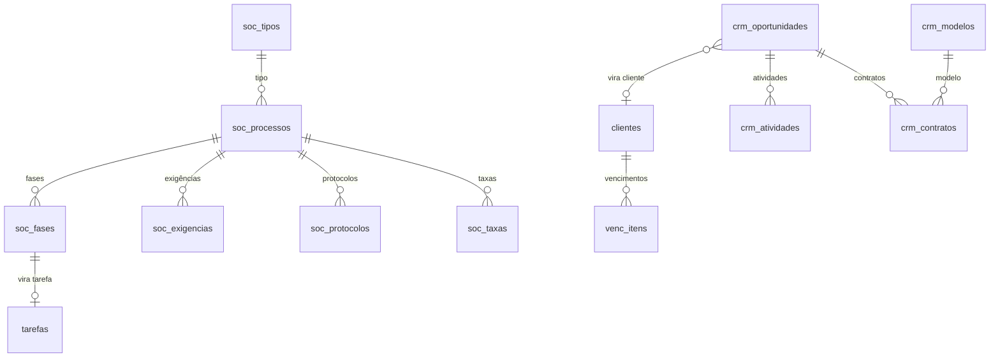

# 4. Banco de dados

> **Resumo:** o banco é um Postgres no Supabase (projeto `bulqqdgfrrpqquqvjjfa`, região São Paulo).
> Todas as tabelas de negócio ficam no esquema `public` e têm RLS ligado. Funções internas de apoio
> (permissões, gatilhos, rotinas) ficam no esquema `app`, que o navegador não acessa.
> As telas falam com o banco de duas formas: leitura/gravação direta nas tabelas (protegida por RLS)
> e chamadas a funções `public.*` (RPC) para operações com regra de negócio.

## 4.1 Como o banco está organizado

| Domínio | Tabelas | Para que serve |
| --- | --- | --- |
| Organização e acesso | `organizacoes`, `membros`, `setores`, `feriados`, `hub_apps`, `hub_acessos`, `hub_perfis`, `app.convites`, `app.convite_envios` | Quem é a empresa (MDC), quem trabalha nela, que ferramentas cada um vê |
| Infra do HUB | `hub_auditoria`, `hub_notificacoes`, `hub_arquivos`, `hub_certificados` | Registro de ações, sino de avisos, arquivos no Storage, certificado digital (cofre) |
| Clientes | `clientes`, `cliente_responsaveis` | Carteira de clientes (vinda do Domínio) e responsável por setor |
| Tarefas | `tarefas`, `comentarios`, `historico`, `modelos_recorrentes` | Tarefas, rotinas mensais geradas automaticamente, histórico |
| Societário | `soc_tipos`, `soc_processos`, `soc_fases`, `soc_exigencias`, `soc_protocolos`, `soc_taxas`, `soc_eventos` | Alterações contratuais e aberturas, fase a fase |
| Portal e demonstrativos | `portal_usuarios`, `portal_convites`, `portal_conversas`, `portal_mensagens`, `portal_balancetes`, `portal_balancete_linhas`, `portal_mapa_contas`, `portal_mapa_dfc`, `portal_pareceres` | Área do cliente: balancetes, demonstrações, parecer, chat |
| Vencimentos | `venc_itens` | Certificados, alvarás, procurações e outros itens que vencem |
| Comercial (CRM) | `crm_oportunidades`, `crm_atividades`, `crm_modelos`, `crm_contratos` | Funil de vendas, leads e contratos |

Regra de ouro: **toda tabela de negócio tem `org_id`**. É por ele que o RLS separa uma organização da outra.
Tabelas ligadas a um cliente também têm `cliente_id`, e o gatilho `app.tg_cliente_mesma_org` impede que um
registro aponte para um cliente de outra organização.

## 4.2 Diagramas por domínio

Os diagramas mostram as tabelas e as ligações principais (não todas as colunas). Versões em imagem estão em
[`imagens/`](imagens/) para quem lê fora do GitHub.

### Organização, acesso e clientes



### Tarefas e rotinas



### Portal do cliente e demonstrativos



### Societário, vencimentos e CRM



## 4.3 Funções que as telas chamam (RPC)

Toda função `public.*` é `SECURITY DEFINER`: roda com permissão do dono e **confere por dentro** se quem chamou
pode fazer aquilo (normalmente com `app.hub_pode(org, app, nível)` ou `app.portal_pode(cliente, permissão)`).

| Área | Funções |
| --- | --- |
| Equipe e acessos | `hub_convidar`, `hub_editar_membro`, `hub_definir_perfil`, `hub_definir_acesso`, `hub_cancelar_convite`, `hub_transferir_trabalho`, `hub_pendencias_membro`, `hub_situacao_contas`, `hub_meus_apps`, `hub_pode_enviar_convite` |
| Clientes | `importar_clientes`, `inativar_cliente`, `reativar_cliente` |
| Tarefas | `gerar_competencia`, `prever_rotina` |
| Societário | `soc_abrir_processo`, `soc_mudar_fase`, `soc_registrar_exigencia`, `soc_concluir_processo`, `soc_cancelar_processo` |
| Portal | `portal_convidar`, `portal_minhas_empresas`, `portal_rotinas`, `portal_processos`, `portal_abrir_conversa`, `portal_conversa_para_tarefa`, `portal_publicar_balancete`, `portal_publicar_parecer` |
| Vencimentos | `venc_renovar` |
| CRM | `crm_receber_lead` (página pública de leads), `crm_converter_cliente`, `crm_arquivar` |
| Certificado | `cert_salvar`, `cert_obter`, `cert_remover` (segredos no Supabase Vault) |

## 4.4 Funções internas e gatilhos (`app.*`)

- **Permissão:** `hub_pode`, `papel`, `eh_gestor`, `portal_pode`, `minhas_orgs`, `meu_setor`, `hub_peso`.
- **Rotinas:** `gerar_tarefas_recorrentes` (pg_cron diário), `venc_avisar` (avisos de vencimento),
  `vencimento` e `dia_util` (calculam prazo útil com feriados).
- **Gatilhos que guardam regras** (não dá para contornar pela tela):

| Gatilho | Tabela | Regra |
| --- | --- | --- |
| `cliente_mesma_org` | 11 tabelas com `cliente_id` | O cliente precisa ser da mesma organização |
| `membros_ultimo_admin` | `membros` | Não deixa a organização ficar sem administrador |
| `membros_sem_pendencias` | `membros` | Não inativa quem ainda tem trabalho aberto |
| `membros_perfil` / `hub_perfis_propagar` | `membros`, `hub_perfis` | Mantém `hub_acessos` igual ao perfil |
| `publicacao_protegida` | `portal_balancetes`, `portal_pareceres` | Publicar só pela função de publicação |
| `portal_mensagens_antes` | `portal_mensagens` | Autor e tipo da mensagem vêm do usuário logado |
| `tarefas_historico` | `tarefas` | Registra cada mudança da tarefa |
| `crm_op_excluir` | `crm_oportunidades` | Não exclui oportunidade que virou cliente ou tem contrato assinado |

## 4.5 Migrações: onde está a versão que vale

As migrações ficam em `supabase/migrations/` e são aplicadas **em ordem numérica**. Várias funções foram
redefinidas em migrações posteriores (`create or replace`), então **a versão que vale é a do arquivo de
número mais alto** em que a função aparece. Para ver a versão em produção sem caçar arquivos:

```sql
select pg_get_functiondef('public.hub_convidar'::regprocedure);   -- troque pelo nome e assinatura
```

Regras para migração nova:

1. Arquivo `NNN_assunto_curto.sql`, número seguinte ao último. Nunca edite uma migração já aplicada.
2. Cabeçalho explicando o porquê, e `comment on table/function` para tudo que for criado.
3. Tabela nova: `org_id` + RLS ligado + políticas por `app.hub_pode` (equipe) ou `app.portal_pode` (cliente).
4. Função `security definer`: sempre `set search_path = public, app` e checagem de permissão na primeira linha.
5. Depois de aplicar, rode os avisos de segurança do Supabase (Advisors) e corrija o que aparecer.
