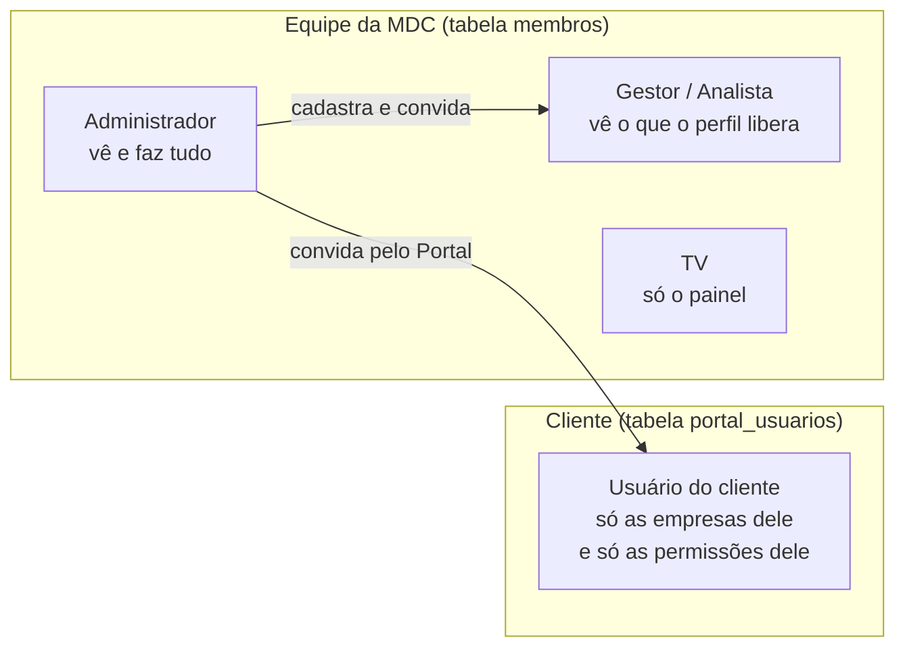
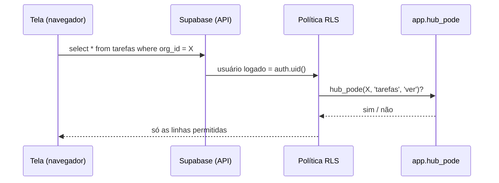
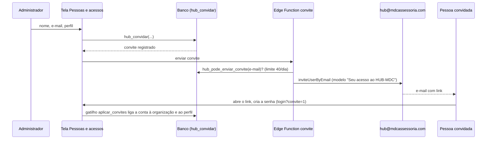

# 5. Segurança e acessos

> **Resumo:** quem pode ver ou mudar cada dado é decidido **no banco**, não na tela. A tela só esconde botões
> por conveniência. Toda regra de verdade está nas políticas RLS e nas funções `app.hub_pode` (equipe da MDC)
> e `app.portal_pode` (usuário do cliente). Se você mexer só na tela, a segurança não muda.

## 5.1 Os três tipos de pessoa

| Quem | Onde fica | Como o banco decide |
| --- | --- | --- |
| Administrador | `membros.papel = 'admin'` | `app.hub_pode` devolve sempre verdadeiro |
| Gestor, analista | `membros` + `hub_perfis` + `hub_acessos` | `app.hub_pode(org, app, nível)` olha o acesso daquele app e o nível |
| TV | `membros.papel = 'tv'` | Só lê o painel de tarefas |
| Usuário do cliente | `portal_usuarios` (uma linha por empresa) | `app.portal_pode(cliente, permissão)` |

## 5.2 Níveis de acesso a cada ferramenta

Cada ferramenta do HUB (`hub_apps.slug`: `tarefas`, `clientes`, `societario`, `demonstrativos`, `atendimento`,
`vencimentos`, `comercial`, `crm`, `config`, `hub`...) tem três níveis, do menor para o maior:

| Nível | Peso | Pode |
| --- | --- | --- |
| `ver` | 1 | Consultar |
| `operar` | 2 | Criar e alterar no dia a dia |
| `gerir` | 3 | Configurar, excluir, publicar |

O **perfil** (`hub_perfis.apps`, ex.: `{"tarefas":"operar","demonstrativos":"ver"}`) é a forma normal de dar
acesso: ao trocar o perfil de uma pessoa, gatilhos regravam `hub_acessos` dela. O administrador não usa perfil.

## 5.3 Como uma tela lê um dado (o caminho da segurança)

Para gravar, a política de `insert/update` costuma exigir `operar`; para excluir, `gerir`. Operações com regra
de negócio (convidar, publicar balancete, transferir trabalho) passam por funções `public.*` que conferem a
permissão na primeira linha.

## 5.4 Convite e criação de senha

Ninguém cria conta sozinho: o cadastro público está desligado.

## 5.5 Cuidados que valem para qualquer mudança

- **Nunca** use a chave `service_role` no navegador. O app usa só a chave publicável (pública por natureza).
- Toda tabela nova: `org_id`, RLS ligado, políticas com `app.hub_pode` ou `app.portal_pode`.
- Toda função `security definer`: `set search_path` fixo e checagem de permissão logo no início.
- Edge Functions conferem o token do usuário e a origem (lista `ORIGENS` em `supabase/functions/convite`).
- Certificado digital: o arquivo e a senha ficam no **Supabase Vault** (`hub_certificados` guarda só as referências).
- Depois de qualquer migração, rode os avisos de segurança do Supabase (Advisors).
