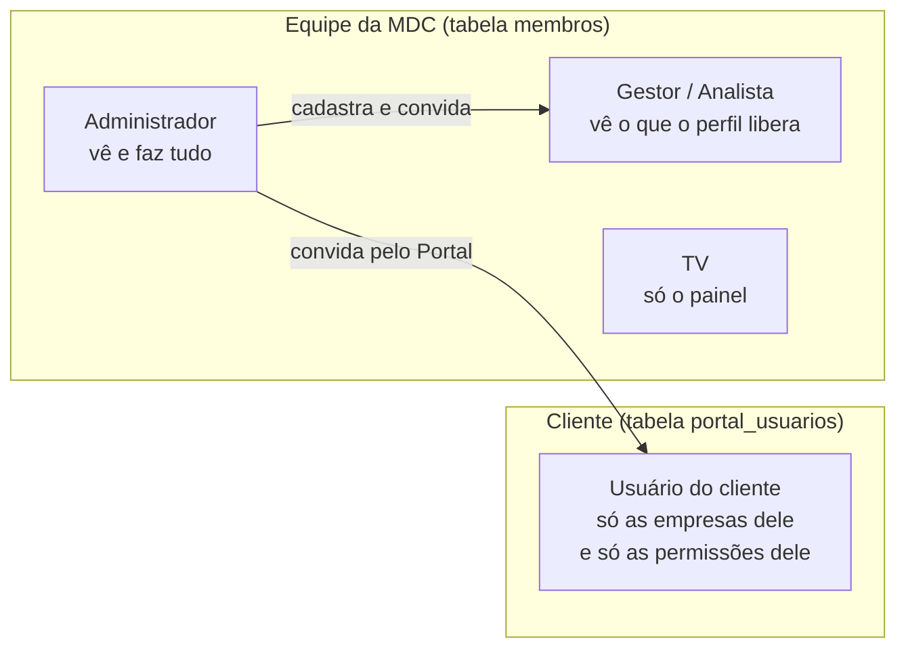
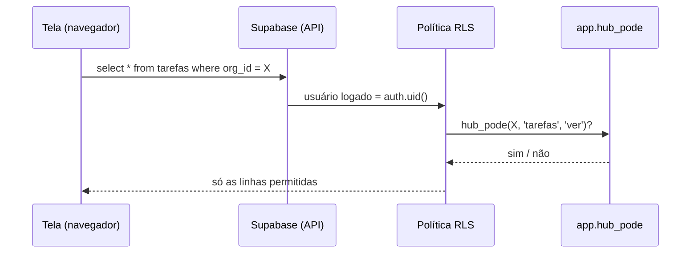
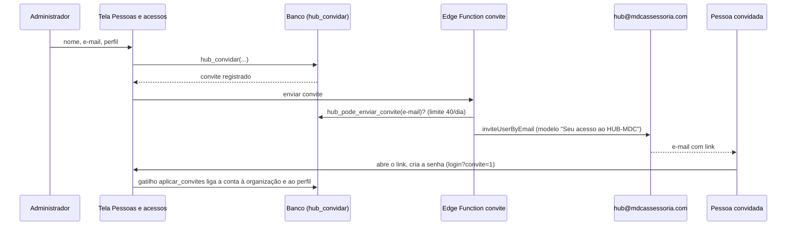

# 5. Segurança e acessos

> **Resumo:** quem pode ver ou mudar cada dado é decidido **no banco**, não na tela. A tela só esconde botões
> por conveniência. Toda regra de verdade está nas políticas RLS e nas funções `app.hub_pode` (equipe da MDC)
> e `app.portal_pode` (usuário do cliente). Se você mexer só na tela, a segurança não muda.

## 5.1 Os três tipos de pessoa

| Quem | Onde fica | Como o banco decide |
| --- | --- | --- |
| Administrador | `membros.papel = 'admin'` | `app.hub_pode` devolve sempre verdadeiro |
| Gestor, analista | `membros` + `hub_perfis` + `hub_acessos` | `app.hub_pode(org, app, nível)` olha o acesso daquele app e o nível |
| TV | `membros.papel = 'tv'` | Só lê o painel de tarefas |
| Usuário do cliente | `portal_usuarios` (uma linha por empresa) | `app.portal_pode(cliente, permissão)` |

## 5.2 Níveis de acesso a cada ferramenta

Cada ferramenta do HUB (`hub_apps.slug`: `tarefas`, `clientes`, `societario`, `demonstrativos`, `atendimento`,
`vencimentos`, `comercial`, `crm`, `config`, `hub`...) tem três níveis, do menor para o maior:

| Nível | Peso | Pode |
| --- | --- | --- |
| `ver` | 1 | Consultar |
| `operar` | 2 | Criar e alterar no dia a dia |
| `gerir` | 3 | Configurar, excluir, publicar |

O **perfil** (`hub_perfis.apps`, ex.: `{"tarefas":"operar","demonstrativos":"ver"}`) é a forma normal de dar
acesso: ao trocar o perfil de uma pessoa, gatilhos regravam `hub_acessos` dela. O administrador não usa perfil.

## 5.3 Como uma tela lê um dado (o caminho da segurança)

Para gravar, a política de `insert/update` costuma exigir `operar`; para excluir, `gerir`. Operações com regra
de negócio (convidar, publicar balancete, transferir trabalho) passam por funções `public.*` que conferem a
permissão na primeira linha.

## 5.4 Convite e criação de senha

Ninguém cria conta sozinho: o cadastro público está desligado.

## 5.5 Cuidados que valem para qualquer mudança

- **Nunca** use a chave `service_role` no navegador. O app usa só a chave publicável (pública por natureza).
- Toda tabela nova: `org_id`, RLS ligado, políticas com `app.hub_pode` ou `app.portal_pode`.
- Toda função `security definer`: `set search_path` fixo e checagem de permissão logo no início.
- Edge Functions conferem o token do usuário e a origem (lista `ORIGENS` em `supabase/functions/convite`).
- Certificado digital: o arquivo e a senha ficam no **Supabase Vault** (`hub_certificados` guarda só as referências).
- Depois de qualquer migração, rode os avisos de segurança do Supabase (Advisors).

## 5.6 Travas que o banco garante (migração 020, aplicada em 01/11/2026)

| Trava | Onde |
| --- | --- |
| Acesso ao Portal só nasce por convite; a equipe só desativa ou muda permissões. Pessoa da equipe não pode ter acesso de cliente **ativo** na própria organização. O acesso não muda de pessoa nem de empresa. Tudo fica na auditoria. | política `portal_usuarios_update` + gatilho `portal_usuario_nao_equipe` |
| Contas de balancete publicado não mudam | gatilho `linhas_balancete_protegidas` |
| Concluir processo só se estiver aberto; baixa (que inativa o cliente) só gestor | `soc_concluir_processo` |
| A TV só lê a logo (`<org>/marca`); arquivo enviado não muda de caminho, empresa, cliente nem de quem enviou; apagar só gestor ou quem enviou | políticas `hub_arquivos_equipe_*`, `hub_storage_equipe_*`, gatilho `hub_arquivos_imutavel` |
| Funções internas `app.*` não podem ser chamadas pela API, exceto as usadas pelas regras de acesso | grants da 020 |
| Importar e reprocessar balancete gravam tudo numa transação (ou grava inteiro, ou nada muda); mês publicado é recusado (021) | `portal_gravar_balancete`, `portal_regravar_contas` |
| Link de criar senha (WhatsApp, ou quando o e-mail falha): e-mail da equipe (convite pendente ou membro) só administrador; cliente administrador, gestor ou quem gere o Atendimento; só conta que nunca entrou; acesso de cliente recusa e-mail da equipe e a equipe recusa qualquer e-mail que seja ou já tenha sido acesso de cliente; cada link na auditoria (024, 025, 027) | `hub_pode_ver_link_convite` + Função `convite` (`so_link`) |
| Pasta do SharePoint: só administrador vê e muda; mudança na auditoria; segredo Microsoft só nos segredos da função (023) | `hub_integracoes`, gatilho `integracao_auditada` |
| Números de balancete publicado (resumo, índices, demonstrações, período) não mudam; só o comentário do contador (022) | gatilho `balancete_publicado_imutavel` |
| Financeiro: ver exige a ferramenta Financeiro (ver); cadastrar banco, importar plano e extrato exigem operar; plano e extrato só pelas funções (tudo ou nada, auditadas); conta bancária só liga em conta analítica do mesmo cliente (026) | `fin_*`, `fin_importar_plano`, `fin_importar_extrato`, `tg_fin_conta_bancaria` |
| Financeiro (cadastros, a pagar/receber, estoque): `app.fin_pode(cliente, nível)` = equipe com a ferramenta Financeiro no nível pedido **ou** pessoa do cliente no Portal com a permissão `financeiro` (ver/operar; `gerir` é só da equipe). Sem apagar: cadastro inativa, título cancela, baixa e movimento estornam (motivo obrigatório). Situação/valor pago do título e movimentos de estoque só pelas funções; saída de estoque trava o item e confere o saldo; estoque negativo só a equipe com gerir libera. Gravações diretas (cadastros, edição de título e de conta bancária) vão para a auditoria pelo gatilho `tg_fin_auditar` (028/029). Categorias (ligadas ao plano) e centros de custo: só a equipe grava, o Portal só lê; nenhum cadastro muda de empresa (`tg_fin_sem_troca_empresa`, 030) | `fin_pessoas`, `fin_categorias`, `fin_centros_custo`, `fin_titulos`, `fin_baixas`, `est_*`, `fin_lancar`, `fin_baixar`, `fin_estornar_baixa`, `fin_cancelar_titulo`, `est_movimentar`, `est_estornar_movimento`, `est_definir_negativo`, `tg_fin_titulo`, `tg_fin_categoria`, `tg_est_item` |
| Estoque e pedidos (033): mesmo `app.fin_pode` (ver para ler, operar para gravar). Pedidos e linhas só pelas funções `est_pedido_*` (tudo ou nada, auditadas); custo médio só o HUB grava (`tg_est_item_v2`); venda confirmada e compra recebida travam os itens em ordem e conferem o saldo; cancelar recusa se há parcela paga ou se a compra já foi consumida; fotos dos itens só na pasta `<org>/estoque/<cliente>/` (Storage: Portal com a permissão financeiro vê e envia imagens). As telas usam o nível dos módulos `estoque`, `saidas` e `entradas` para mostrar os botões; a separação por módulo no banco fica para a integração | `est_grupos`, `est_pedidos`, `est_pedido_itens`, `est_pedido_titulos`, `est_salvar_item`, `est_importar_itens`, `est_inventario`, `est_pedido_*`, `app.est_recalcular`, `app.est_pedido_lancar`, políticas `est_fotos_*` |

Avisos do Supabase que continuam e são esperados: as funções `public.*` chamadas pelas telas (cada uma confere a
permissão na primeira linha) e `crm_receber_lead`, que recebe os leads do Simulador sem login. Pendente no painel
(Authentication › Policies): ligar a proteção contra senha vazada.
