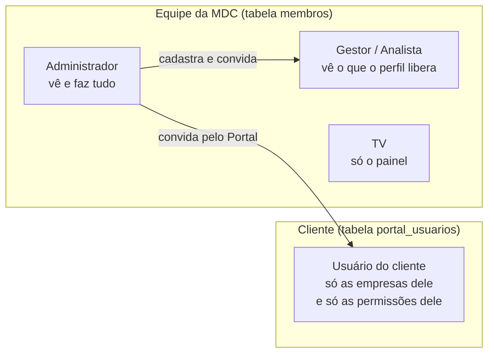
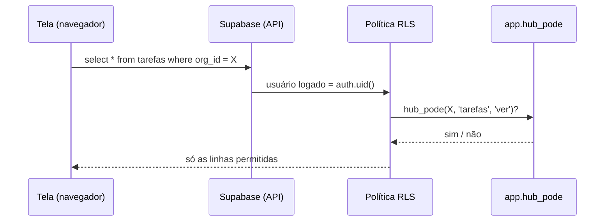
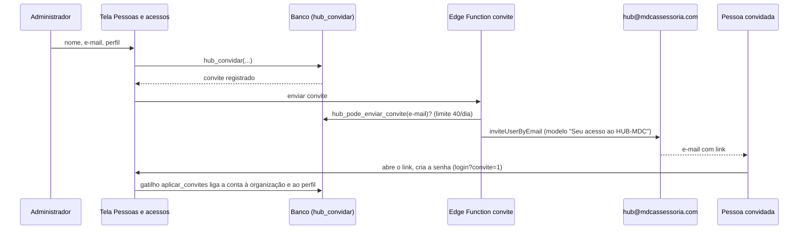

# 5. Segurança e acessos

> **Resumo:** quem pode ver ou mudar cada dado é decidido **no banco**, não na tela. A tela só esconde botões
> por conveniência. Toda regra de verdade está nas políticas RLS e nas funções `app.hub_pode` (equipe da MDC)
> e `app.portal_pode` (usuário do cliente). Se você mexer só na tela, a segurança não muda.

## 5.1 Os três tipos de pessoa

| Quem | Onde fica | Como o banco decide |
| --- | --- | --- |
| Administrador | `membros.papel = 'admin'` | `app.hub_pode` devolve sempre verdadeiro |
| Gestor, analista | `membros` + `hub_perfis` + `hub_acessos` | `app.hub_pode(org, app, nível)` olha o acesso daquele app e o nível |
| TV | `membros.papel = 'tv'` | Só lê o painel de tarefas |
| Usuário do cliente | `portal_usuarios` (uma linha por empresa) | `app.portal_pode(cliente, permissão)` |

## 5.2 Níveis de acesso a cada ferramenta

Cada ferramenta do HUB (`hub_apps.slug`: `tarefas`, `clientes`, `societario`, `demonstrativos`, `atendimento`,
`vencimentos`, `comercial`, `crm`, `config`, `hub`, `financeiro`, `licencas`...) tem três níveis, do menor para o maior:

| Nível | Peso | Pode |
| --- | --- | --- |
| `ver` | 1 | Consultar |
| `operar` | 2 | Criar e alterar no dia a dia |
| `gerir` | 3 | Configurar, excluir, publicar |

O **perfil** (`hub_perfis.apps`, ex.: `{"tarefas":"operar","demonstrativos":"ver"}`) é a forma normal de dar
acesso: ao trocar o perfil de uma pessoa, gatilhos regravam `hub_acessos` dela. O administrador não usa perfil.

**Desde a 039 (02/11/2026)**, só o administrador define o que cada pessoa vê, de dois jeitos, no cadastro e na edição
(Pessoas e acessos): **módulos escolhidos um a um** (`hub_convidar(..., p_apps)`, `hub_editar_membro(..., p_apps)` e
`hub_definir_acessos`, que troca todos de uma vez e tira a pessoa do perfil) ou **perfil pronto** (muda junto com o
perfil). Convite com módulos escolhidos não ganha o Tarefas padrão. O banco também passou a exigir o módulo em duas
tabelas que só olhavam o papel: `tarefas` (ver para ler, operar para criar e mudar) e `hub_arquivos` (anexo só para
quem tem o módulo dele, por `app.arquivo_pode`). Testes: `supabase/testes/93_base_039.sql` e `94_acesso_039.sql`.

## 5.3 Como uma tela lê um dado (o caminho da segurança)

Para gravar, a política de `insert/update` costuma exigir `operar`; para excluir, `gerir`. Operações com regra
de negócio (convidar, publicar balancete, transferir trabalho) passam por funções `public.*` que conferem a
permissão na primeira linha.

## 5.4 Convite e criação de senha

Ninguém cria conta sozinho: o cadastro público está desligado.

## 5.5 Cuidados que valem para qualquer mudança

- **Nunca** use a chave `service_role` no navegador. O app usa só a chave publicável (pública por natureza).
- Toda tabela nova: `org_id`, RLS ligado, políticas com `app.hub_pode` ou `app.portal_pode`.
- Toda função `security definer`: `set search_path` fixo e checagem de permissão logo no início.
- Edge Functions conferem o token do usuário e a origem (lista `ORIGENS` em `supabase/functions/convite`).
- Certificado digital: o arquivo e a senha ficam no **Supabase Vault** (`hub_certificados` guarda só as referências).
- Depois de qualquer migração, rode os avisos de segurança do Supabase (Advisors).

## 5.6 Travas que o banco garante (migração 020, aplicada em 01/11/2026)

| Trava | Onde |
| --- | --- |
| Acesso ao Portal só nasce por convite; a equipe só desativa ou muda permissões. Pessoa da equipe não pode ter acesso de cliente **ativo** na própria organização. O acesso não muda de pessoa nem de empresa. Tudo fica na auditoria. | política `portal_usuarios_update` + gatilho `portal_usuario_nao_equipe` |
| Contas de balancete publicado não mudam | gatilho `linhas_balancete_protegidas` |
| Concluir processo só se estiver aberto; baixa (que inativa o cliente) só gestor | `soc_concluir_processo` |
| A TV só lê a logo (`<org>/marca`); arquivo enviado não muda de caminho, empresa, cliente nem de quem enviou; apagar só gestor ou quem enviou | políticas `hub_arquivos_equipe_*`, `hub_storage_equipe_*`, gatilho `hub_arquivos_imutavel` |
| Funções internas `app.*` não podem ser chamadas pela API, exceto as usadas pelas regras de acesso | grants da 020 |
| Importar e reprocessar balancete gravam tudo numa transação (ou grava inteiro, ou nada muda); mês publicado é recusado (021) | `portal_gravar_balancete`, `portal_regravar_contas` |
| Link de criar senha (WhatsApp, ou quando o e-mail falha): e-mail da equipe (convite pendente ou membro) só administrador; cliente administrador, gestor ou quem gere o Atendimento; só conta que nunca entrou; acesso de cliente recusa e-mail da equipe e a equipe recusa qualquer e-mail que seja ou já tenha sido acesso de cliente; cada link na auditoria (024, 025, 027) | `hub_pode_ver_link_convite` + Função `convite` (`so_link`) |
| Pasta do SharePoint: só administrador vê e muda; mudança na auditoria; segredo Microsoft só nos segredos da função (023) | `hub_integracoes`, gatilho `integracao_auditada` |
| Números de balancete publicado (resumo, índices, demonstrações, período) não mudam; só o comentário do contador (022) | gatilho `balancete_publicado_imutavel` |
| Financeiro: ver exige a ferramenta Financeiro (ver); cadastrar banco, importar plano e extrato exigem operar; plano e extrato só pelas funções (tudo ou nada, auditadas); conta bancária só liga em conta analítica do mesmo cliente (026) | `fin_*`, `fin_importar_plano`, `fin_importar_extrato`, `tg_fin_conta_bancaria` |
| Financeiro (cadastros, a pagar/receber, estoque): `app.fin_pode(cliente, nível)` = equipe com a ferramenta Financeiro no nível pedido **ou** pessoa do cliente no Portal com a permissão `financeiro` (ver/operar; `gerir` é só da equipe). Sem apagar: cadastro inativa, título cancela, baixa e movimento estornam (motivo obrigatório). Situação/valor pago do título e movimentos de estoque só pelas funções; saída de estoque trava o item e confere o saldo; estoque negativo só a equipe com gerir libera. Gravações diretas (cadastros, edição de título e de conta bancária) vão para a auditoria pelo gatilho `tg_fin_auditar` (028/029). Categorias (ligadas ao plano) e centros de custo: só a equipe grava, o Portal só lê; nenhum cadastro muda de empresa (`tg_fin_sem_troca_empresa`, 030) | `fin_pessoas`, `fin_categorias`, `fin_centros_custo`, `fin_titulos`, `fin_baixas`, `est_*`, `fin_lancar`, `fin_baixar`, `fin_estornar_baixa`, `fin_cancelar_titulo`, `est_movimentar`, `est_estornar_movimento`, `est_definir_negativo`, `tg_fin_titulo`, `tg_fin_categoria`, `tg_est_item` |
| Estoque e pedidos (033): mesmo `app.fin_pode` (ver para ler, operar para gravar). Pedidos e linhas só pelas funções `est_pedido_*` (tudo ou nada, auditadas); custo médio só o HUB grava (`tg_est_item_v2`); venda confirmada e compra recebida travam os itens em ordem e conferem o saldo; cancelar recusa se há parcela paga ou se a compra já foi consumida; fotos dos itens só na pasta `<org>/estoque/<cliente>/` (Storage: Portal com a permissão financeiro vê e envia imagens). As telas usam o nível dos módulos `estoque`, `saidas` e `entradas` para mostrar os botões; a separação por módulo no banco fica para a integração | `est_grupos`, `est_pedidos`, `est_pedido_itens`, `est_pedido_titulos`, `est_salvar_item`, `est_importar_itens`, `est_inventario`, `est_pedido_*`, `app.est_recalcular`, `app.est_pedido_lancar`, políticas `est_fotos_*` |

| Licenças (031): só a equipe com a ferramenta `licencas` lê; gravação só pelas funções `lic_*` (operar: baixa, desfazer baixa, cancelar e gerar mensalidades; gerir: módulos, planos, contratos, reajuste e bloqueio), sempre com motivo e auditoria; nada se apaga. **Portal com módulo pago**: `app.fin_pode` (e as políticas de Portal de contas bancárias e plano) só vale se `app.cliente_tem_modulo(cliente, 'financeiro')`: contrato ativo e vigente com o módulo e cliente sem bloqueio manual. A equipe MDC continua acessando cliente bloqueado. O Portal vê só `{bloqueado, módulos}` (`portal_licenca_situacao`), nunca o motivo | `lic_*`, `app.cliente_tem_modulo`, `app.cliente_bloqueado`, `app.fin_pode`, `portal_licenca_situacao` |

| Notas fiscais (032): ver = `app.fin_pode(cliente, 'ver')`; lançar, desfazer, enviar XML e manifestar = `operar`. Notas, itens, eventos, controle da captura, certificados, parâmetros, tipos e regras: **sem gravação direta** (revogada), só pelas funções. Certificado A1 da empresa: arquivo e senha no Vault (`fis_pfx_<cliente>`/`fis_senha_<cliente>`), lido só pelas Funções Edge (`fis_cert_obter` = service_role); quem envia: equipe com Financeiro `gerir` ou o próprio cliente no Portal (`fis_pode_certificado`); o CNPJ raiz do certificado precisa ser o da empresa. Parâmetros só a equipe (`operar`); regras dos tipos de entrada só a equipe (`gerir`). NF-e só é lançada depois da Confirmação da operação. Bucket `fiscal` privado: ler com `ver` na empresa do caminho `<org>/<cliente>/…`; enviar só em `…/upload/…` com `operar`; sem troca nem exclusão de XML. Agendador da captura com token próprio no Vault (`fiscal_captura_token`) | `fis_*`, `fis_cert_*`, `fis_processar_nota`, `fis_registrar_upload`, políticas `fis_storage_*`, `app.fis_caminho_pode` |

| Módulos de gestão separados (034/035, aplicadas em 02/11/2026): ferramentas `entradas`, `saidas`, `estoque`, `centros_custo`, `plano_contas`, `relatorios` em `hub_apps` (o código passou a aceitar sublinhado). A 035 fez `app.hub_pode(org, 'financeiro', nível)` aceitar **qualquer** ferramenta de gestão em **qualquer** nível — quem tinha só "Relatórios" ganhava o Financeiro inteiro, inclusive o que é sensível (certificado, estoque negativo, regras dos tipos de entrada) — e o Portal passou a usar os dados de gestão com contrato de qualquer módulo (até só Relatórios, de cortesia). **Desfeito pela 036** (linha abaixo). Transferências entre contas só por `fin_transferir`/`fin_estornar_transferencia` | `app.modulos_gestao`, `app.cliente_tem_gestao`, `fin_transferencias` |

| Auditoria independente de 02/11/2026 (036): `app.hub_pode` volta a ser estrito (só a ferramenta pedida). Dados de gestão por assunto com `app.gestao_pode(cliente, nível, módulos)` (tabela 5.7): ler = qualquer módulo de gestão; gravar = o módulo do assunto; sensível continua só no Financeiro. Portal: permissão `financeiro` (ver e lançar) ou `financeiro_ver` (só ver), lista fechada de permissões e liberar Financeiro só com Financeiro (gerir) (`app.portal_perm_validas`, gatilho `portal_perm_valida`). Certificado e regras de notas no Portal só com cliente sem bloqueio e contrato de Entradas/Financeiro; módulo inativo não libera. XML enviado à mão: chave conferida (DV, CNPJ do emitente, modelo 55/65/57 ou NFS-e) e o modelo vem da chave; a nota da SEFAZ/ADN substitui a enviada à mão não lançada (auditoria) e, se já lançada, avisa os administradores. Nota cancelada pelo emitente depois de lançada: auditoria + sino + não deixa pagar. Título de nota/pedido só muda pelo documento de origem; nota, autor e data do título não mudam. Venda faturada só cancela com Financeiro (gerir) e motivo citando a nota. Saída com data passada não deixa a ficha negativa em nenhum dia. Desfazer nota recalcula o custo médio. Contrato de licença sem corrida (gatilho trava o cliente). Fotos de itens e envios do Portal só na pasta da organização do cliente. Desfazer extrato marca (não apaga). Leads do Simulador: até 20 por minuto. **Nada se apaga**: tarefas, vencimentos, CRM, feriados, perfis, convites do Portal e clientes sem DELETE (política, grant e gatilho `nada_se_apaga`); no lugar `tarefa_cancelar`, `venc_encerrar`, `crm_arquivar`, `feriado_inativar`, `hub_inativar_perfil`, `portal_cancelar_convite`, com motivo e auditoria. CNPJ do cliente com certificado/notas só o administrador muda | `app.hub_pode`, `app.hub_pode_algum`, `app.gestao_pode`, `app.fin_pode`, `app.fin_lancar_titulos`, `fis_registrar_upload`, `app.fis_gravar_nota`, `app.fis_gravar_evento`, `app.est_gravar`, `est_pedido_permissao`, `lic_contrato_produto_unico`, `nada_se_apaga`, `cliente_cnpj` |

## 5.7 Quem grava o quê nos módulos de gestão (036, revista na 042)

Regra (042): a gestão é **só da empresa da própria organização** (MDC; `organizacoes.gestao_cliente_id`). **Ler** = equipe
com qualquer módulo de gestão (`app.modulos_gestao()`; Contratos tem leitura própria). **Gravar** = o módulo do assunto
(tabela), na equipe com o nível pedido. O Portal do Cliente **não** lê nem grava gestão, nem envia certificado (as linhas
históricas acima que citam o Portal, `cliente_tem_modulo` e `financeiro_ver` valem só até a 041).

| Assunto | Módulos que gravam | Onde |
| --- | --- | --- |
| Contas a pagar/receber avulsas, baixas, estornos, transferências | Financeiro | `fin_lancar`, `fin_baixar`, `fin_estornar_baixa`, `fin_cancelar_titulo`, `fin_transferir`, política de `fin_titulos` |
| Notas de entrada: enviar XML, lançar, desfazer, de-para, manifestar, XML no Storage | Entradas, Financeiro | `fis_registrar_upload`, `fis_processar_nota`, `fis_desfazer_lancamento`, `fis_pode`, `fis_depara_itens`, `app.fis_caminho_pode` |
| Pedido de venda | Saídas, Financeiro | gatilho `est_pedido_permissao`, `app.est_pedido_travar` |
| Pedido de compra | Entradas, Financeiro | gatilho `est_pedido_permissao`, `app.est_pedido_travar` |
| Itens, estoques, movimentos, inventário, fotos, fornecedores/clientes | Estoque, Financeiro, Entradas, Saídas (`app.fin_pode`) | `est_*`, `fin_pessoas`, políticas `est_fotos_*` |
| Plano de contas (importar) e categorias | Plano de contas, Financeiro (só equipe) | `fin_importar_plano`, políticas de `fin_categorias` |
| Centros de custo | Centros de custo, Financeiro (só equipe) | políticas de `fin_centros_custo` |
| Relatórios | ninguém grava (só leitura) | — |
| Contratos fixos (041/042/043): cadastrar, editar, suspender, reativar, encerrar, reajustar, anexar; gerar fatura à mão e cancelar fatura (043, operar, sempre com motivo) | Contratos (só equipe; o Portal não vê contratos). Faturas e fila de envio (`fin_faturas`, `fin_envios`): leitura com Contratos (ver), gravação só pelas funções, nada se apaga, gatilho `gestao_so_empresa`. **Portal (043):** o cliente lê só as faturas publicadas para o próprio cadastro (`cliente_carteira_id`) pela função `portal_minhas_faturas(cliente)`, que exige o login do Portal desse cliente com a permissão `documentos`; a tabela continua fechada para o Portal. **050:** `portal_faturas_detalhe(cliente)` (mesma regra) devolve também os dados do PDF, a NFS-e emitida em produção e o boleto válido; no bucket `fiscal` o cliente lê só o XML da NFS-e de produção de fatura publicada para ele (`fis_storage_portal_nfse` → `app.portal_nfse_pode`); fatura cancelada some do Portal e o XML dela também. As contas do mês nascem no Financeiro pelo caminho interno `app.fin_lancar_titulos`. **Leitura própria (042, revista na 047):** as contas que o próprio contrato gerou (política `contratos_ver` de `fin_titulos`); os cadastros (fornecedores/clientes, categorias, centros, bancos) **não** são lidos pela tabela desde a 047 (SEG-03): a tela usa `fin_recorrente_opcoes(cliente)`, que devolve só id, nome, tipo e ativo e, para o PDF da fatura, nome, CNPJ/CPF, e-mail e cidade/UF apenas dos clientes que já têm fatura; Contratos **não** está em `app.modulos_gestao()` e não lê o resto do Financeiro, notas nem estoque | `app.contratos_pode`, `fin_recorrente_*`, `fin_indices_atualizar`, políticas `contratos_ver` |
| NFS-e das faturas (046): conferir (ver), emitir (operar), parâmetros (gerir) | Contratos. Tabelas `nfse_*` só leitura com Contratos (ver); gravação só pelas funções; nada se apaga; `gestao_so_empresa`. A Função Edge `nfse-emitir` (verify_jwt) confere o login com `nfse_preparar` (`pode_emitir`) e só então usa a chave de serviço para `nfse_reservar`/`nfse_registrar_resultado` (execute só `service_role`) e `fis_cert_obter`. Bucket `fiscal`: Contratos (ver) lê só `<org>/<cliente>/nfse-emitidas/…`; quem grava é a função. Ir para produção pede confirmação; certificado, senha e XML nunca vão para log | `nfse_*`, `app.nfse_*`, `app.fis_caminho_pode` |
| Contratos a pagar que lançam contas (048, BD-03) | Contratos (operar) **e** Financeiro (operar): criar, editar, reativar, gerar à mão e atualizar contas no reajuste. A receber e "só documento": só Contratos | `app.contratos_lanca_pode` |
| Boleto das faturas (049): configurar banco (gerir), gerar (operar), ver (ver) | Contratos. Tabelas `link_contas_banco` e `fin_fatura_boletos` só leitura com Contratos (ver); gravação só pelas funções; nada se apaga; `gestao_so_empresa`. A Função Edge `ledgra-link` confere o login com `fatura_boleto_preparar` e só então usa a chave do Ledgra Link e a chave de serviço para `fatura_boleto_registrar` (execute só `service_role`). O aviso de pagamento entra pela `ledgra-link-webhook` (assinatura) e `link_aplicar_evento` baixa uma vez só | `link_*`, `fatura_boleto_*` |
| **Sensível (estrito no Financeiro)**: certificado A1 (gerir), regras dos tipos de entrada (gerir), estoque negativo (gerir), contas bancárias, importar e desfazer extrato, parâmetros de notas (operar) | Financeiro | `fis_pode_certificado`, `fis_salvar_tipo_entrada`, `est_definir_negativo`, `fin_contas_bancarias`, `fin_importar_extrato`, `fin_desfazer_lote`, `fis_salvar_parametros` |

**Gestão só da MDC (042, decisão do Edvaldo em 02–03/11/2026).** A gestão (Financeiro, Entradas, Saídas, Estoque, Centros de
custo, Plano de contas, Relatórios e Contratos) vale só para a empresa da própria organização: `organizacoes.gestao_cliente_id`
(na MDC, o cadastro de CNPJ 48.140.121/0001-65). `app.empresa_gestao(cliente)` entra em `app.gestao_pode`, `app.fin_pode`,
`app.contratos_pode`, `fis_pode_certificado` e nas leituras de plano e bancos; o gatilho `gestao_so_empresa` em todas as
tabelas `fin_*`, `fis_*` e `est_*` com `cliente_id` recusa gravar outra empresa ("A gestão do HUB é só da empresa da MDC"),
inclusive pelas Funções Edge. A rotina dos contratos e a captura de notas (`fis_captura_reservar`) também filtram a empresa
da gestão (043, BD-01/BD-02): um cadastro antigo de outra empresa é ignorado e não trava a rotina. O Portal do Cliente não lê mais gestão. A Cobrança Ledgra (`lic_*`) continua listando clientes.

**Arquivos (042).** No bucket `hub-arquivos` a equipe só lê o arquivo que tem registro em `hub_arquivos` visível pela regra do
módulo (039), a logo (`marca`) e o que ela mesma enviou; envia só na pasta de um módulo que opera (`marca`: gestor); apaga só o
quem enviou um arquivo que ainda não virou registro (047: nem o administrador apaga arquivo com registro). O registro do anexo pela equipe (gatilho
`hub_arquivos_equipe`) exige caminho `<org>/<módulo>/…` (no Portal, a pasta do próprio cliente) e arquivo enviado pela
própria pessoa; `enviado_por` é sempre quem está logado; módulo e referência não mudam depois. Valores "NaN"/infinito são
recusados em todas as colunas numéricas de `fin_*`, `fis_*`, `est_*`, `lic_*` e `crm_*` (travas `*_numero_valido`).

**Anexos sem apagar e empresa da Gestão auditada (047, reauditoria de 03/11/2026).** O registro de `hub_arquivos` não sai
mais da tabela (gatilho `nada_se_apaga`, sem política de DELETE). "Retirar anexo" é só do administrador, com motivo de 5
letras ou mais, pela função `hub_arquivo_retirar`: o anexo some do Portal e das listas, fica marcado (`retirado_em`,
`retirado_por`, `retirado_motivo`) e vai para `hub_auditoria`; marcar à mão pela API é recusado e um anexo retirado não
volta ao Portal (SEG-01). `organizacoes.gestao_cliente_id` só muda por `org_definir_empresa_gestao` (administrador; trocar
uma empresa já definida pede motivo; auditada); o gatilho `org_empresa_gestao` recusa a mudança direta (SEG-02). Anexo
enviado pelo Portal com referência só entra se a tarefa ou a conversa for do próprio cliente (gatilho
`hub_arquivos_portal_ref`, SEG-09). NaN/infinito também são recusados nas colunas numéricas de `portal_*` e `soc_*`
(SEG-08).

Contas geradas por nota ou pedido nascem pela função interna `app.fin_lancar_titulos` (quem tem Entradas ou Saídas gera as
contas do documento sem precisar do Financeiro) e só mudam ou cancelam pelo documento de origem.

Avisos do Supabase que continuam e são esperados: as funções `public.*` chamadas pelas telas (cada uma confere a
permissão na primeira linha) e `crm_receber_lead`, que recebe os leads do Simulador sem login. Pendente no painel
(Authentication › Policies): ligar a proteção contra senha vazada.
