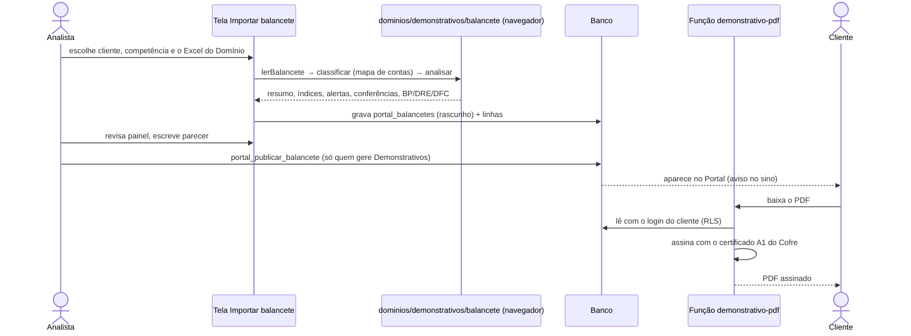
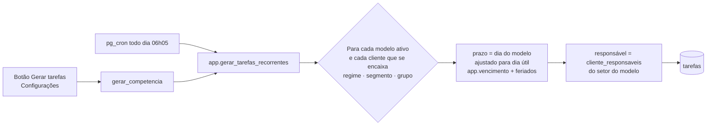
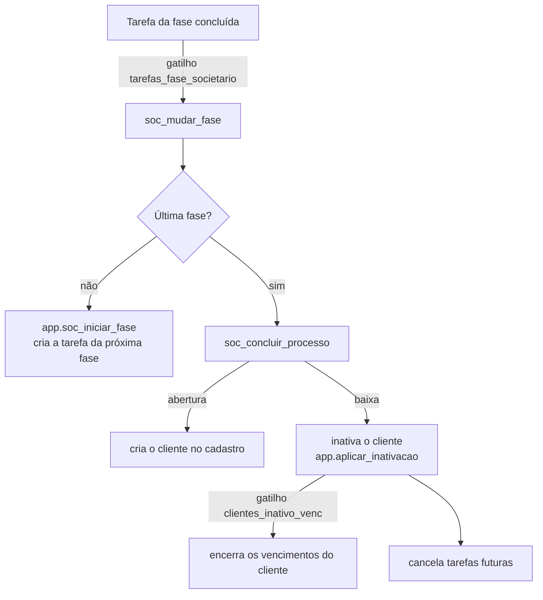

# 6. Fluxos importantes

> **Resumo:** quatro fluxos concentram quase toda a regra de negócio: o balancete (Demonstrativos → Portal),
> as tarefas recorrentes do mês, o Societário (que cria tarefas e mexe em clientes) e o Atendimento.
> Muitas coisas acontecem **sozinhas no banco** (gatilhos e agendador); o mapa da seção 6.4 mostra todas.

## 6.1 Balancete: do Excel do Domínio ao Portal do cliente

Regras: balancete publicado e suas linhas não mudam (gatilhos `publicacao_protegida` e
`linhas_balancete_protegidas`); para corrigir, despublique, ajuste e publique de novo.

## 6.2 Tarefas recorrentes do mês

É idempotente: rodar de novo para a mesma competência não duplica tarefas.

## 6.3 Societário: uma tarefa concluída avança o processo

Concluir uma **baixa** (que inativa o cliente) é só para gestor ou administrador.

## 6.4 Mapa de automações (o que acontece sem ninguém clicar)

| Gatilho ou agenda | Quando | O que faz |
| --- | --- | --- |
| pg_cron `gerar-tarefas-recorrentes` | Todo dia 06h05 | Gera as tarefas do mês |
| pg_cron `avisar-vencimentos` → `app.venc_avisar` | Todo dia 06h15 | Avisos de vencimento 60/30/7 dias no sino |
| `tarefas_historico` | Toda mudança de tarefa | Grava o histórico |
| `tarefas_fase_societario` | Tarefa de fase concluída | Avança o processo societário |
| `clientes_inativo_venc` | Cliente inativado | Encerra os vencimentos dele |
| `crm_op_etapa` | Oportunidade muda de etapa | Registra a data da etapa |
| `membros_perfil`, `hub_perfis_propagar` | Perfil trocado ou editado | Regrava os acessos da pessoa |
| `aplicar_convites`, `aplicar_convites_portal` | Conta criada pelo convite | Liga a conta à organização ou ao cliente |
| `portal_usuario_nao_equipe` | Acesso de portal criado ou mudado | Impede equipe como usuário do portal e audita |
| Simulador (projeto separado) → `crm_receber_lead` | Lead preenchido no site | Cria a oportunidade no CRM |

## 6.5 Atendimento: conversa vira tarefa

O cliente abre uma conversa no Portal (`portal_abrir_conversa`); a equipe responde em `/atendimento`. Se o pedido
der trabalho, o botão "virar tarefa" chama `portal_conversa_para_tarefa`, que cria a tarefa ligada à conversa e
avisa o cliente com uma mensagem de sistema.
