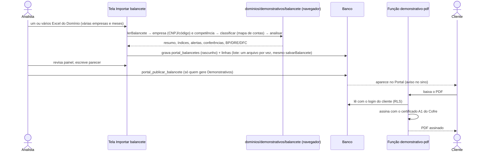
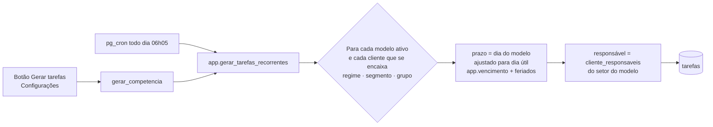
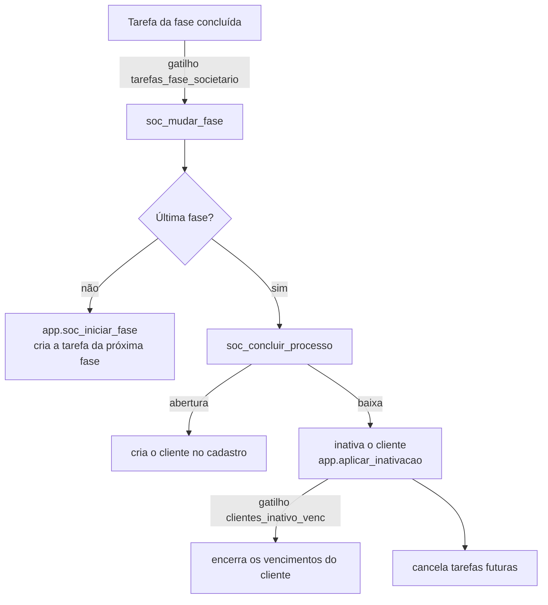
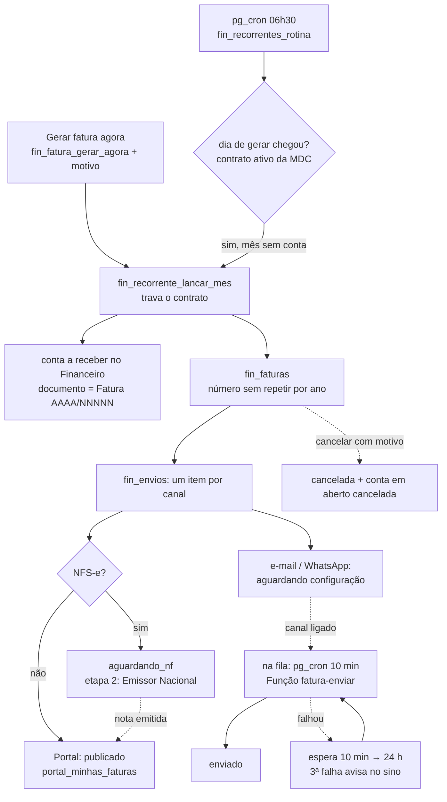
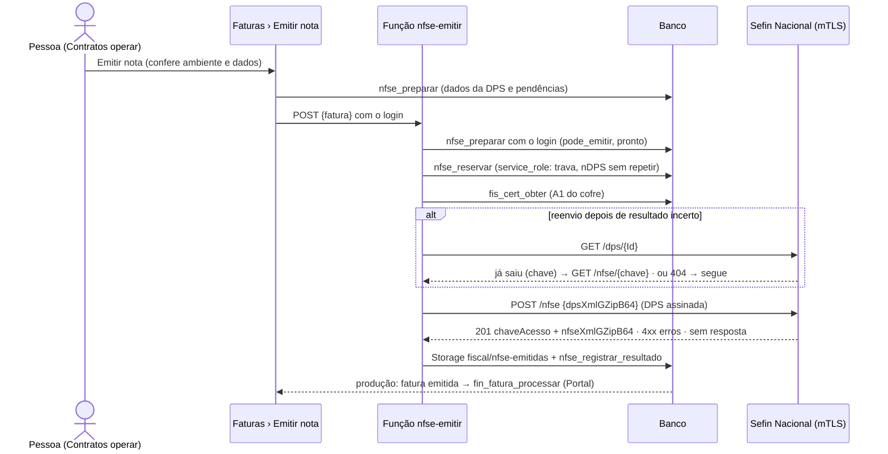

# 6. Fluxos importantes

> **Resumo:** quatro fluxos concentram quase toda a regra de negócio: o balancete (Demonstrativos → Portal),
> as tarefas recorrentes do mês, o Societário (que cria tarefas e mexe em clientes) e o Atendimento.
> Muitas coisas acontecem **sozinhas no banco** (gatilhos e agendador); o mapa da seção 6.4 mostra todas.

## 6.1 Balancete: do Excel do Domínio ao Portal do cliente

Regras: no lote, arquivo de mês já publicado fica de fora (precisa despublicar) e rascunho existente só é trocado
quando marcado "Substituir"; o resumo por empresa sai em PDF e Excel. Na análise e no Portal, o período (mês,
trimestre, semestre ou ano do calendário) é escolhido no topo e agrega os balancetes no navegador; o "Baixar PDF"
segue esse período e o servidor refaz o cálculo só com meses publicados: assina só período completo, período que só
falta o fim sai parcial e sem assinatura, e mês faltando no meio bloqueia o PDF. A importação (um arquivo ou lote) e o
"Reprocessar" gravam cabeçalho, cálculo e contas numa transação só (`portal_gravar_balancete`, `portal_regravar_contas`). Detalhes em [modulos/demonstrativos.md](modulos/demonstrativos.md).

Balancete publicado e suas linhas não mudam (gatilhos `publicacao_protegida` e
`linhas_balancete_protegidas`); para corrigir, despublique, ajuste e publique de novo.

## 6.2 Tarefas recorrentes do mês

É idempotente: rodar de novo para a mesma competência não duplica tarefas.

## 6.3 Societário: uma tarefa concluída avança o processo

Concluir uma **baixa** (que inativa o cliente) é só para gestor ou administrador.

**Empresa ainda não cadastrada** (ex.: chega à MDC já precisando de alteração contratual): no "Novo processo", em
Cliente, escolha "Empresa ainda não cadastrada no HUB", digite o CNPJ e clique em **Buscar dados**: a razão social e a
UF vêm da Receita (BrasilAPI) e o quadro mostra situação, endereço, CNAE e sócios, com o botão para anotar esses dados
nas observações. Tudo continua editável à mão. O processo anda normalmente.
Quando um gestor cadastrar a empresa em Tarefas › Configurações › Clientes, a ficha do processo oferece **Ligar ao
cliente** (`soc_vincular_cliente`, migração 037): o processo e as tarefas das fases passam para o cliente, com registro
no histórico e na auditoria. Na abertura nada muda: concluir o processo cadastra a empresa sozinho.

**Avançar no quadro** (desde 02/11/2026, molde 8.3.1): no computador, arrastar o cartão para uma coluna à frente
abre a janela "Avançar o processo" já com a fase escolhida; o botão **Avançar** do cartão abre a mesma janela (é o
caminho no celular, onde o quadro vira a lista de cartões por fase com o seletor "Ver a fase", e no teclado). Ao
confirmar, as fases do meio ainda pendentes são dispensadas e a atual é concluída (`soc_mudar_fase`, nessa ordem;
regra em `dominios/societario/processos.ts`, `passosParaAvancar`). Voltar uma fase só pela ficha do processo.
Na ficha, concluir pede confirmação (`useConfirmar`) e cancelar pede o motivo (`JanelaMotivo`, vai para o histórico).
Os indicadores da lista (fase atrasada, previsão vencida, com exigência, parados há 5+ dias) filtram a lista ao clicar.

## 6.3.1 Societário: acervo do cliente como base da alteração (073)

- **Guardar:** em Societário › Documentos dos clientes ("Guardar documento") ou na ficha do processo, pelo botão
  "Guardar no acervo" de cada anexo. A janela pede o tipo (contrato social, alteração, consolidação, cartão CNPJ,
  documento de sócio, procuração, ata, certidão, inscrição, alvará, outro), data, descrição e registro na Junta.
- **Substituir:** ao guardar uma alteração ou consolidação, o HUB sugere o documento do contrato que estava vigente;
  ele passa a "Substituído" (continua guardado) e o novo vira a base. Cartão CNPJ, alvará etc. sugerem o do mesmo tipo.
- **Usar como base:** a ficha de todo processo ligado a um cliente mostra o cartão "Documentos do cliente" com os
  vigentes de contrato, CNPJ e sócios (regra `documentosBase` em `dominios/societario/acervo.ts`), com Abrir e o
  atalho para o acervo completo filtrado pelo cliente.
- **Retirar:** só quem gerencia o Societário, com motivo; a ficha e o arquivo ficam no histórico e na auditoria.

## 6.4 Mapa de automações (o que acontece sem ninguém clicar)

| Gatilho ou agenda | Quando | O que faz |
| --- | --- | --- |
| pg_cron `gerar-tarefas-recorrentes` | Todo dia 06h05 | Gera as tarefas do mês |
| pg_cron `avisar-vencimentos` → `app.venc_avisar` | Todo dia 06h15 | Avisos de vencimento 60/30/7 dias no sino |
| pg_cron `licencas-diaria` → `app.lic_rotina_diaria` | Todo dia 06h25 | Encerra contratos de licença com prazo vencido, gera as mensalidades do mês (sem duplicar) e, uma vez por dia, avisa no sino (administradores e quem tem Licenças) das mensalidades que venceram ontem e dos clientes que chegaram aos dias de atraso em que o HUB sugere bloquear. Bloquear é manual |
| pg_cron `fin-indices-buscar` → `app.fin_indices_pedir` | Todo dia 06h20 | Pede ao Banco Central (API SGS, por `pg_net`) os últimos 24 meses de IPCA, INPC e IGP-M; a resposta é lida depois e grava `fin_indices` |
| pg_cron `financeiro-recorrentes` → `app.fin_recorrentes_rotina` | Todo dia 06h30 | Lê os índices que chegaram; renova vigências com renovação automática; lança no Financeiro a conta do mês de cada contrato ativo da empresa da gestão cujo dia de gerar chegou — a receber, com a fatura e a fila de envio (043, [6.6](#66-fatura-dos-contratos-a-receber)) — e recupera o mês anterior, sem duplicar; erro num contrato vai para a auditoria e a rotina segue; encerra contratos cujo fim passou; avisa no sino (administradores e Contratos gerir) reajustes do mês e fins de vigência chegando ([módulo](modulos/contratos.md)) |
| pg_cron `pessoal-resumo` → `app.pessoal_resumo_rodar` e Função `pessoal-aviso` | A cada hora (minuto 3); a função só quando há aviso na fila | MDC · Pessoal (076): uma vez por dia, depois da hora escolhida por cada pessoa, o resumo das finanças da família no sino e, para quem ligou, no celular (Web Push). Sem nada a contar, não avisa ([módulo](modulos/pessoal.md#3-resumo-diário-migração-076)) |
| `organizacoes_semear_licencas` | Organização criada | Cadastra os módulos vendáveis e o plano Gestão completa (preço zero) |
| `tarefas_historico` | Toda mudança de tarefa | Grava o histórico |
| `tarefas_fase_societario` | Tarefa de fase concluída | Avança o processo societário |
| `clientes_inativo_venc` | Cliente inativado | Encerra os vencimentos dele |
| `crm_op_etapa` | Oportunidade muda de etapa | Registra a data da etapa |
| `membros_perfil`, `hub_perfis_propagar` | Perfil trocado ou editado | Regrava os acessos da pessoa |
| `aplicar_convites`, `aplicar_convites_portal` | Conta criada pelo convite | Liga a conta à organização ou ao cliente |
| `portal_usuario_nao_equipe` | Acesso de portal criado ou mudado | Impede equipe como usuário do portal e audita |
| pg_cron `agente-balancetes` → Função `balancete-agente` | A cada 15 min, só com a pasta ligada em Configurações › Integrações | Lê a pasta de balancetes do SharePoint, cria rascunhos, move os arquivos e registra em `hub_importacoes` |
| pg_cron `fiscal-captura` → Função `fiscal-captura` | A cada 15 min, só se houver empresa com captura ligada e certificado válido | Para cada empresa liberada: Distribuição DF-e da SEFAZ (NF-e, respeitando 137/656 e 1 hora de espera), ciência automática nos resumos, ADN da NFS-e; grava XML no bucket `fiscal` e as notas/eventos ([fluxo](modulos/notas-fiscais.md#4-fluxos)) |
| `fatura_nfse_aberta` | Fatura cancelada | Recusa se a NFS-e está sendo enviada ou com resultado incerto em produção (046) |
| Ferramenta aberta do HUB (`/ferramentas/simulador-regime`) → `crm_receber_lead` | Lead preenchido na página aberta | Cria a oportunidade no CRM |
| `fin_conta_bancaria_valida`, `fin_categoria_valida`, `fin_titulo_valida`, `est_item_valida` | Gravação de conta bancária, categoria, título ou item | Confere empresa, conta analítica ativa do plano, tipo da categoria x tipo do título, travas de situação do título e de item com saldo |
| `sem_troca_empresa`, `cliente_mesma_org` (tabelas `fin_*` e `est_*`) | Cadastro do Financeiro/estoque alterado | Impede mudar de empresa ou de organização |
| `fin_auditar` | Conta bancária, fornecedor/cliente, categoria, centro de custo, título, item, grupo de produto ou estoque criado/alterado direto pela tela | Registra antes e depois na auditoria (as funções `fin_*`/`est_*` registram o próprio evento) |
| `app.est_recalcular` (chamado por `app.est_gravar` e pelos estornos) | Todo movimento de estoque gravado ou estornado | Recalcula a ficha do item (saldo e custo médio depois de cada movimento) e o custo médio do cadastro |
| `est_pedido_confirmar` / `est_pedido_receber` → `app.est_pedido_lancar` | Venda confirmada / compra recebida | Baixa ou dá entrada no estoque dos itens estocáveis e cria uma conta a receber/pagar por parcela (`fin_lancar`) |
| `est_pedido_cancelar` | Pedido cancelado | Estorna os movimentos do pedido e cancela as parcelas em aberto |

## 6.5 Atendimento: conversa vira tarefa

O cliente abre uma conversa no Portal (`portal_abrir_conversa`); a equipe responde em `/atendimento`. Se o pedido
der trabalho, o botão "virar tarefa" chama `portal_conversa_para_tarefa`, que cria a tarefa ligada à conversa e
avisa o cliente com uma mensagem de sistema.

Telas (molde 8.3.1, desde 02/11/2026): `/atendimento` tem indicadores que filtram (novas, resposta atrasada, minhas),
filtros de busca/situação/assunto e PDF/Excel da lista. A lista e a conversa usam a mesma moldura do "Fale com a MDC"
do Portal (`dominios/atendimento/componentes/PainelConversas`): no computador ficam lado a lado; no celular aparece uma
de cada vez, com o botão "Voltar". Nova conversa (equipe ou cliente) abre na janela `NovaConversa`.

## 6.6 Fatura dos contratos a receber

Migração 043 (etapa 1, sem integrações). Cada contrato a receber diz **o documento** (NFS-e ou só nota fatura), **o que
enviar** (nota + fatura + boleto, nota + fatura com boleto depois, fatura + boleto ou só a fatura), **o dia de gerar** (1–28)
e **por onde** (e-mail, WhatsApp, Portal do Cliente).

- **Vencimento:** dia de vencer igual ou antes do dia de gerar → vence no mês seguinte (gera 25, vence 5 → 05 do mês
  seguinte); depois → mesmo mês. A pagar continua gerando no dia 1 com vencimento no mesmo mês.
- **Situação:** `gerada` (sem canal) · `aguardando_nf` · `pronta` (falta enviar) · `enviada` (todos os canais) · `cancelada`.
  Boleto: `a_definir` enquanto a plataforma não é escolhida.
- **Sem duplicar:** trava do contrato + índices únicos das contas e faturas não canceladas. Mês cancelado não volta pela
  rotina; volta à mão, com motivo (também serve para o mês que a rotina perdeu).
- **Etapa 2 — NFS-e (046, feito):** ver o fluxo abaixo. Envio real de e-mail (Microsoft 365) e WhatsApp (Meta): 053, falta a TI ligar os
  canais (docs/07, seção 7.7). A fazer: o modo automático da nota.

