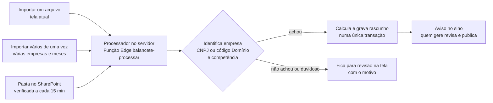

# Demonstrativos: importação em lote, agente do SharePoint e visão por período (a construir)

Pedido do Edvaldo em 31/10/2026. Vem logo depois da reorganização do código (etapa 2).

## 1. Um só "processador" de balancete, três portas de entrada

- O cálculo passa a rodar no servidor (decisão 0003); a tela só mostra a prévia. As três portas usam o mesmo processador,
  então o resultado é sempre igual.
- Arquivo repetido (mesma empresa e competência) não duplica: pergunta se substitui o rascunho; balancete publicado nunca é
  substituído sem despublicar.

## 2. Importação manual em lote (pelo usuário)

1. O usuário arrasta **um ou vários arquivos** (Excel do Domínio), de **uma ou várias empresas**, de um ou vários meses.
2. O HUB lê cada arquivo e mostra uma lista: arquivo · empresa reconhecida · competência · período (mês ou acumulado) ·
   situação ("pronto", "empresa não encontrada", "já existe", "arquivo ilegível").
3. O usuário corrige o que precisar (escolhe a empresa numa lista, por exemplo) e clica **"Importar todos"**.
4. O HUB processa tudo de uma vez, separa por empresa e mostra o resumo: quantos entraram, por empresa, e o que ficou de fora
   com o motivo. Exporta esse resumo em PDF/Excel.

## 3. Agente do SharePoint (automático, sem computador ligado)

- Pasta `HUB-MDC/Balancetes/Entrada` no SharePoint da MDC (nome a confirmar), com `Processados` e `Com problema`.
- A cada 15 minutos o HUB (agendador do banco + Função Edge) lê a pasta pela Microsoft Graph, processa e move o arquivo.
- Requer, uma vez, um aplicativo no Entra ID com permissão **só àquela pasta** (Sites.Selected); o código fica no cofre
  do Supabase. Passo a passo para o TI a ser escrito em `infra/`.
- Tela "Histórico de importações": o que chegou, quando, por qual porta, resultado.

## 4. Visão por período na análise

- No topo da tela de análise: **Ano** (só os anos com balancete) · **Visão** (Mês, Trimestre, Semestre, Ano) ·
  **Qual período** (jan…dez, 1º–4º trimestre, 1º–2º semestre, ano inteiro).
- 2024-01 a 2024-03 = 1º trimestre/2024; 2024-01 a 2024-06 = 1º semestre/2024; "Ano" junta todo 2024.
- DRE e DFC somam os meses; balanço é o do último mês do período; índices refeitos sobre o período.
- Completude visível: "3 de 3 meses importados" ou "falta mar/2024".
- Comparação automática com o mesmo período do ano anterior.
- Empresas com balancete já acumulado (ex.: Greencore e MDC, jan–dez/2025 num arquivo só): a visão anual usa esse
  balancete; mês e trimestre ficam indisponíveis com explicação.
- O PDF e o Portal do cliente seguem o período escolhido.
