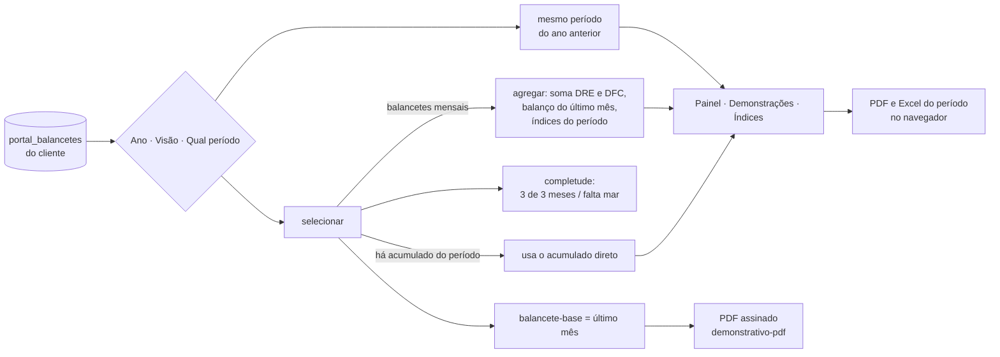
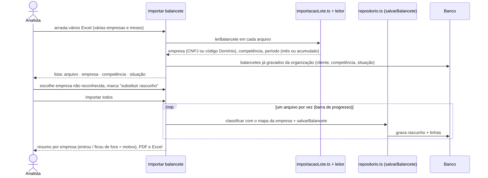

# Módulo Demonstrativos

> **Resumo:** a equipe importa o balancete do Domínio (um arquivo ou vários de uma vez), o HUB calcula balanço, DRE,
> DFC, índices e fragilidades, a equipe revisa e publica, e o cliente vê no Portal. A análise pode ser vista por mês,
> trimestre, semestre ou ano do calendário, com comparação ao mesmo período do ano anterior.

## 1. Telas

| Endereço | Quem usa | O que faz |
| --- | --- | --- |
| `/demonstrativos` | Equipe | Lista de balancetes por cliente e competência; reprocessar rascunhos |
| `/demonstrativos/importar` | Equipe (operar) | Importa **um** arquivo (revisão conta a conta antes de gravar) ou **vários** de uma vez (lote) |
| `/demonstrativos/[id]` | Equipe | Análise do cliente: Painel, Balanço/DRE/DFC, Balancete, Índices, Fragilidades, Parecer; publicar |
| `/demonstrativos/riscos` | Equipe | Riscos da carteira (fragilidades de todos os clientes) |
| `/demonstrativos/certificado` | Administrador | Certificado A1 usado para assinar o PDF |
| `/portal` (abas Resumo, Balanço/DRE/DFC, Balancete, Índices, Parecer) | Cliente | Só os balancetes publicados |

Código: regras em `web/src/dominios/demonstrativos/` (leitura e cálculos em `balancete/`, `calculosDemonstracoes.ts`,
`periodos.ts`, `selecaoPeriodo.ts`, `importacaoLote.ts`, gravação em `repositorio.ts`, peças de tela em `componentes/`);
pedaços da tela de importação em `web/src/app/(hub)/demonstrativos/importar/_componentes/`.

## 2. Visão por período

No topo da análise (equipe: abas Painel, Balanço/DRE/DFC e Índices; Portal: todas as abas) ficam três escolhas:
**Ano** (só anos com balancete) · **Visão** (Mês, Trimestre, Semestre, Ano) · **Qual período** (jan…dez,
1º–4º trimestre, 1º–2º semestre, ano inteiro). A visão fica lembrada no navegador; ano e período começam no
período que contém o balancete aberto (equipe) ou no último com dado (Portal).

| Regra | Onde |
| --- | --- |
| Períodos fixos do calendário: jan–mar = 1º trimestre, jan–jun = 1º semestre, ano = todos os meses | `selecaoPeriodo.ts` (`mesesDoPeriodo`) |
| DRE e DFC somam os meses; balanço é o do último mês importado contra a abertura do primeiro | `periodos.ts` (`agregar`), chamado por `selecionar` |
| Índices: margens e carga sobre a DRE do período; liquidez e endividamento no fechamento; prazos pela média dos meses | `periodos.ts` (regras de antes, sem mudança) |
| Completude em linguagem simples: "3 de 3 meses importados", "2 de 3 meses importados · falta mar/2024" | `selecionar` |
| Comparação com o mesmo período do ano anterior quando ele existe (KPIs, DRE, DFC, PDF e Excel do período) | `mesmoPeriodoAnoAnterior` |
| Opção sem dado aparece desabilitada com o porquê | `opcoesDoAno`, `visoesDoAno` |
| Balancete **acumulado** (vários meses num arquivo, ex.: jan–dez de MDC e Greencore): é usado direto no menor período do calendário que o contém (jan–dez → Ano; jan–mar → 1º trimestre). Mês/Trimestre/Semestre cobertos só por ele ficam indisponíveis: "este cliente enviou o balancete do ano inteiro de uma vez" | `ehAcumulado`, `selecionar` |

Exportação:
- **Baixar PDF · <período>** (`componentes/BotaoPdf.tsx` → Função Edge `demonstrativo-pdf`): o PDF **completo** (capa,
  termômetro, balanço, DRE, DFC, índices, pontos de atenção e balancete de verificação) **do período escolhido**, assinado
  com o certificado A1 quando tudo o que entra nele está publicado. O botão manda só a escolha (ano, visão, número); o
  servidor refaz o período com as mesmas regras da tela (`selecaoPeriodo.ts`, `periodos.ts`, `linhasPeriodo.ts`, copiados
  pelo `scripts/sync-funcoes.sh`) **usando só meses publicados**, para ninguém conseguir mandar números próprios para um
  documento assinado. Mês único = PDF daquele mês (com acumulado do ano); trimestre/semestre/ano = coluna de comparação
  com o mesmo período do ano anterior, balancete do período (abertura do 1º mês, movimento somado, fechamento do último)
  e sem parecer (o parecer é mensal). Regra única para tela e servidor (`pdfPeriodo.ts`):
  - **completo** (todos os meses do período publicados): sai assinado;
  - **parcial** (só faltam os últimos meses): sai **sem assinatura**, com selo "período parcial" e "-parcial" no nome;
  - **lacuna** (falta mês publicado no meio ou no começo): não gera, porque caixa e balancete não fechariam; o botão
    fica desligado e diz o que publicar (no Portal: "fica disponível quando a MDC concluir …").
  - A coluna de comparação com o ano anterior só aparece quando os dois períodos estão completos.
  - Limitação conhecida: empresa aberta no meio do ano cai em "lacuna" no PDF anual do primeiro exercício.
- **Excel do período** (`componentes/ExportarPeriodo.tsx`): planilha no navegador com os valores como número.

## 3. Importação em lote

Situações de cada arquivo: **Pronto**, **Pronto · substitui o rascunho**, **Empresa não encontrada** (escolha na lista),
**Falta a competência**, **Já existe (rascunho)** (marque "Substituir"), **Já publicado** (nunca substitui: despublique
antes), **Repetido neste lote**, **Arquivo ilegível** (com o motivo do leitor). Só os prontos são gravados.
Um arquivo só continua na revisão detalhada de sempre (grupos conta a conta, conferências e prévia).

## 4. Tabelas usadas

| Tabela | Uso no módulo |
| --- | --- |
| `portal_balancetes` | Um registro por cliente e competência (resumo, índices, alertas, conferências, demonstrações, `periodo_inicio`/`periodo_fim`, situação rascunho/publicado) |
| `portal_balancete_linhas` | Contas do balancete importado |
| `portal_mapa_contas` | Regra conta → grupo (padrão da organização ou do cliente) |
| `portal_mapa_dfc` | Regra conta → linha da DFC |
| `portal_pareceres` | Parecer técnico por balancete, com versões |

Detalhes de colunas e travas no [capítulo 4](../04-banco-de-dados.md); o fluxo até o Portal na [seção 6.1](../06-fluxos.md#61-balancete-do-excel-do-domínio-ao-portal-do-cliente).

## 5. Limitações conhecidas

- O cálculo e a gravação ainda rodam no navegador (decisão 0003 prevê levar para o servidor); o lote grava arquivo a
  arquivo, sem transação única: se a conexão cair no meio, os que já foram ficam gravados e o resumo mostra o resto.
- O PDF de trimestre, semestre ou ano não traz parecer técnico nem comentário do contador (os dois são mensais); os
  pontos de atenção são os do último mês do período.
- Período com mês faltando soma só os meses importados (a completude avisa); o balanço é o do último mês importado.
- Prazos médios do período são a média simples dos meses (regra de `periodos.ts`).
- Balancete acumulado que não começa em janeiro é tratado a partir de janeiro do ano da competência.
- Na tela da equipe as abas Balancete, Fragilidades e Parecer continuam sendo do arquivo aberto, não do período.
- O lote ainda não vem do SharePoint (seção 3 do desenho em `docs/futuro/demonstrativos-importacao-e-periodos.md`).
