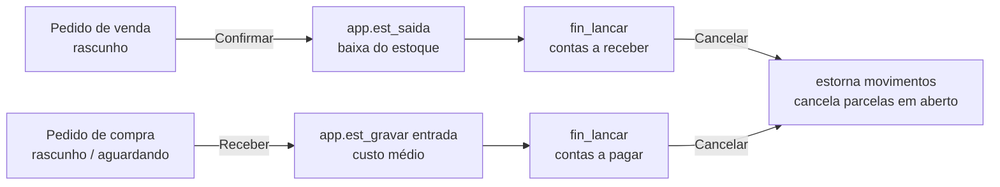

# Estoque, pedidos de venda (Saídas) e pedidos de compra (Entradas)

> **Resumo:** cadastro de itens fácil para o próprio cliente (assistente em 4 passos, cadastro rápido, planilha,
> duplicar, foto), estoque com custo médio ponderado e ficha (kardex), inventário guiado, e pedidos de venda e de
> compra que mexem no estoque e no Financeiro sozinhos. Migração `033_estoque_pedidos.sql` (sobre a 029). Frente 3 do
> [plano do Financeiro v2](../futuro/financeiro-v2-plano.md). Desde 01/11/2026 são módulos separados no menu.

## 1. Telas

| Endereço | Módulo | O que faz |
| --- | --- | --- |
| `/estoque` | Estoque | **Itens**: cartões (com foto) ou lista; busca por qualquer palavra (nome, código, código de barras, marca, grupo, NCM, sem acento e em qualquer ordem); filtros Mostrar (produtos, serviços, que controlam estoque, abaixo do mínimo, sem estoque, sem preço) e Grupo; "Mais filtros" (inativos); indicadores clicáveis (itens ativos, valor em estoque, abaixo do mínimo, sem estoque); **Novo item** (assistente), **Cadastro rápido**, **Importar planilha**, **Grupos**; por item: Editar, Duplicar, Ficha; PDF e Excel |
| `/estoque/posicao` | Estoque | Posição valorizada: saldo × custo médio por item, de um estoque ou de todos (com o saldo de cada local); filtros estoque, grupo, busca; indicadores; total; clicar no item abre a ficha; PDF e Excel |
| `/estoque/ficha` | Estoque | Ficha do item (kardex): saldo anterior, entradas, saídas, saldo e custo médio depois de cada movimento, valor do saldo; período em um clique; estornados opcionais; PDF e Excel |
| `/estoque/movimentos` | Estoque | Movimentações manuais (entrada, saída, inventário de um item, transferência, estorno) — a tela que já existia |
| `/estoque/inventario` | Estoque | Inventário guiado em 4 passos: escolhe o estoque (e o grupo), imprime a **folha de contagem** (PDF/Excel), digita o contado (botão "preencher os em branco com o saldo do sistema"), confere as diferenças (quantidade e valor) e grava tudo de uma vez |
| `/estoque/locais` | Estoque | Estoques (locais), o padrão e a regra de estoque negativo (só equipe com gerir) |
| `/saidas` | Saídas | **Pedidos de venda**: período, situação, busca; indicadores (vendido no período, rascunhos, a faturar, ticket médio); novo pedido; Editar, Confirmar, Faturar, Ver, PDF, Duplicar, Cancelar com motivo |
| `/entradas/compras` | Entradas | **Pedidos de compra**: idem, com Receber (mercadoria chegou) e indicador "aguardando entrega" |

Em pedidos de venda e de compra (lista e janela "Ver") há o botão **Ver caminho**: a árvore pedido → nota (achada pelo
número no Documento) → contas → pagamentos e a entrada/saída do estoque ([Financeiro, seção 8](financeiro.md#8-ver-caminho-árvore-do-documento-03112026)).

`/financeiro/estoque` (tela antiga) redireciona para `/estoque` (`next.config.ts`). A empresa é sempre a MDC
(`organizacoes.gestao_cliente_id`), como no Financeiro.

### Assistente de item (`AssistenteItem.tsx`)

1. **O que é**: "Produto que eu vendo" (controla estoque), "Serviço" (nunca controla), "Material de uso" (produto
   que não controla estoque); nome (avisa nome repetido), código sugerido (P0001…/S0001…), grupo (digitado; grupo novo
   é criado junto), marca, foto opcional (reduzida no navegador para 800 px JPEG).
2. **Venda e compra**: unidade de venda em botões (UN, CX, KG…), "compro em outra embalagem" (1 CX vem com N UN),
   código de barras e NCM (com explicação).
3. **Estoque**: controlar? estoque mínimo, "quanto tem hoje" e em qual estoque (saldo inicial, só no cadastro novo).
4. **Preços**: preço de custo, markup desejado (botão "usar preço sugerido"), preço de venda; mostra na hora o lucro
   por unidade, a margem sobre o preço e o markup sobre o custo (vermelho se abaixo do custo); categorias de venda e
   de compra.

Na edição todos os passos ficam abertos e há "Salvar item" em qualquer passo. Duplicar copia tudo menos código,
código de barras e foto.

### Pedido (`EditorPedido.tsx`)

Cliente/fornecedor digitado (novo é cadastrado junto, na mesma transação), busca de item com teclado e leitor de
código de barras (Enter inclui; "cadastrar como item novo" abre o cadastro rápido), linha com quantidade, unidade
(na compra: caixa ou unidade, convertendo o preço), preço, desconto e aviso de saldo insuficiente; desconto e frete do
pedido; condição de pagamento (à vista, 30, 30/60, 30/60/90, parcelado por mês, personalizado com parcelas
editáveis) com prévia; estoque, categoria, centro de custo, documento e observação; "já recebi/paguei" (à vista).
Botões: Salvar rascunho e Salvar e confirmar (venda) / Salvar e receber a mercadoria (compra). Se o lançamento falhar
(ex.: estoque insuficiente), o pedido fica salvo como rascunho e a mensagem diz o motivo.

PDF do pedido no timbrado (`pdfPedido.ts`): dados do cliente/fornecedor, itens, totais, parcelas e observação.

## 2. Regras

| Regra | Onde |
| --- | --- |
| **Custo médio ponderado**: cada entrada com custo faz `(saldo × custo médio + qtd × custo) / (saldo + qtd)`; com saldo zero ou negativo vale o custo da entrada; saída, ajuste e transferência não mudam o custo médio | `app.est_recalcular` (banco), `estoqueRegras.custoMedio` (prévia) |
| Ficha: cada movimento guarda o saldo do item (todos os estoques) e o custo médio logo depois dele; movimento com data passada ou estorno recalcula a partir daquela data | `est_movimentos.saldo_apos/custo_medio_apos`, `app.est_recalcular` |
| Custo médio não se digita (só o HUB grava); o "preço de custo" do cadastro passa a ser o último custo de entrada | `tg_est_item_v2`, `app.est_gravar` |
| Margem = (preço − custo) / preço; markup = (preço − custo) / custo; preço sugerido = custo × (1 + markup); custo de referência = custo médio (ou o preço de custo, se ainda não houver) | `estoqueRegras.ts` |
| Unidade de compra: 1 `unidade_compra` = `fator_compra` unidades de estoque; na compra em caixa o estoque entra em unidades e o custo é por unidade | `est_pedido_salvar`, `app.est_pedido_lancar` |
| Venda confirmada: saída (`app.est_saida`) só dos itens que controlam estoque; serviço e item que não controla passam sem mexer; não deixa vender mais do que tem (salvo estoque negativo liberado); guarda o custo médio da saída na linha (margem da venda) | `app.est_pedido_lancar` |
| Compra recebida: entrada (`app.est_gravar`, origem `pedido_compra`) com custo = (total da linha + rateio de frete − desconto do pedido) / quantidade em unidades de estoque | `app.est_pedido_lancar`, `pedidosRegras.ratearCustoCompra` |
| Parcelas viram contas a receber/pagar por `public.fin_lancar` (uma chamada por parcela, descrição "Pedido de venda nº 12 · Cliente (1/3)", documento "PV 12"/"PC 12" ou o nº da nota); ligadas ao pedido em `est_pedido_titulos` | `app.est_pedido_lancar` |
| Soma das parcelas = total do pedido (sem parcelas = à vista na data); categoria obrigatória para lançar quando o total > 0 | `est_pedido_salvar`, `app.est_pedido_lancar` |
| Situações: venda rascunho → confirmado → faturado; compra rascunho → confirmado ("aguardando entrega", sem efeito) → recebido; qualquer uma → cancelado. Só rascunho (e compra aguardando) se edita | `est_pedido_*`, `pedidosRegras.situacaoPedido` |
| Cancelar: estorna os movimentos do pedido (marca, não apaga) e cancela as parcelas em aberto. Recusa se alguma parcela tem pagamento ("estorne o recebimento antes") ou se estornar a entrada da compra deixaria o estoque negativo ("os produtos já saíram") | `est_pedido_cancelar` |
| Movimento gerado por pedido não se estorna pela tela de movimentos (só cancelando o pedido) | `est_estornar_movimento` |
| Número do pedido sequencial por empresa e tipo, sem repetir com dois pedidos ao mesmo tempo | `pg_advisory_xact_lock` em `est_pedido_salvar` |
| Duas vendas do último item ao mesmo tempo: a segunda espera a primeira (item travado) e é recusada | `app.est_gravar` (`for update`), teste 60 |
| Linhas trocadas num rascunho ficam `removido = true` (nada se apaga) | `est_pedido_itens` |
| Importação: acha o item pelo código ou, sem código, pelo nome; achou = atualiza só o que veio preenchido; novo = cadastra (com saldo inicial no estoque padrão, criando "Depósito principal" se não houver); tudo ou nada; até 5.000 linhas | `est_importar_itens`, `planilhaItens.ts` |
| Planilha: reconhece Código/SKU/Referência, Nome/Descrição/Produto, Tipo, Unidade/Un, Grupo/Categoria/Família, Marca, Preço/Preço de venda, Custo, Estoque mínimo, Saldo/Estoque/Quantidade, EAN/Código de barras, NCM, Controla estoque (Sim/Não), Unidade de compra, Fator; erros por linha em português | `planilhaItens.lerPlanilhaItens` |
| Inventário guiado: lança só a diferença de cada item contado (itens iguais são pulados), tudo de uma vez, com o mesmo grupo | `est_inventario` |

## 3. Banco (migração 033)

| Objeto | O que é |
| --- | --- |
| `est_grupos` | Grupos de produto (gravação direta com `operar`, auditada) |
| `est_itens` (+) | `grupo_id`, `marca`, `unidade_compra`, `fator_compra`, `custo_medio` (só o HUB), `markup`, `foto_caminho`, `atualizado_em`; índice por código de barras |
| `est_movimentos` (+) | `saldo_apos`, `custo_medio_apos` (ficha); índices da ficha e da origem |
| `est_pedidos` | Cabeçalho: tipo, número, cliente/fornecedor (`fin_pessoas`), datas, estoque, categoria, centro, totais, condição, `parcelas` (jsonb), documento, situação, lançado/cancelado |
| `est_pedido_itens` | Linhas (item, unidade, fator, quantidade, preço, desconto, total, custo, movimento gerado, removido) |
| `est_pedido_titulos` | Títulos (`fin_titulos`) gerados por cada pedido |
| `app.est_recalcular(item, desde)` | Recalcula a ficha e o custo médio |
| `app.est_gravar` (substituída) | Mesma assinatura da 029; agora atualiza o último custo e recalcula a ficha (a frente de notas usa com origem `nota_entrada`) |
| `est_estornar_movimento` (substituída) | Igual à 029 + recálculo |
| `est_salvar_item(p)`, `est_importar_itens(cliente, itens)` | Cadastro (assistente/rápido) e importação, com grupo novo e saldo inicial na mesma transação |
| `est_inventario(p)` | Inventário de vários itens |
| `est_pedido_salvar(p)`, `est_pedido_confirmar(pedido, p)`, `est_pedido_receber(pedido, p)`, `est_pedido_faturar(pedido, documento)`, `est_pedido_cancelar(pedido, motivo)` | Pedidos (tudo ou nada, auditados com `app.registrar`) |
| Políticas `est_fotos_ver`/`est_fotos_enviar` (Storage) | Pasta `<org>/estoque/<cliente>/`: o cliente do Portal com a permissão financeiro vê e envia fotos (só imagem) |

Acesso: `app.fin_pode(cliente, nível)` em tudo (RLS de leitura e checagem nas funções). Pedidos e linhas não têm
gravação direta pela API. As telas usam o nível do módulo (`estoque`, `saidas`, `entradas`) para mostrar os botões;
a separação das permissões por módulo no banco fica para a integração.

## 4. Testes

- SQL: `supabase/testes/60_estoque_pedidos.sql` (rodado por `rodar.sh` depois da 030): custo médio (inclusive com
  data passada e estorno), cadastro e importação, inventário, venda com serviço e item não estocável, estoque
  insuficiente, venda sem categoria, cancelamento com parcela paga (recusa) e sem (estorna estoque e títulos),
  compra em caixa com rateio de frete/desconto, cancelamento de compra cujos produtos já saíram, acesso do Portal e
  de quem não tem acesso, e **concorrência de duas vendas** (duas conexões pelo `dblink`).
- Vitest: `estoqueRegras.test.ts` (margem, markup, preço sugerido, custo médio, conversão de unidade, busca, código
  sugerido, totais e parcelas do pedido, rateio, leitura da planilha de itens).

## 5. Limitações e próximos passos

- Pedido de venda ainda não emite nota (o "Faturar" só registra o número); a emissão vem depois (NF-e/NFS-e).
- Kardex por item (todos os estoques juntos); a posição mostra o saldo de cada estoque.
- O custo médio é do item na empresa (não por estoque).
- Devolução de venda/compra: por enquanto, cancelar o pedido ou lançar movimento manual.
- Recebimento parcial de compra não existe: recebe o pedido inteiro.
