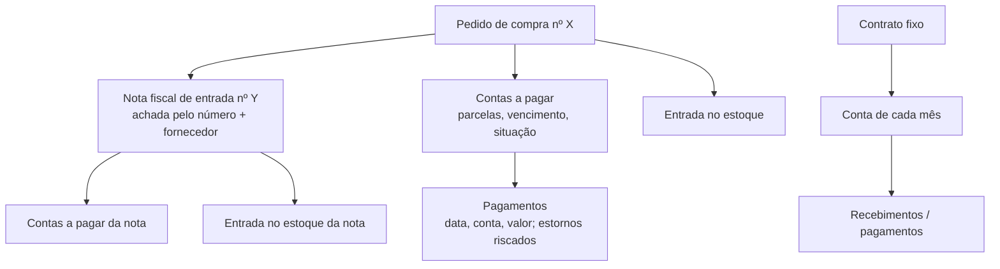

# Módulo Financeiro

> **Resumo:** a gestão financeira de cada cliente dentro do HUB, usada pela equipe MDC e (próxima etapa de tela) pelo
> próprio cliente no Portal. Etapa 1: plano de contas do Domínio, contas bancárias e extratos (OFX ou Excel).
> Etapa 1B (01/11/2026): cadastros (fornecedores/clientes, despesas e receitas ligadas ao plano, centros de custo),
> contas a pagar e a receber (parcelas, baixa parcial com juros/multa/desconto, estorno, cancelamento), Entradas e
> saídas (o dinheiro que entrou/saiu e para onde foi) e Itens e estoque (com "controla estoque?"). Próximas: pedidos de
> compra e venda (baixa automática do estoque), conciliação com o extrato, notas de entrada (XML da SEFAZ/NFS-e com o
> certificado A1, manifestação do destinatário) e de saída (emissão). Cada etapa é auditada e testada com MDC e
> Greencore (Piloto HUB) antes da carteira.
> Financeiro v2 (01/11/2026, Frente 4): painel inicial, módulos separados no menu lateral (modelo Conta Azul/Omie:
> Financeiro, Plano de contas, Centros de custo, Relatórios e o cadastro comum de fornecedores e clientes; Entradas,
> Saídas e Estoque vêm das outras frentes), transferência entre contas (migração 034) e o molde visual único
> (`docs/08-convencoes.md`, 8.3.1).

## 1. Telas

Desde o Financeiro v2 a gestão do cliente é dividida em **módulos**, cada um com item próprio no menu lateral
(`hub_apps`) e liberável por cliente. As abas da barra superior ficam curtas; no Financeiro, "Bancos ▾" junta contas
bancárias, transferências, extratos e conciliação (no celular, botão "Telas"). Rotas antigas redirecionam (`next.config.ts`):
`/financeiro/plano` → `/plano-contas` e `/financeiro/cadastros` → `/cadastros/pessoas`.

| Módulo · endereço | Quem usa | O que faz |
| --- | --- | --- |
| Financeiro · `/financeiro` | Equipe (ver; atalhos com operar) | **Painel** da MDC: saudação e data, dinheiro nos bancos hoje (soma das contas ativas, com o saldo de cada uma), atalhos (nova conta a pagar, a receber, importar extrato, cadastrar item), "Hoje", "Vencidos" e "Próximos 7 dias" (a pagar e a receber), fluxo de caixa previsto dos próximos 30 dias (saldo atual + contas em aberto; vencido conta hoje; aviso se o saldo ficar negativo), maiores despesas do mês por categoria (no começo do mês, sem nada pago, mostra o mês passado), últimos 6 meses realizados (entrou × saiu). Empresa nova vê os **primeiros passos** (plano → banco → categorias → lançar) |
| Financeiro · `/financeiro/pagar` e `/financeiro/receber` | Equipe (ver; lançar e baixar com operar) | Contas a pagar / a receber: filtro de vencimento em um clique, situação (em aberto, vencidos, a vencer, pagos, cancelados), fornecedor/cliente e categoria em "Mais filtros", busca; etiquetas dos filtros em uso; frase de resumo; 3 indicadores que filtram ao clicar (vencido, a vencer, pago); lançar (parcelas mensais, "já foi pago", fornecedor novo cadastrado na hora), pagar/receber (total ou parcial), editar, histórico com estorno, cancelar com motivo; PDF e Excel. `?nova=1` abre "Nova conta" (atalho do painel) |
| Financeiro · `/financeiro/movimento` | Equipe | Entradas e saídas: pagamentos e recebimentos do período (realizado) e, se marcado em "Mais filtros", o previsto; entrou, saiu, resultado; "para onde foi o dinheiro" por categoria (clique filtra); transferências entre contas aparecem na lista (chip "Transferência") mas **não** entram nos totais; lançar entrada/saída à vista e transferência; PDF e Excel |
| Financeiro · `/financeiro/bancos` | Equipe (ver; cadastro e transferência com operar) | Contas bancárias: saldo atual, último lançamento, a conciliar, conta contábil ligada; indicadores (saldo, a conciliar, sem conta contábil); cadastrar, editar e "Transferir entre contas"; PDF e Excel |
| Financeiro · `/financeiro/transferencias` | Equipe (ver; transferir e estornar com operar) | Transferências entre contas da MDC por período e conta; nova transferência; estorno com motivo; PDF e Excel |
| Financeiro · `/financeiro/extratos` | Equipe (ver; importar com operar) | Importa OFX ou planilha numa conta (confere antes de gravar); lista com filtros de conta, período, busca e (em "Mais filtros") entradas/saídas e situação; totais; PDF e Excel |
| Financeiro · `/financeiro/conciliacao` | Equipe (ver; conciliar com operar) | Escolhe a conta e o período; à esquerda os lançamentos do extrato (começa em "A conciliar"; busca, situação, entradas/saídas), à direita as **sugestões do HUB** para o escolhido com "Conciliar com esta". Janela larga "Conciliar" com abas: Contas do HUB (marcar um ou mais pagamentos já lançados, contas em aberto com juros/desconto ou transferências; conferência da soma), Criar lançamento (categoria, centro e fornecedor sugeridos), Transferência, Ignorar (motivo). Linha conciliada: "Desfazer conciliação" com motivo. Indicadores: movimento do extrato × do HUB no período e a **diferença** em destaque; PDF e Excel com a ligação de cada linha. Sem extrato: leva a Extratos |
| Financeiro · `/financeiro/estoque` (provisório) | Equipe (ver; movimentar com operar; regra de negativo com gerir) | Abas Itens, Estoques e Movimentações. Sai do Financeiro quando o módulo Estoque (`/estoque`, Frente 3) entrar |
| Plano de contas · `/plano-contas` | Equipe (ver; importar com operar) | Importa o plano de contas do Domínio (Excel/CSV); lista com busca e filtros; PDF e Excel |
| Plano de contas · `/plano-contas/categorias` | Equipe (ver; cadastrar com operar) | Despesas e receitas, cada uma ligada a conta analítica ativa do plano; filtros, PDF e Excel |
| Centros de custo · `/centros-custo` | Equipe (ver; cadastrar com operar) | Centros de custo da MDC; PDF e Excel |
| Fornecedores e clientes · `/cadastros/pessoas` | Quem tem Financeiro, Entradas, Saídas ou Estoque | Cadastro comum (CPF/CNPJ conferido) usado por todos os módulos; aparece no menu lateral como "Fornecedores e clientes" |
| Relatórios · `/relatorios` | Equipe | Painel de relatórios gerenciais com período em um clique, PDF e Excel: **Resultado de caixa** (DRE gerencial por grupo e categoria, juros/multas e descontos à parte, "sobrou/faltou"), **Realizado x previsto** (mês a mês: previsto pelo vencimento, realizado pelos pagamentos, com gráfico), **Pagas e recebidas** (cada baixa, indicadores que filtram), **Centros de custo** (receitas, despesas, resultado e parte das despesas) |

| Endereço | Quem usa | O que faz |
| --- | --- | --- |

Contas geradas pelo módulo [Contratos](contratos.md) (041) levam o selo **"Contrato fixo"** nas listas de A pagar e A
receber (e "Contrato fixo" na coluna Documento da exportação). São contas normais: pagar, receber, editar e cancelar
continuam aqui; só o vínculo com o contrato e o mês (`recorrente_id`, `competencia`) não mudam pela tela.

Desde 03/11/2026 essas telas cuidam só da MDC: a empresa é a própria da organização (`organizacoes.gestao_cliente_id`,
migração 042), sem campo "Empresa" na tela e sem nada lembrado no navegador; o banco recusa gravar ou ler a gestão de
outra empresa. Sem `gestao_cliente_id`, as telas avisam "A empresa da MDC ainda não foi definida para a Gestão. Peça ao
administrador."
Permissão nas telas: cada módulo usa a própria ferramenta (`plano_contas`, `centros_custo`, `relatorios`); as tabelas
ainda conferem `app.fin_pode` (ferramenta `financeiro`) até a separação de RLS por módulo, feita na integração.

Código: regras puras em `web/src/dominios/financeiro/` (`ofx.ts`, `extratoPlanilha.ts`, `planoDominio.ts`, testes em
`leitores.test.ts`), leituras paginadas em `leituras.ts`, gravações em `repositorio.ts`, telas em
`web/src/app/(hub)/financeiro/`. Etapa 1B: regras puras em `regras.ts` (CPF/CNPJ, período, parcelas, situação; testes
em `regras.test.ts`), exportação comum PDF/Excel em `exportar.ts`, telas compartilhadas em `componentes/`
(`TelaTitulos`, `LancarTitulo`, `BaixaTitulo`, `CadPessoas`, `CadCategorias`, `CadCentros`, `EstoqueLocais`,
`EstoqueMovimentos`, `estoqueBase`; as peças de tela comuns ficam em `components/ui/` e a escolha da empresa em `dominios/organizacao/componentes/EmpresaEmGestao`). Financeiro v2: contas do painel em `painel.ts` (prazos, fluxo previsto,
realizado por mês, despesas por categoria, primeiros passos, saldo com transferências; testes em `painel.test.ts`),
dos relatórios em `relatorios.ts` (testes em `relatorios.test.ts`), gráficos SVG em `componentes/GraficosPainel.tsx`,
visões dos relatórios em `componentes/RelatoriosVisoes.tsx`, `PrimeirosPassos`, `NovaTransferencia`, `PaginaCadastro`.

Itens, estoque e pedidos saíram do Financeiro em 01/11/2026 e viraram os módulos **Estoque** (`/estoque`),
**Saídas** (`/saidas`, pedidos de venda) e **Entradas** (`/entradas/compras`, pedidos de compra): ver
[Estoque e pedidos](estoque.md). `/financeiro/estoque` redireciona para `/estoque`.

## 2. Regras

| Regra | Onde |
| --- | --- |
| Plano de contas: precisa das colunas Classificação e Descrição (ou Nome); Código e Tipo (S/A) são opcionais. Sem coluna Tipo, conta com filha é sintética | `planoDominio.ts` |
| Importar o plano de novo atualiza: conta nova entra, existente é atualizada, conta que saiu do Domínio fica **inativa** (nunca apagada) | `fin_importar_plano` (migração 026) |
| Conta bancária só se liga a conta **analítica ativa** do plano do mesmo cliente; não muda de cliente | gatilho `tg_fin_conta_bancaria` |
| Extrato OFX (SGML ou XML) e planilha (data, histórico, valor ou débito/crédito); OFX com acento antigo é lido como Windows-1252 | `ofx.ts`, `extratoPlanilha.ts`, `leituras.textoDoArquivo` |
| Lançamento repetido não entra duas vezes: chave = FITID do banco + data + valor (há bancos que repetem o FITID) ou, sem FITID, data + valor + histórico + documento; iguais no mesmo dia ganham número de ordem | `chavesDoArquivo` + `unique (conta_id, chave)` |
| OFX com mais de uma conta é recusado (um extrato por conta) | `lerOfx` |
| Planilha: a descrição nunca é a coluna da data; valor sem sinal com coluna D/C separada vira saída quando D | `extratoPlanilha.ts` |
| Depois de gravar, o HUB compara o saldo calculado com o saldo final informado pelo banco no OFX e avisa a diferença | `ImportarExtrato.tsx` |
| Desfazer importação: retira o lote e os lançamentos dele, só se nenhum foi conciliado; fica na auditoria | `fin_desfazer_lote` |
| Reimportar o plano mostra antes quantas contas entram e quantas ficariam inativas (alerta forte acima de 30%) | tela do plano |
| Aviso quando o número da conta do arquivo não bate com o cadastrado | tela de extratos |
| Saldo da conta = saldo do banco no fim do dia informado + lançamentos dos dias seguintes | `saldoDaConta` |

## 3. Banco (migração 026)

`fin_plano_contas`, `fin_plano_importacoes`, `fin_contas_bancarias`, `fin_extrato_lotes`, `fin_extrato_linhas`.
Leitura com `app.hub_pode(org, 'financeiro', 'ver')`; contas bancárias gravadas direto com `operar`; plano e extrato só
pelas funções `fin_importar_plano`, `fin_importar_extrato` e `fin_desfazer_lote` (security definer, conferem `operar`,
tudo ou nada, registradas na auditoria). A conta contábil do banco só é validada quando muda (reimportar o plano não
trava a edição da conta bancária).

## 4. Etapa 1B: cadastros e contas a pagar/receber (migrações 028 e 030)

| Regra | Onde |
| --- | --- |
| Categoria (despesa/receita) só liga em conta **analítica ativa** do plano da mesma empresa; não muda de empresa; só a equipe MDC cadastra (o cliente no Portal só lê), como os centros de custo | `tg_fin_categoria`, políticas `fin_incluir`/`fin_alterar` (030) |
| Fornecedor/cliente, centro de custo e estoque (local) não mudam de empresa | `tg_fin_sem_troca_empresa` (030) |
| Fornecedor digitado na hora no lançamento: o banco acha pelo nome ou cadastra, na mesma transação | `fin_lancar` (`pessoa_nome`, 030) |
| Valor digitado: "1.250" = mil duzentos e cinquenta (ponto é milhar); "1.250,50" e "1250.50" também valem | `regras.numeroBr` |
| Editar valor de título pago em parte: precisa ficar maior do que o já pago (senão daria baixa do restante) | `tg_fin_titulo` (030) |
| Entradas e saídas: juros e multa e descontos aparecem em linhas próprias ("Juros e multas pagos/recebidos", "Descontos obtidos/concedidos"), não na categoria do título | `movimento/page.tsx` |
| Conta a pagar usa categoria de despesa; a receber, de receita; fornecedor, centro e banco previsto da mesma empresa | `tg_fin_titulo` |
| Lançar: valor dividido em parcelas mensais iguais, centavos na última; vencimento no mesmo dia (último dia do mês quando não existe, ex.: 31/01 → 28/02); "já foi pago" quita todas na hora | `fin_lancar`, prévia em `regras.dividirParcelas` |
| Pagar/receber: baixa total ou parcial; `valor` = quanto do título foi baixado, `total` = o que passou no banco (valor + juros + multa − desconto); quita quando o baixado chega ao valor | `fin_baixar` |
| Estorno de pagamento: marca (não apaga), exige motivo, reabre o título; recusa se já conciliado com o extrato | `fin_estornar_baixa` |
| Cancelar: só título em aberto sem pagamento, com motivo | `fin_cancelar_titulo` |
| Situação e valor pago só mudam pelas funções; título quitado/cancelado não se edita; valor não fica abaixo do já pago | `tg_fin_titulo` (`app.fin_interno`) |
| Situação na tela: Vencido (vencimento < hoje, com saldo), Vence hoje, A vencer, Pago em parte, Pago, Cancelado | `regras.situacaoDoTitulo` |
| CPF/CNPJ só com números e dígitos verificadores conferidos na tela; único por empresa | `regras.documentoValido`, índice `fin_pessoas_documento` |
| Nada se apaga (sem política de delete): cadastros inativam | RLS |
| Saldo dos bancos continua vindo do extrato; pagamentos registrados aqui são ligados às linhas do extrato na conciliação (seção "Conciliação do extrato"), sem contar duas vezes | `fin_baixas.extrato_linha_id` (051) |

## Conciliação do extrato (migração 051, auditoria T-02)

Etapa 2 do extrato: cada linha importada é ligada ao que está no HUB. Tela `/financeiro/conciliacao`; regras puras e
sugestão em `web/src/dominios/financeiro/conciliacao.ts` (teste `conciliacao.test.ts`); janela em
`componentes/JanelaConciliar.tsx`, painel em `componentes/PainelConciliacao.tsx`.

| Regra | Onde |
| --- | --- |
| Uma linha liga a **um ou mais** itens: pagamentos já lançados sem extrato, contas em aberto (baixa criada na data e na conta do extrato, forma "Conciliação do extrato") ou transferências; entrada só com contas a receber, saída só com a pagar | `fin_conciliar` → `app.fin_conciliar_ligar` |
| A soma (com juros, multa e desconto de cada conta em aberto) precisa ser **igual** ao valor do extrato; senão recusa ("A soma escolhida … não bate"). Na tela, "Levar a diferença para juros/desconto" acerta a última conta escolhida | banco; `conciliacao.ajustarDiferenca` |
| Criar lançamento: conta já paga/recebida no valor e na data da linha (categoria obrigatória; centro, fornecedor/cliente, documento opcionais; fornecedor novo cadastrado pelo nome) | `fin_conciliar_lancar` (usa `app.fin_lancar_titulos`) |
| Transferência: cria a transferência entre a conta do extrato e a outra conta (sentido pelo sinal) e concilia; quando o extrato da outra conta chegar, a mesma transferência aparece lá para conciliar | `fin_conciliar_transferir` |
| Ignorar: linha fora da conciliação, motivo com 5 letras ou mais; a diferença continua no quadro de saldos | `fin_extrato_ignorar` |
| Uma linha só tem uma conciliação valendo; um pagamento só liga a uma linha; uma transferência só uma vez em cada conta | índices únicos de `fin_conciliacoes` e `fin_conciliacao_itens` |
| **Nada se apaga:** desfazer marca a conciliação como desfeita (motivo, quem e quando), solta os pagamentos e a linha volta a "A conciliar"; pagamentos criados na conciliação continuam valendo (estorne na tela da conta, se for o caso) | `fin_conciliacao_desfazer`, gatilho `nada_se_apaga` |
| Pagamento ou transferência conciliados não estornam; extrato com linha conciliada não se desfaz (desfaça a conciliação antes) | `fin_estornar_baixa`, `fin_estornar_transferencia` (051), `fin_desfazer_lote` |
| Saldos do período: movimento do extrato (linhas não desfeitas) × movimento do HUB na conta (pagamentos pelo total e transferências); diferença = extrato − HUB | `fin_conciliacao_dados` |
| Tudo auditado (`conciliar`, `ignorar_extrato`, `desfazer_conciliacao`) | `app.registrar` |

**Sugestão automática** (`sugerir`): para cada candidato do mesmo sentido soma pontos — valor igual 50 (valor perto, até
3%, 15: provável juros/desconto), data perto até 30 (pagamento ±5 dias; conta em aberto ±10 dias do vencimento), nome
parecido até 20 (palavras do fornecedor/cliente ou da descrição no histórico, sem acento e sem as palavras comuns de
extrato como PIX, TED, LTDA), mesmo documento 15 e boleto já baixado pelo Ledgra Link 10. Quando nenhuma conta sozinha
bate o valor, procura 2 a 4 contas cuja soma dá o valor exato (pagamento agrupado). Mostra até 3 com 55 pontos ou mais;
75 ou mais aparece como "Combina muito". "Conciliar com esta" grava na hora quando a soma bate; com juros/desconto abre
a janela já marcada para conferir.

## 5. Acesso do cliente (Portal)

As tabelas da etapa 1B usam `app.fin_pode(cliente, nível)`: equipe com a ferramenta Financeiro **ou** pessoa do cliente
com a permissão `financeiro` no Portal (ver e lançar; `gerir` só a equipe). O cliente também enxerga as contas
bancárias e o plano da própria empresa. **A tela do Portal ainda não existe** (próxima entrega); até lá, a permissão
`financeiro` não aparece na lista de permissões do Portal.

## 6. Itens e estoque (migração 029; ampliado na 033)

A 033 acrescentou grupos, unidade de compra, custo médio, ficha (kardex), inventário guiado e os pedidos de venda e
de compra, que geram as contas a receber e a pagar por `fin_lancar`. Tudo em [Estoque e pedidos](estoque.md).

| Regra | Onde |
| --- | --- |
| Item é produto ou serviço; **serviço nunca controla estoque**; item com saldo não deixa de controlar estoque | `est_itens_servico_sem_estoque`, `tg_est_item` |
| Item não estocável não entra em movimento manual; na saída automática (pedidos/notas) passa sem mexer no estoque | `app.est_gravar`, `app.est_saida` |
| Saída/transferência confere o saldo do local com o item travado (duas saídas ao mesmo tempo não furam o estoque); estoque negativo só se a equipe (gerir) liberar para a empresa | `app.est_gravar`, `est_definir_negativo` |
| Inventário: a pessoa informa o saldo **contado**; o HUB lança a diferença | `est_movimentar` (tipo ajuste) |
| Transferência: dois movimentos ligados pelo mesmo grupo; estorno desfaz os dois | `est_movimentar`, `est_estornar_movimento` |
| Estorno só de movimento manual, com motivo, e recusado se deixar o estoque negativo | `est_estornar_movimento` |
| Saldo = soma dos movimentos não estornados, por item e local | visão `est_saldos` (security_invoker) |
| Um estoque padrão por empresa | índice `est_locais_padrao` |

## 7. Transferências entre contas e módulos no menu (migração 034, Financeiro v2)

`034_painel_transferencias.sql` (**não aplicada pela frente**; testes em `supabase/testes/70_transferencias.sql`, no `rodar.sh`).

| Regra | Onde |
| --- | --- |
| Transferência = dinheiro que sai de uma conta e entra em outra **da mesma empresa**; não é receita nem despesa | `fin_transferencias` |
| Só pela função: contas diferentes, mesma empresa, ambas ativas, valor > 0, data obrigatória; equipe ou Portal com `operar` (`app.fin_pode`); fica na auditoria | `fin_transferir` |
| Estorno marca (não apaga), exige motivo, não estorna duas vezes; fica na auditoria | `fin_estornar_transferencia` |
| Sem insert/update/delete direto (RLS só de leitura) | políticas de `fin_transferencias` |
| Saldo atual da conta = saldo pelos extratos + transferências registradas **depois** do último dia importado do extrato daquela conta (as anteriores já vieram no extrato; contar de novo seria em dobro). Sem extrato, vale a data do saldo inicial | `painel.saldoComTransferencias` (Bancos e painel) |
| Em Entradas e saídas a transferência aparece como duas linhas (sai de uma, entra na outra) e fica fora dos totais e do "para onde foi o dinheiro" | `movimento/page.tsx` |

A mesma migração cadastra no `hub_apps` os módulos `entradas`, `saidas`, `estoque`, `centros_custo`, `plano_contas` e
`relatorios` (status `ativo`). A separação das permissões (RLS) por módulo é feita na integração; até lá as tabelas
seguem a ferramenta `financeiro`. Tipos de `fin_transferencias`, `fin_transferir` e `fin_estornar_transferencia` foram
acrescentados à mão em `web/src/lib/database.types.ts`: regenerar depois de aplicar.

## 8. Ver caminho (árvore do documento, 03/11/2026)

Pedido do Edvaldo: "um botão que mostre como árvore o que foi feito: ex.: pedido de compra, nota fiscal de entrada e
pagamento". Só site, sem migração: usa as ligações que o banco já grava.

**Onde está o botão** (ícone de ramificação, nome acessível "Ver caminho"):

| Tela | Onde |
| --- | --- |
| Entradas › Notas recebidas (`/entradas`) | Em cada nota (ao lado do "⋯") e na janela "Ver itens e histórico" |
| Entradas › Lançar nota, aba Lançadas (`/entradas/lancar`) | Em cada nota lançada |
| Entradas › Pedidos de compra (`/entradas/compras`) e Saídas (`/saidas`) | Em cada pedido e na janela "Ver" do pedido |
| Financeiro › A pagar e A receber | Em cada conta, ao lado de Pagar/Receber |
| Contratos (`/contratos`) | Em cada contrato e na ficha (ao lado das abas) |

**O que a janela mostra** (`ArvoreDocumento`, `Modal` com `celularCheio`: no celular ocupa a tela inteira): de qualquer
ponto, sobe até a origem e desce até os pagamentos:

- Cada nó: ícone, tipo em linguagem simples, número e pessoa, data, valor, chip de situação (cores da 8.3.1: verde
  pago/feito, azul a vencer, âmbar atenção, vermelho vencido, cinza cancelado/estornado) e botão para abrir o documento
  (**Ver a nota** abre o espelho DANFE, **Ver pedido** abre o pedido, **Ver pagamentos** abre o histórico da conta só para
  ler, **Abrir Contratos** leva ao módulo). O documento abre no lugar da árvore e, ao fechar, a árvore volta. O nó de onde
  a pessoa abriu leva o selo "Você abriu daqui". Fechar a árvore aberta de um detalhe (pedido, nota, ficha do contrato)
  volta para o detalhe.
- No topo: contas do caminho, total, pago/recebido e quanto falta; e o quadro **O que falta** ("Parcela 2/2 a pagar em
  aberto, vence 29/11/2026 · falta R$ 70,00", "A mercadoria do pedido nº 2 ainda não chegou", "Nota nº 1188 ainda não
  lançada", "Próxima conta do contrato sai em 01/12/2026").
- **Baixar PDF** no timbrado MDC (`gerarRelatorioPdf` + `lib/identidade.ts`): resumo, o que falta e o caminho em linhas
  recuadas ("> " marca o documento aberto), arquivo `Caminho-<documento>-<data>.pdf`.

| Regra | Onde |
| --- | --- |
| Origem: pagamento → conta → contrato (`recorrente_id`) ou nota (`nota_id` / `fis_notas.titulos`) → pedido (pelo número) ou pedido (`est_pedido_titulos`); sem nada disso é **conta avulsa**, mostrada junto das outras parcelas do mesmo lançamento (`grupo`) | `arvore.origemDoPonto` |
| Pedido → contas (`est_pedido_titulos`) e estoque (`est_movimentos` origem `pedido_compra`/`pedido_venda`, `origem_id` = pedido); nota → contas (`fin_titulos.nota_id`) e estoque (origem `nota_entrada`); contrato → contas (`recorrente_id`, em ordem de mês); conta → pagamentos (`fin_baixas`, com os estornados) | `arvore.montarArvore` |
| **Pedido de compra ↔ nota**: o banco não grava. A árvore liga quando o **primeiro número** do documento do pedido ("NF 1188") é o número da nota **e** o fornecedor é o mesmo (mesmo cadastro, ou CNPJ do emitente = documento do fornecedor do pedido). A ligação aparece com o aviso "Ligada pelo número da nota no pedido e pelo fornecedor" | `arvore.documentoCitaNota`, `arvoreLeituras` |
| Nota ligada a pedido **já recebido** e ainda não lançada **não** vira pendência: o aviso diz que lançar a nota com estoque e contas repetiria os valores | `arvore.noPedido` |
| Pendência de conta: em aberto ou paga em parte, com o vencimento (ou "vencida desde") e quanto falta; título "(1/2)" no fim da descrição não se repete | `arvore.noTitulo` |
| Resumo: soma das contas não canceladas do caminho (total, pago = total − falta, falta) | `montarArvore` |
| Leituras: por blocos de ids com `lerTudo` (`.in`), e cada resultado é conferido de novo no navegador; erro em português (`traduzirErro` pelo `useConsulta`) | `arvoreLeituras.lerArvore` |

Código: regras puras em `web/src/dominios/financeiro/arvore.ts` (testes em `arvore.test.ts`: pedido com 2 parcelas e 1
paga, nota sem pedido, conta avulsa, pagamento estornado, contrato com 3 meses, ligação pelo número, linhas do PDF),
leituras em `arvoreLeituras.ts`, PDF em `arvorePdf.ts`, janela em `componentes/ArvoreDocumento.tsx`, botão em
`web/src/components/ui/BotaoVerCaminho.tsx`. `npm run telas` abre o "Ver caminho" em Pedidos de compra (e baixa o PDF),
Notas recebidas (abre "Ver a nota" de dentro da árvore), A pagar (abre "Ver pagamentos"), Saídas (de dentro do pedido) e
na ficha do contrato; as fotos saem como `*-ver-caminho-*.png`.

**Pendências para migração futura** (nada foi criado no banco):

1. **Ligação gravada pedido de compra ↔ nota fiscal** (ex.: `fis_notas.pedido_id` preenchido por `fis_processar_nota`
   com a escolha "esta nota é do pedido nº X"). Hoje a árvore acha pelo número no campo Documento do pedido; pedido
   sem o número da nota (ou com outro número antes) não se liga. Com a ligação gravada, o lançamento da nota poderia
   também impedir a duplicidade (pedido recebido + nota lançada com estoque e contas).
2. **Pedido de venda ↔ nota de saída**: "Faturar" só guarda o número; a ligação vem com a emissão (Saídas).
3. Índices para a busca pelo número: `fis_notas (cliente_id, numero)` e `est_pedidos (cliente_id, pessoa_id, tipo)` (hoje
   a busca é pequena, por fornecedor; vira índice se a carteira crescer).
4. Conciliação: entrou na 051 (`fin_baixas.extrato_linha_id` preenchido ao conciliar); a árvore pode passar a mostrar a
   linha do extrato abaixo de cada pagamento.
