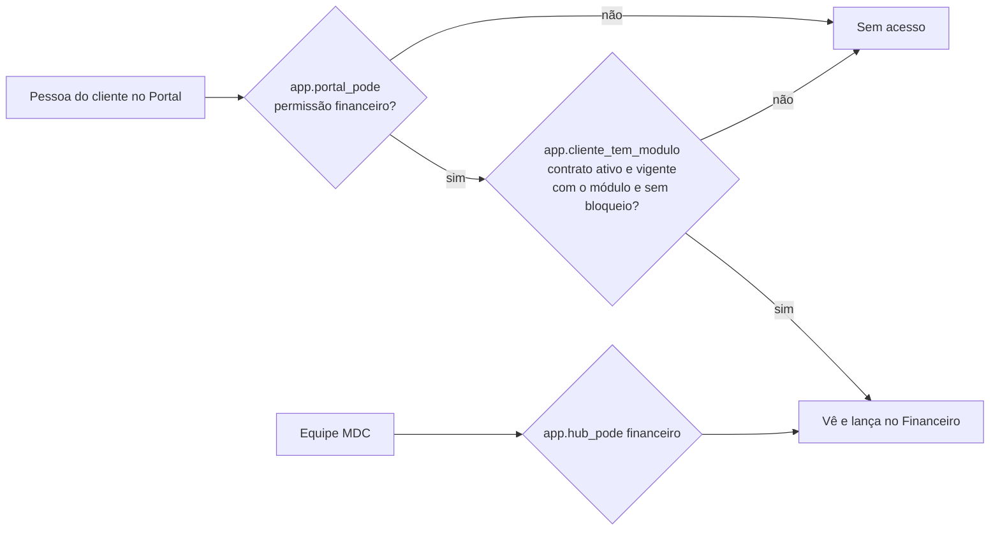
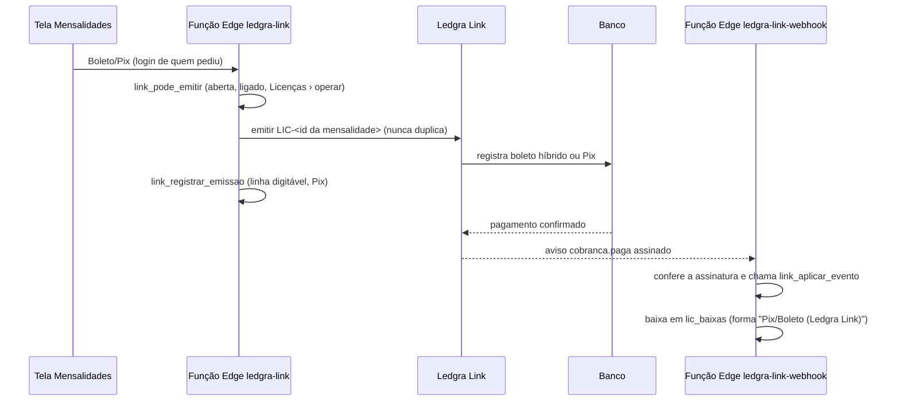

# Módulo Sistemas (antigo Licenças / Cobrança Ledgra)

> **Desde 18/11/2026 (migração 088) o módulo `licencas` aparece como "Sistemas":** licença por sistema da MDC (Ledgra ERP,
> EXato e os próximos), usuários incluídos e a mais, chave por sistema, cobrança pela mensalidade da licença ou pela
> fatura de um contrato a receber da Gestão, e a Receita por sistema no mesmo menu. Detalhes na seção "Sistemas (088)"
> no fim. Os avisos abaixo contam a história do módulo.

> **Desligado desde 05/11/2026 (migração 060):** o Ledgra cuida dos clientes dele e tem a própria cobrança. No HUB fica
> só o controle das licenças vendidas, em **Contratos › Receita por sistema** (059). A ferramenta `licencas` está com
> status `desligado` em `hub_apps` (fora do menu; o cartão do Ledgra Link em Configurações também some). Nada foi
> apagado: tabelas `lic_*` e `link_*`, telas e regras continuam; para religar, volte o status para `ativo`.

> **Mudança de 02/11/2026 (migração 040):** o HUB deixou de vender módulos aos clientes. O produto para os clientes é o
> **Ledgra**, desenvolvido do zero, à parte. Este módulo virou a **Cobrança Ledgra**, no grupo Gestão do menu: os
> "produtos" e "planos" passam a ser os do Ledgra (cadastre em Produtos e planos), e contratos, mensalidades, baixas e
> inadimplentes seguem iguais. Os módulos de gestão (Financeiro, Entradas, Saídas, Estoque, Centros de custo, Plano de
> contas, Relatórios) continuam ligados, só para a gestão da própria MDC (financeiro, notas de entrada e de saída). Os
> produtos antigos (módulos do HUB) foram inativados; o Financeiro saiu da lista de permissões do Portal. O texto
> abaixo é a descrição original, de quando o módulo vendia os módulos do HUB.

> **Resumo:** onde a MDC controla a venda dos módulos do HUB aos clientes (licença mensal): módulos e planos com preço
> de tabela, contratos por cliente, mensalidades geradas sozinhas todo dia, baixa manual, inadimplência por faixa de
> atraso, bloqueio manual e o relatório "Faturamento do mês" para acrescentar ao honorário. Bloqueado = o cliente não
> acessa os módulos pagos no Portal; os dados ficam guardados e a equipe MDC continua acessando. Migração 031.

## 1. Decisões do Edvaldo (01/11/2026)

- A licença é cobrada **junto com o honorário**: o HUB controla contratos, valores, vencimentos e atrasos; o boleto/Pix
  é o que a MDC já usa; a **baixa é manual**.
- Inadimplência: o HUB **lista e avisa** (sino); o **bloqueio é manual** (a MDC decide quem bloquear).
- Módulos separados, cada um vendável e liberável por cliente (modelo Conta Azul/Omie): `financeiro`, `entradas`,
  `saidas`, `estoque`, `centros_custo`, `plano_contas`, `relatorios`, e o plano **Gestão completa** com todos. Começam
  com preço zero: a MDC define em Produtos e planos.

> **Tabelas de preço (15/11/2026, pedido do Edvaldo).** Em Produtos e planos, quem tem o nível gerir digita direto
> na tela: aba **Produtos** = o preço mensal de cada produto na própria linha ("Salvar preços" grava só o que mudou);
> aba **Planos (pacotes)** = quadro produto × pacote (marcar com X), "Avulsos somariam", preço do pacote, desconto e o
> atalho "calcular o preço com X% de desconto" ("Salvar pacotes"). Ledgra e HUB em separado. Peças em
> `dominios/licencas/componentes/TabelasPrecos.tsx`, regras com teste em `dominios/licencas/precos.ts`; grava pelas
> mesmas `lic_salvar_produto` / `lic_salvar_plano`. Nome, descrição e "à venda" continuam na janela (Novo/Editar).
> No Novo contrato, a busca que deixa um cliente só já o escolhe (antes ele aparecia marcado e a tela dizia "Escolha o cliente").

## 2. Telas (ferramenta `licencas`, só equipe)

| Endereço | Nível | O que faz |
| --- | --- | --- |
| `/licencas` | ver (gerar mensalidades: operar) | Painel: receita mensal recorrente, a receber no mês, recebido no mês, em atraso, clientes bloqueados, inadimplência por faixa (1-15, 16-30, 31-60, 61-90, 90+ dias), gráfico faturado × recebido dos últimos 6 meses, reajustes a fazer; PDF e Excel do resumo |
| `/licencas/cobrancas` | ver (baixa, desfazer, cancelar e gerar: operar) | Mensalidades: filtros por mês, situação e cliente (busca em "Mais filtros"); indicadores que filtram ao clicar; dar baixa (data, forma, juros, desconto), desfazer baixa e cancelar com motivo; PDF e Excel |
| `/licencas/inadimplentes` | ver (bloquear e regra de dias: gerir) | Clientes com mensalidade vencida, do maior atraso para o menor; "Copiar mensagem de cobrança" (WhatsApp, começa com bom dia/boa tarde/boa noite pela hora da organização); bloquear/desbloquear com motivo; "Sugerido bloquear" a partir de N dias; bloqueados sem atraso; histórico de bloqueios; PDF e Excel |
| `/licencas/contratos` | ver (cadastrar, editar, reajustar, encerrar: gerir) | Contratos com módulos de cada cliente, valor, vencimento, vigência e reajuste; assistente em 5 passos; histórico (reajustes, encerramento, mensalidades); `?cliente=<id>` abre filtrado; PDF e Excel |
| `/licencas/faturamento` | ver | Faturamento do mês: por cliente, mensalidade do mês em aberto + atrasados de meses anteriores = o que acrescentar ao honorário; PDF (timbrado) e Excel com código do Domínio e CNPJ |
| `/licencas/produtos` | ver (cadastrar: gerir) | Abas Sistemas e Módulos (código fixo, preço de tabela, à venda); PDF e Excel |
| `/licencas/pacotes` | ver (montar: gerir) | Pacotes de licença: sistema, módulos, preço, usuários incluídos, usuário a mais e excedente; cartões ou grade; PDF e Excel |

Integrações: o cadastro do cliente (Configurações › Clientes, ao abrir os responsáveis) mostra os módulos contratados,
o valor mensal e se está bloqueado (`ModulosDoCliente`); o Portal do Cliente mostra um aviso amigável quando o cliente
está bloqueado (`AvisoBloqueioPortal`), sem o motivo, com telefone e atalho para o chat.

Código: regras puras em `web/src/dominios/licencas/regras.ts` e `mensagem.ts` (testes em `regras.test.ts`), leituras em
`leituras.ts`, gravações em `repositorio.ts`, componentes em `componentes/` (`Base`, `AssistenteContrato`,
`JanelasContrato`, `BaixaCobranca`, `GraficoMeses`, `ModulosDoCliente`, `AvisoPortal`), telas em `web/src/app/(hub)/licencas/`.

## 3. Regras

| Regra | Onde |
| --- | --- |
| Mensalidade do mês M vence no dia do contrato no próprio mês M (31 vira o último dia do mês) | `app.lic_vencimento`, `regras.vencimentoDaCompetencia` |
| Valor do mês: cheio; com "proporcional", só os dias cobertos no mês de início ou de fim | `app.lic_valor_mes`, `regras.valorDoMes` |
| Uma mensalidade por contrato e mês (`unique (contrato_id, competencia)`): gerar de novo não duplica; mensalidade cancelada não volta | `app.lic_gerar` |
| Ao salvar um contrato que já vale, a mensalidade do mês atual é gerada na hora | `lic_salvar_contrato` |
| Um módulo não pode estar em dois contratos ativos do mesmo cliente | `lic_salvar_contrato` |
| O contrato guarda a própria cópia dos módulos; mudar o plano depois não muda contratos já fechados | `lic_contrato_produtos` |
| Valor e reajuste novos valem para as mensalidades geradas depois; as já geradas não mudam | `lic_salvar_contrato`, `lic_reajustar_contrato` |
| Reajuste: percentual informado pela MDC (índice de 12 meses), de −50% a 100%; histórico em `lic_reajustes`. O painel lembra quando o mês do reajuste chega e o contrato completou 12 meses | `lic_reajustar_contrato`, `regras.reajustePendente` |
| Encerrar: data e motivo; mensalidades em aberto de meses depois são canceladas; o mês do encerramento continua cobrado | `lic_encerrar_contrato` |
| Contrato com fim no passado é encerrado sozinho ("Fim do prazo do contrato") | `app.lic_rotina_diaria` |
| Baixa sempre do valor inteiro; total recebido = valor + juros − desconto; data não pode ser futura | `lic_baixar_cobranca` |
| Desfazer baixa e cancelar exigem motivo; a baixa desfeita fica marcada (não some) | `lic_desfazer_baixa`, `lic_cancelar_cobranca` |
| Faixas de atraso: 1-15, 16-30, 31-60, 61-90, mais de 90 dias, pelo vencimento | `regras.faixaDoAtraso` |
| Bloqueio manual com motivo; desbloqueio também com motivo; uma linha por bloqueio (histórico) | `lic_bloquear`, `lic_desbloquear`, `lic_bloqueios` |
| Nada se apaga: as tabelas `lic_*` só têm leitura pela API; tudo grava pelas funções, que registram em `hub_auditoria` | RLS + funções |

## 4. Acesso do cliente (regra nova)

- `app.cliente_tem_modulo(cliente, módulo)`: contrato **ativo** e **vigente hoje** (início ≤ hoje ≤ fim) com o módulo e
  cliente **sem bloqueio** em aberto. Aceita os slugs dos módulos (`financeiro`, `entradas`, `saidas`, `estoque`,
  `centros_custo`, `plano_contas`, `relatorios`). Pode ser usada direto nas políticas (tem `grant` para `authenticated`).
- `app.cliente_bloqueado(cliente)`: bloqueio manual em aberto.
- `app.fin_pode` (028) passou a exigir `cliente_tem_modulo(cliente, 'financeiro')` no lado do Portal; as políticas de
  Portal de `fin_contas_bancarias` e `fin_plano_contas` também. A equipe não é afetada. As tabelas de estoque (`est_*`)
  usam `fin_pode`, então hoje seguem o contrato do Financeiro; a separação por módulo fica para a integração.
- `portal_licenca_situacao(cliente)`: `{bloqueado, modulos}` para o Portal (sem o motivo do bloqueio).

## 5. Banco (migração 031)

`lic_produtos`, `lic_planos`, `lic_plano_produtos`, `lic_contratos`, `lic_contrato_produtos`, `lic_cobrancas`,
`lic_baixas`, `lic_reajustes`, `lic_bloqueios`, `lic_parametros`. Leitura com `app.hub_pode(org, 'licencas', 'ver')`;
gravação só pelas funções `lic_salvar_produto`, `lic_salvar_plano` (gerir), `lic_salvar_contrato`,
`lic_encerrar_contrato`, `lic_reajustar_contrato` (gerir), `lic_gerar_cobrancas`, `lic_baixar_cobranca`,
`lic_desfazer_baixa`, `lic_cancelar_cobranca` (operar), `lic_bloquear`, `lic_desbloquear`, `lic_definir_parametros`
(gerir). Módulos e plano iniciais por organização em `app.lic_semear` (também ao criar organização nova).

Rotina diária `licencas-diaria` (pg_cron, 06h25): encerra contratos vencidos, gera as mensalidades do mês e, uma vez por
dia, avisa no sino (administradores e quem tem a ferramenta Licenças) das mensalidades que venceram ontem e dos
clientes que chegaram aos dias de atraso em que o HUB sugere bloquear.

Testes: `supabase/testes/40_licencas.sql` (geração idempotente, proporcional, baixa, desfazer, cancelar, inadimplência,
bloqueio e o efeito no `fin_pode` do Portal, encerramento, reajuste, rotina diária) e `regras.test.ts`.

## 6. Limitações e próximos passos

- Baixa manual quando o Ledgra Link está desligado (com ele ligado, a baixa é automática: seção 7).
- Valor do índice de reajuste digitado pela MDC (sem consulta automática ao IBGE/FGV).
- A ferramenta `licencas` não entrou nos perfis prontos: só administradores e quem receber a ferramenta veem a receita.
- Módulos do Portal ainda sem tela própria do cliente: o aviso de bloqueio aparece no topo do Portal.

## 7. Boleto e Pix pelo Ledgra Link (migração 043)

O **Ledgra Link by MDC Assessoria** é o add-on de conexão bancária da MDC (repositório `ledgra-link`): fala com os bancos,
guarda os certificados e avisa os sistemas por eventos assinados. A Cobrança Ledgra é o primeiro uso no HUB.

| Onde | O que faz |
| --- | --- |
| Configurações › Integrações › Ledgra Link | Liga/desliga, conta da MDC no Ledgra Link, tipo (boleto com Pix, só Pix com vencimento, só boleto), multa (até 2%), juros ao mês (até 10%), dias aceitos após vencer; "Testar conexão" |
| Cobrança Ledgra › Mensalidades | Mensalidade em aberto ganha **Boleto/Pix** (ou **Ver boleto/Pix**); a janela mostra o Pix copia e cola e a linha digitável, copiar e "Enviar pelo WhatsApp" (mensagem começa com bom dia/boa tarde/boa noite); selo com a situação no banco |

Regras:

| Regra | Onde |
| --- | --- |
| Emite só mensalidade em aberto, com o Ledgra Link ligado e permissão Licenças › operar (conferido com o login de quem pediu) | `link_pode_emitir` |
| A referência no Ledgra Link é `LIC-<id da mensalidade>`: repetir o pedido nunca gera dois boletos | Função `ledgra-link` |
| Mensalidade já vencida: o boleto/Pix sai com vencimento em 3 dias (o banco não registra vencimento no passado) e a janela avisa | Função `ledgra-link` |
| Boleto válido não é trocado; só emite de novo se o anterior foi recusado, cancelado, baixado ou venceu no banco | `link_registrar_emissao` |
| Cada aviso do Ledgra Link é aplicado uma vez só (id do evento); o mesmo aviso repetido devolve "repetido" | `link_aplicar_evento`, `link_eventos` |
| Pago o valor ou mais: baixa automática (o que passar do valor entra como juros); pago a menor: **não baixa**, fica "Pago a menor: revisar" | `link_aplicar_evento` |
| Já baixada à mão antes do aviso: não baixa de novo ("ja_baixada"); a trava `lic_baixas_uma_valida` garante uma baixa válida por mensalidade | `link_aplicar_evento` |
| A baixa automática é uma baixa comum: aparece nos relatórios e pode ser desfeita pela tela, com motivo | `lic_desfazer_baixa` |
| A tela só lê as tabelas `link_*`; quem grava são as funções (as de servidor só com `service_role`) | RLS + grants |

Testes: `supabase/testes/99_ledgra_link_043.sql` (permissão, emissão, aviso repetido, pago a menor, já baixada, cobrança
desconhecida, desfazer, tela sem gravar direto) e `web/src/dominios/licencas/ledgraLink.test.ts` (mensagem do WhatsApp).

## Licença do ERP Ledgra (migração 067)

- **Módulos do Ledgra** entram em Produtos e planos sozinhos (`lic_produtos.sistema = 'ledgra'`: Financeiro, Compras,
  Vendas, Estoque, Produção, Ledgra Auditor, Ledgra Legislação e Ledgra XML; preço zero até a MDC definir). Toda
  organização nova recebe a lista. Desde a 072 a **Legislação** (pesquisa, biblioteca, NCM/TIPI, tabelas de ICMS,
  códigos e consultas) é vendida sozinha (`ledgra-legislacao`); o **Auditor** (SPED, conferência, créditos e agenda)
  já traz a Legislação junto, então não precisa contratar os dois. Desde a 083 o **Ledgra Ponto** (`ledgra-ponto`:
  registro de ponto REP-P da Portaria 671 — celular, navegador ou quiosque, comprovante e arquivo AFD) também é vendido
  sozinho, sem o Departamento Pessoal do Ledgra; o contrato full já o recebe. Desde a 084 o **Ledgra DP** (`ledgra-dp`)
  libera o Departamento Pessoal operado pela própria empresa (sem a MDC). Desde a 087 o **Ledgra Jurídico**
  (`ledgra-juridico`: processos, prazos, valores e provisões pelo CPC 25) é um adicional próprio; o contrato full já o recebe.
- **Modalidade do contrato** (`lic_contratos.modalidade`): **gratuita** (valor zero, a MDC escolhe os módulos),
  **pacote** (plano ou módulos com valor) e **full** ("Ledgra full" no assistente: todos os módulos ativos do Ledgra,
  inclusive os criados depois).
- **Chave do Ledgra**: no contrato, Ações › Chave do Ledgra. Gera `LDG-` + 6 grupos de 5 (o texto aparece uma vez; o
  banco guarda só o hash), mostra a última conferência do Ledgra e revoga com motivo. Gerar outra revoga a anterior.
- **Conferência**: o Ledgra chama `lic_ledgra_validar(chave, cnpj)` ao salvar a chave e todo dia às 6h30. Devolve
  ativa, bloqueada (cliente em Inadimplentes), sem_contrato, cnpj_diferente ou inválida, com os módulos liberados.
  Sem resposta do HUB, o Ledgra mantém a última licença boa por 7 dias.

## Licenças Ledgra: cadastro aberto, valores guardados (migração 074, 13/11/2026)
- O módulo voltou ao menu como **Licenças Ledgra**, só com **Licenças** e **Produtos e planos**. A cobrança mensal fica em
  Gestão › Contratos (decisão de 05/11); `/licencas` abre direto a lista de licenças.
- Níveis da permissão `licencas`: **ver** = licenças sem nenhum valor; **operar** = cadastra/altera a licença e gera ou
  revoga a chave do Ledgra; **gerir** = valores (preços, valor do contrato, reajuste, mensalidades, encerrar).
- Proteção no banco: as colunas de preço/valor de `lic_produtos`, `lic_planos` e `lic_contratos` não são legíveis pelo
  navegador; voltam só pela `lic_valores(org)` (gerir). `lic_cobrancas`, `lic_baixas` e `lic_reajustes` só com gerir.
  Quem opera sem gerir cadastra pelo preço de tabela; na alteração o valor atual é mantido.
- Ligação com o Ledgra pelo CNPJ: o servidor do Ledgra chama a Função `hub-integracao` (ação `vincular_cnpj`, com o
  código do Ledgra; migração 092) e ela chama `lic_ledgra_vincular_cnpj(cnpj)`, que devolve uma chave nova da licença
  ativa daquele CNPJ (botão "Buscar no HUB" na aba Licença da empresa no Ledgra). Até a 092 o Ledgra fazia essa chamada
  com a chave de serviço do HUB (auditoria 19/11/2026, SEG-01).

## Contrato de licença do Ledgra e do HUB (migração 085, 15/11/2026)

**Para quê.** Cada licença vendida tem o seu contrato escrito, no papel timbrado da MDC, gerado pelo HUB com os dados
da licença. Um contrato por licença (decisão do Edvaldo): quem compra Ledgra e Portal do HUB em licenças separadas
recebe um contrato de cada.

**Modelo das cláusulas** (Licenças › Modelo do contrato, `/licencas/modelo`, só com a permissão de valores). Texto em
markdown simples (`#` título, `##` cláusula, `-` item, `**negrito**`) com variáveis `{{assim}}` (lista na própria tela e
em `dominios/licencas/contratoLicenca.ts`, `VARIAVEIS`). Sem modelo gravado vale o **modelo-padrão do HUB**
(`MODELO_PADRAO`), feito sobre: Lei 9.609/1998 (uso de software por contrato de licença, art. 9º; validade técnica,
arts. 7º e 8º), LGPD (MDC como operadora, art. 39; segurança, art. 46; o cliente, controlador, comunica o incidente,
art. 48) e MP 2.200-2/2001, art. 10, § 2º (assinatura eletrônica aceita pelas partes). **Recomenda-se a revisão do
advogado da MDC antes do primeiro uso.** Cada gravação vira versão nova (`lic_contrato_modelo_versoes`, com "Usar este
texto"); contratos já emitidos não mudam. "Ver exemplo (PDF)" mostra o modelo preenchido com dados fictícios.

**Emitir** (Licenças › Ações › Contrato (PDF e assinatura)). Informa quem assina pelo cliente (nome completo e CPF
válido; cargo e e-mail opcionais) e escolhe **como assina**:
- **Pelo link (eletrônica)**: "Gerar link de assinatura" (vale 15 dias; aparece uma vez, com Copiar e "Enviar pelo
  WhatsApp" com saudação pela hora). O cliente abre `/assinar/<código>` sem login, lê o contrato, informa nome e CPF
  (precisa ser o CPF indicado; 10 tentativas erradas travam o link) e marca "Li e concordo". O banco grava nome, CPF,
  data e hora, IP e navegador. Gerar de novo invalida o link anterior.
- **Em papel (ou outro meio)**: baixa o PDF, colhe a assinatura e depois "Registrar assinatura" com a data (não pode ser
  futura nem antes da emissão) e uma observação.

"Ver minuta (PDF)" sai com a marca d'água MINUTA. Ao emitir, o banco numera (**LIC-AAAA/NNNN**, sem repetir), troca o
`{{numero}}`, recusa texto com variável sobrando e guarda a fotografia do texto com o **código de integridade
SHA-256**. O PDF assinado ganha no fim o "Registro da assinatura" (quem, quando, IP, navegador e o código). A lista de
licenças mostra a etiqueta do contrato (número e situação: falta assinar, link enviado, assinado).

**Depois de assinado (086).** Quando o cliente assina pelo link, quem emitiu o contrato e os administradores recebem o
aviso no sino ("Contrato assinado: LIC-…"). No contrato em papel, "Registrar assinatura" aceita o arquivo assinado
(PDF ou foto, até 15 MB) e, depois, "Anexar contrato assinado" / "Trocar arquivo assinado"; "Ver contrato assinado"
abre o arquivo. Os arquivos ficam na pasta `licencas-contrato` do Storage, que só quem tem a permissão de valores lê ou
grava (`app.arquivo_pode`). Ao cadastrar uma licença nova, a lista pergunta "Quer emitir agora o contrato?" (botão
"Emitir contrato", só para quem tem a permissão de valores).

**Enviar o link e acompanhar.** Junto do link aparecem "Copiar link", "Enviar pelo WhatsApp" e "Enviar por e-mail".
O e-mail abre no programa de e-mail de quem está no HUB, já com o destinatário (o e-mail de quem assina), o assunto e o
texto com o link e a validade (`emailAssinatura`), porque o HUB ainda não envia e-mail sozinho: faltam os segredos
`GRAPH_*` do Microsoft 365 (docs/07, seção 7.7); quando forem cadastrados, dá para trocar pelo envio automático. Na
lista de licenças, quem tem a permissão de valores filtra por **Contrato** (Sem contrato, Falta assinar, Assinado) e o
Excel/PDF ganha a coluna Contrato (`noFiltroContrato`, `textoContratoLista`, com teste).

**Cancelar** com motivo (mínimo 5 letras): o contrato fica guardado como cancelado, o link para de funcionar e a licença
pode receber um contrato novo. Nada se apaga.

**Quem pode.** O texto traz o preço, então ver, emitir, gerar link, registrar e cancelar exigem a **permissão de
valores** (`licencas` › gerir), a mesma dos valores das licenças (074). Quem só opera não vê os contratos emitidos.

**Banco (085).** Tabelas `lic_contrato_modelo`, `lic_contrato_modelo_versoes` e `lic_contrato_documentos` (um ativo por
licença; o hash do link não sai pela API). Funções: `lic_contrato_modelo_salvar`, `lic_documento_emitir`,
`lic_documento_link`, `lic_documento_assinatura_registrar`, `lic_documento_cancelar` (equipe) e, sem login,
`lic_assinatura_abrir` / `lic_assinatura_aceitar` (pelo código do link). Testes: `supabase/testes/155_base_085.sql` e
`156_contrato_085.sql`, e `157_assinado_086.sql` para a 086 (`lic_documento_anexar`, arquivo e aviso), dentro do `rodar.sh`. Código: `dominios/licencas/contratoLicenca.ts` (texto e regras, com
teste), `documentos.ts` (leituras, gravações e PDF), `componentes/JanelaContratoLicenca.tsx`, `TextoContrato.tsx`,
`app/(hub)/licencas/modelo` e `app/assinar/[token]`.

## Sistemas (migração 088, 18/11/2026)

Decisão do Edvaldo: a EXRH, a TEAM Brasil e as próximas são **clientes** dos sistemas da MDC. O HUB cadastra o cliente,
define qual sistema ele usa e emite a chave; a cobrança vem para a gestão MDC. Preço: valor base com usuários incluídos
+ valor por usuário a mais (a mesma estrutura aceita só fixo ou só por usuário).

- **`lic_sistemas`** (slug, nome, prefixo da chave de 3 letras, situação `vendendo` / `em_breve` / `desligado`). Semeados:
  HUB-MDC, Ledgra ERP, EXato (vendendo), Hub-Team e Acesso remoto (em breve). Grava só `lic_sistema_salvar` (gerir).
  Tela: Sistemas › Sistemas e produtos › aba Sistemas.
- **Módulos por sistema**: `lic_produtos.sistema` aponta para `lic_sistemas`; o código do módulo começa com o do sistema
  (`exato-rs`) e na chave vai sem o prefixo (`rs`). EXato semeado com 12 módulos (diaristas, operacao, transporte,
  auditoria, rs, crm, contratos, faturamento, financeiro, compras, estoque, juridico) e, desde a 098, o add-on
  `exato-pagamento_planilha` (Pagamento de diárias por planilha: carga do Excel, cadastro do PIX, lote nomeado, dobras
  aprovadas por outra pessoa e remessa CNAB 240; precisa do Financeiro; EXato 083).
- **Licença**: `lic_contratos.sistema` (um contrato ativo por cliente e sistema; não muda), `usuarios_incluidos` (vazio =
  sem limite), `valor_usuario_adicional` (só com gerir, volta pela `lic_valores`), `excedente` (`cobrar` | `bloquear`) e
  `recorrente_id` (contrato a receber da empresa da gestão que fatura a licença; ao ligar, o contrato ganha o
  `sistema_id` da Gestão com o mesmo nome — Receita por sistema). Full = todos os módulos ativos do sistema.
- **Chave por sistema**: `lic_ledgra_chaves.sistema` (nome antigo mantido; uma ativa por cliente e sistema), prefixo do
  sistema (`LDG-…`, `EXA-…`). `lic_chave_gerar(cliente, sistema)` (operar), `lic_validar(sistema, chave, cnpj)` (anon; a
  chave é o segredo) devolve situação, módulos, `usuarios_incluidos` e `excedente`; `lic_vincular_cnpj(sistema, cnpj)`
  só service_role. As funções do Ledgra (`lic_ledgra_validar`, `lic_ledgra_chave_gerar`, `lic_ledgra_vincular_cnpj`)
  continuam e chamam as novas.
- **Uso**: `lic_uso_informar(sistema, chave, cnpj, usuarios)` (anon, com a chave) guarda em `lic_usos` o MAIOR número
  do mês. `app.lic_adicional(contrato, mês)` = (usuários − incluídos) × valor, só com excedente `cobrar`.
- **Cobrança do mês seguinte**: sem contrato a receber → `app.lic_gerar` soma o adicional na mensalidade
  (`lic_cobrancas.usuarios_adicionais/valor_adicionais`, texto "+ N usuário(s) adicional(is) de MM/AAAA"); com contrato a
  receber → a mensalidade da licença não é gerada e `app.fin_recorrente_lancar_mes` soma o adicional na conta e na fatura.
- **Telas**: menu Sistemas (Licenças, Sistemas e produtos, Receita por sistema — saiu de Contratos; `/contratos/sistemas`
  redireciona —, Modelo do contrato). Assistente da licença: sistema → módulos → valor e usuários ("Quando passar do
  limite": Liberar e cobrar / Não deixar passar) e "Como cobrar". Janela da chave genérica (`JanelaChave`). Regras puras
  em `regras.ts` (`textoUsuarios`, `usuariosAdicionais`, `valorAdicional`, `ondeColarChave`).
- **Testes**: `supabase/testes/159_base_088.sql` + `160_sistemas_088.sql` (no fim do `rodar.sh`, depois de aplicar a
  licença do Ledgra 067 a 087).
- **Próximo**: o EXato (e depois o Ledgra) cria a conta do cliente ligada à chave, chama `lic_validar` e informa os
  usuários por `lic_uso_informar`.

## Pacotes de licença (091, 19/11/2026, pedido do Edvaldo)

- O plano virou o **pacote** completo: `lic_planos` ganha `sistema` (FK para `lic_sistemas`; todos os módulos do pacote
  são dele), `usuarios_incluidos` (vazio = sem limite; qualquer número a partir de 1), `valor_usuario_adicional` (só gerir;
  volta pela `lic_valores` em `planos_adicional`) e `excedente` (`cobrar` | `bloquear`). Pacotes antigos receberam o
  sistema dos módulos.
- `lic_salvar_plano` (gerir) grava tudo; recusa módulo de outro sistema e troca de sistema de pacote já usado em licença.
- A licença **não** depende do pacote depois de fechada: ao escolher o pacote no assistente, usuários, adicional (com
  gerir) e excedente vêm preenchidos (`herancaDoPacote`) e a licença guarda a própria cópia.
- Tela própria **Sistemas › Pacotes de licença** (`/licencas/pacotes`): cartões por pacote (sistema, módulos, usuários,
  excedente, preço e desconto sobre os avulsos, licenças ativas), filtros (sistema, situação, busca), PDF/Excel e a vista
  **Grade módulo × pacote** (`QuadroPacotes`). Montagem na `JanelaPacote` (sistema → módulos → usuários → preço →
  exemplo de mensalidade). A aba Planos saiu de Sistemas e produtos. Regras puras em `pacotes.ts` (com teste).
- Testes: `supabase/testes/161_pacotes_091.sql`.

## Empresas que usam o sistema (migração 095, 19/11/2026)

A licença é de um cliente (o CNPJ que confere a chave), mas um sistema como o EXato atende o grupo inteiro (EXRH, TEAM
Leasing, ACB…). Em **Sistemas › Licenças › Ações › Empresas no &lt;sistema&gt;** a MDC marca, entre os clientes ativos, as
empresas do grupo que usam aquele sistema (`JanelaEmpresasLicenca`, atalho "Marcar as filiais do mesmo CNPJ").

- **`lic_contrato_empresas`** (contrato, cliente, org): só leitura pela API (`licencas › ver`); grava só
  **`lic_contrato_empresas_definir(contrato, clientes[])`** (`licencas › operar`, licença ativa, clientes ativos da mesma
  organização; troca a lista inteira; o cliente da licença não entra porque já vale sempre).
- **`lic_empresas(sistema, chave, cnpj)`** (anon, como `lic_validar`): o servidor do sistema manda a chave da licença e o
  CNPJ; chave e CNPJ conferidos, cliente não bloqueado e licença ativa → `{situacao: 'ativa', empresas: [...]}` com o
  cliente da licença primeiro e as marcadas, só razão, fantasia, CNPJ (só números), regime, cidade, UF e código do
  Domínio. Sem chave válida: `invalida`, `cnpj_diferente`, `bloqueada` ou `sem_contrato`, sem empresas.
- Uso: EXato › Administração › Empresas e marcas › Nova empresa › **Trazer do HUB** (preenche o CNPJ da matriz e consulta
  a Receita). Testes: `supabase/testes/166_empresas_095.sql`.

### Módulos de cada empresa (migração 096, 20/11/2026)

Fluxo do Edvaldo: o HUB é a origem. Cadastra a empresa (CNPJ + Receita), a licença diz o sistema, o pacote e os usuários
(um total para o grupo), a 095 diz as empresas e aqui, se quiser, os módulos de cada uma (na mesma janela, "Todos os
módulos" / "N de M módulos").

- `lic_contrato_empresa_modulos` (contrato, cliente, modulos[]): sem linha = todo o pacote; grava só
  `lic_contrato_empresa_modulos_definir(contrato, cliente, modulos[])` (operar; empresa da licença; módulos dentro do
  pacote; vazio ou pacote inteiro apaga a linha). Tirar a empresa da licença (095) apaga a escolha dela.
- `app.lic_modulos_do_contrato(contrato)` = mesma regra do `lic_validar`; `lic_contrato_modulos(contrato)` dá o pacote com
  o nome para a tela.
- `lic_empresas` passa a devolver `modulos` (pacote), `usuarios_incluidos` e, em cada empresa, `modulos` (null = todos).
- O EXato (082) busca isso uma vez por dia e pelo botão "Buscar no HUB agora": cria a empresa "A concluir" com a matriz e
  as filiais e aplica os módulos em "Módulos por empresa". Testes: `supabase/testes/167_modulos_096.sql`.
