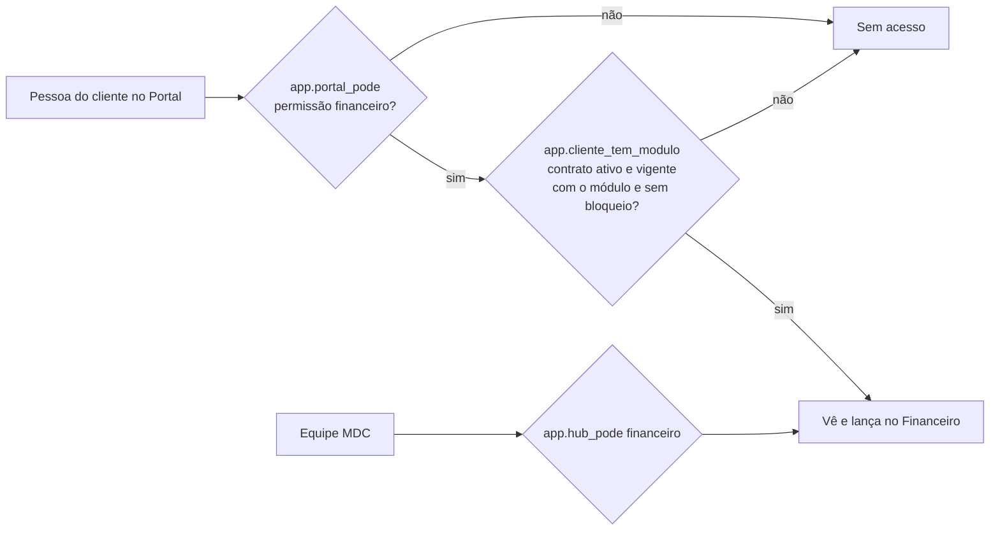

# Módulo Licenças

> **Resumo:** onde a MDC controla a venda dos módulos do HUB aos clientes (licença mensal): módulos e planos com preço
> de tabela, contratos por cliente, mensalidades geradas sozinhas todo dia, baixa manual, inadimplência por faixa de
> atraso, bloqueio manual e o relatório "Faturamento do mês" para acrescentar ao honorário. Bloqueado = o cliente não
> acessa os módulos pagos no Portal; os dados ficam guardados e a equipe MDC continua acessando. Migração 031.

## 1. Decisões do Edvaldo (01/11/2026)

- A licença é cobrada **junto com o honorário**: o HUB controla contratos, valores, vencimentos e atrasos; o boleto/Pix
  é o que a MDC já usa; a **baixa é manual**.
- Inadimplência: o HUB **lista e avisa** (sino); o **bloqueio é manual** (a MDC decide quem bloquear).
- Módulos separados, cada um vendável e liberável por cliente (modelo Conta Azul/Omie): `financeiro`, `entradas`,
  `saidas`, `estoque`, `centros_custo`, `plano_contas`, `relatorios`, e o plano **Gestão completa** com todos. Começam
  com preço zero: a MDC define em Produtos e planos.

## 2. Telas (ferramenta `licencas`, só equipe)

| Endereço | Nível | O que faz |
| --- | --- | --- |
| `/licencas` | ver (gerar mensalidades: operar) | Painel: receita mensal recorrente, a receber no mês, recebido no mês, em atraso, clientes bloqueados, inadimplência por faixa (1-15, 16-30, 31-60, 61-90, 90+ dias), gráfico faturado × recebido dos últimos 6 meses, reajustes a fazer; PDF e Excel do resumo |
| `/licencas/cobrancas` | ver (baixa, desfazer, cancelar e gerar: operar) | Mensalidades: filtros por mês, situação e cliente (busca em "Mais filtros"); indicadores que filtram ao clicar; dar baixa (data, forma, juros, desconto), desfazer baixa e cancelar com motivo; PDF e Excel |
| `/licencas/inadimplentes` | ver (bloquear e regra de dias: gerir) | Clientes com mensalidade vencida, do maior atraso para o menor; "Copiar mensagem de cobrança" (WhatsApp, começa com bom dia/boa tarde/boa noite pela hora da organização); bloquear/desbloquear com motivo; "Sugerido bloquear" a partir de N dias; bloqueados sem atraso; histórico de bloqueios; PDF e Excel |
| `/licencas/contratos` | ver (cadastrar, editar, reajustar, encerrar: gerir) | Contratos com módulos de cada cliente, valor, vencimento, vigência e reajuste; assistente em 5 passos; histórico (reajustes, encerramento, mensalidades); `?cliente=<id>` abre filtrado; PDF e Excel |
| `/licencas/faturamento` | ver | Faturamento do mês: por cliente, mensalidade do mês em aberto + atrasados de meses anteriores = o que acrescentar ao honorário; PDF (timbrado) e Excel com código do Domínio e CNPJ |
| `/licencas/produtos` | ver (cadastrar: gerir) | Abas Módulos (código fixo, preço de tabela, à venda) e Planos (módulos, preço, economia sobre os avulsos); PDF e Excel |

Integrações: o cadastro do cliente (Configurações › Clientes, ao abrir os responsáveis) mostra os módulos contratados,
o valor mensal e se está bloqueado (`ModulosDoCliente`); o Portal do Cliente mostra um aviso amigável quando o cliente
está bloqueado (`AvisoBloqueioPortal`), sem o motivo, com telefone e atalho para o chat.

Código: regras puras em `web/src/dominios/licencas/regras.ts` e `mensagem.ts` (testes em `regras.test.ts`), leituras em
`leituras.ts`, gravações em `repositorio.ts`, componentes em `componentes/` (`Base`, `AssistenteContrato`,
`JanelasContrato`, `BaixaCobranca`, `GraficoMeses`, `ModulosDoCliente`, `AvisoPortal`), telas em `web/src/app/(hub)/licencas/`.

## 3. Regras

| Regra | Onde |
| --- | --- |
| Mensalidade do mês M vence no dia do contrato no próprio mês M (31 vira o último dia do mês) | `app.lic_vencimento`, `regras.vencimentoDaCompetencia` |
| Valor do mês: cheio; com "proporcional", só os dias cobertos no mês de início ou de fim | `app.lic_valor_mes`, `regras.valorDoMes` |
| Uma mensalidade por contrato e mês (`unique (contrato_id, competencia)`): gerar de novo não duplica; mensalidade cancelada não volta | `app.lic_gerar` |
| Ao salvar um contrato que já vale, a mensalidade do mês atual é gerada na hora | `lic_salvar_contrato` |
| Um módulo não pode estar em dois contratos ativos do mesmo cliente | `lic_salvar_contrato` |
| O contrato guarda a própria cópia dos módulos; mudar o plano depois não muda contratos já fechados | `lic_contrato_produtos` |
| Valor e reajuste novos valem para as mensalidades geradas depois; as já geradas não mudam | `lic_salvar_contrato`, `lic_reajustar_contrato` |
| Reajuste: percentual informado pela MDC (índice de 12 meses), de −50% a 100%; histórico em `lic_reajustes`. O painel lembra quando o mês do reajuste chega e o contrato completou 12 meses | `lic_reajustar_contrato`, `regras.reajustePendente` |
| Encerrar: data e motivo; mensalidades em aberto de meses depois são canceladas; o mês do encerramento continua cobrado | `lic_encerrar_contrato` |
| Contrato com fim no passado é encerrado sozinho ("Fim do prazo do contrato") | `app.lic_rotina_diaria` |
| Baixa sempre do valor inteiro; total recebido = valor + juros − desconto; data não pode ser futura | `lic_baixar_cobranca` |
| Desfazer baixa e cancelar exigem motivo; a baixa desfeita fica marcada (não some) | `lic_desfazer_baixa`, `lic_cancelar_cobranca` |
| Faixas de atraso: 1-15, 16-30, 31-60, 61-90, mais de 90 dias, pelo vencimento | `regras.faixaDoAtraso` |
| Bloqueio manual com motivo; desbloqueio também com motivo; uma linha por bloqueio (histórico) | `lic_bloquear`, `lic_desbloquear`, `lic_bloqueios` |
| Nada se apaga: as tabelas `lic_*` só têm leitura pela API; tudo grava pelas funções, que registram em `hub_auditoria` | RLS + funções |

## 4. Acesso do cliente (regra nova)

- `app.cliente_tem_modulo(cliente, módulo)`: contrato **ativo** e **vigente hoje** (início ≤ hoje ≤ fim) com o módulo e
  cliente **sem bloqueio** em aberto. Aceita os slugs dos módulos (`financeiro`, `entradas`, `saidas`, `estoque`,
  `centros_custo`, `plano_contas`, `relatorios`). Pode ser usada direto nas políticas (tem `grant` para `authenticated`).
- `app.cliente_bloqueado(cliente)`: bloqueio manual em aberto.
- `app.fin_pode` (028) passou a exigir `cliente_tem_modulo(cliente, 'financeiro')` no lado do Portal; as políticas de
  Portal de `fin_contas_bancarias` e `fin_plano_contas` também. A equipe não é afetada. As tabelas de estoque (`est_*`)
  usam `fin_pode`, então hoje seguem o contrato do Financeiro; a separação por módulo fica para a integração.
- `portal_licenca_situacao(cliente)`: `{bloqueado, modulos}` para o Portal (sem o motivo do bloqueio).

## 5. Banco (migração 031)

`lic_produtos`, `lic_planos`, `lic_plano_produtos`, `lic_contratos`, `lic_contrato_produtos`, `lic_cobrancas`,
`lic_baixas`, `lic_reajustes`, `lic_bloqueios`, `lic_parametros`. Leitura com `app.hub_pode(org, 'licencas', 'ver')`;
gravação só pelas funções `lic_salvar_produto`, `lic_salvar_plano` (gerir), `lic_salvar_contrato`,
`lic_encerrar_contrato`, `lic_reajustar_contrato` (gerir), `lic_gerar_cobrancas`, `lic_baixar_cobranca`,
`lic_desfazer_baixa`, `lic_cancelar_cobranca` (operar), `lic_bloquear`, `lic_desbloquear`, `lic_definir_parametros`
(gerir). Módulos e plano iniciais por organização em `app.lic_semear` (também ao criar organização nova).

Rotina diária `licencas-diaria` (pg_cron, 06h25): encerra contratos vencidos, gera as mensalidades do mês e, uma vez por
dia, avisa no sino (administradores e quem tem a ferramenta Licenças) das mensalidades que venceram ontem e dos
clientes que chegaram aos dias de atraso em que o HUB sugere bloquear.

Testes: `supabase/testes/40_licencas.sql` (geração idempotente, proporcional, baixa, desfazer, cancelar, inadimplência,
bloqueio e o efeito no `fin_pode` do Portal, encerramento, reajuste, rotina diária) e `regras.test.ts`.

## 6. Limitações e próximos passos

- Baixa manual (sem leitura do extrato da MDC nem boleto próprio).
- Valor do índice de reajuste digitado pela MDC (sem consulta automática ao IBGE/FGV).
- A ferramenta `licencas` não entrou nos perfis prontos: só administradores e quem receber a ferramenta veem a receita.
- Módulos do Portal ainda sem tela própria do cliente: o aviso de bloqueio aparece no topo do Portal.
