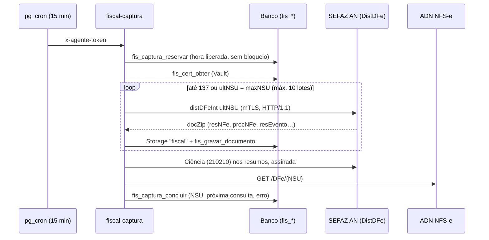

# Módulo Entradas — notas fiscais recebidas

> **"Notas fiscais" (migração 061, 05/11/2026):** a 059 tinha desligado este módulo; o Edvaldo não achou onde ver as
> notas emitidas contra o CNPJ da MDC, então ele voltou com o nome **Notas fiscais**, com as abas Notas recebidas,
> Lançar no Financeiro, Carga tributária e Certificado digital. Pedidos de compra fica fora (Estoque desligado). A tela
> de notas recebidas tem o botão "Emitir nota fiscal", que leva a Contratos › Faturas e notas fiscais.

> **Resumo:** com o certificado A1 (e-CNPJ) da empresa, o HUB busca sozinho as NF-e na SEFAZ (Distribuição DF-e do
> Ambiente Nacional) e as NFS-e no Ambiente de Dados Nacional (ADN), mostra cada nota em linguagem simples
> ("Aguardando sua resposta", "Prazo vencendo", "Confirmada"…), responde à SEFAZ (manifestação do destinatário, com
> protocolo) e lança a nota no modelo do Conta Azul: a pessoa escolhe o **tipo de entrada** e a regra decide estoque,
> conta a pagar e categoria. A tela de carga tributária mostra os impostos das compras e os créditos **estimados**
> conforme o regime da empresa. Frente 2 do Financeiro v2 (01/11/2026), migração `032_fiscal.sql`. Comunicador fiscal
> próprio nas Edge Functions (sem empresa emissora).

## 1. Telas (módulo Notas fiscais, rota `/entradas`: Saída e Entrada)

| Endereço | Quem usa | O que faz |
| --- | --- | --- |
| `/entradas` | Financeiro (ver; responder, enviar XML e buscar com operar) | **Notas recebidas**: situação em linguagem simples, dias para o prazo, filtros (emissão em um clique, situação, + fornecedor e tipo de nota), busca; 3 indicadores que filtram (aguardando, prazo vencendo, prontas para lançar); marcar várias e responder em lote; "Responder" por nota; ver itens e histórico com protocolos; **Ver a nota** e **Baixar PDF** à vista em cada linha (ícones olho e baixar; espelho DANFE/DANFSe, seção 1.1); baixar XML; aviso da busca automática em linguagem simples com "Ver detalhes" (seção 1.2); no celular cada nota vira cartão (`QuadroTabela`); "Buscar agora" (respeita a regra da SEFAZ); "Enviar XML"; PDF e Excel |
| `/entradas/saida` | Contratos (ver; ajustar e emitir com operar) | **Notas de saída** (065, 10/11/2026): as NFS-e que a MDC emite, uma para cada fatura de contrato com nota fiscal (a nota nasce sozinha com a fatura). Indicadores que filtram (para emitir, recusadas, emitidas, valor emitido), mês da nota, situação, busca, PDF e Excel; cartão no celular. **Abrir e emitir** abre a janela "Nota fiscal de saída": à esquerda os ajustes só desta nota (serviço, NBS pela tabela oficial, texto da nota, tributos aproximados; vazio = segue o contrato e as Regras fiscais; "Voltar ao texto do contrato"), à direita o que vai ao Emissor Nacional, pendências e tentativas com o motivo de cada recusa. Emitir salva os ajustes e envia. O "Emitir nota" das faturas (Contratos › Faturas) leva para cá (`?fatura=<id>` abre a nota). O valor é sempre o da fatura |
| `/entradas/lancar` | Financeiro (ver; lançar com operar; regras com gerir) | **Lançar nota**: prontas para lançar → 1) tipo de entrada (com o efeito de cada um) 2) fornecedor (acha pelo CNPJ ou cadastra) 3) itens ligados ao estoque (de-para lembrado, fator de unidade, cadastrar item novo) 4) parcelas da fatura (lidas das duplicatas; NFS-e sugere valor líquido das retenções), categoria, centro, conta; aba **Lançadas** com "Desfazer lançamento" (motivo); aba **Regras dos tipos de entrada** da empresa; PDF e Excel. `?nota=<id>` abre direto |
| `/entradas/carga-tributaria` | Financeiro (ver) | **Carga tributária das entradas**: por fornecedor, NCM, CFOP ou mês; ICMS(+ST), IPI, PIS/COFINS, ISS, IBS/CBS, carga % e crédito estimado; frase de resumo, 3 indicadores, gráfico que filtra a tabela; "Como o crédito é estimado" com a lei e a vigência de cada regra; PDF e Excel |
| `/entradas/certificado` | Financeiro (gerir envia/remove; operar muda parâmetros) | **Certificado digital** da empresa: situação, CNPJ, emissor (ICP-Brasil?), vencimento; envio com `CampoArquivo` + senha; busca automática (por fonte: documentos recebidos, última e próxima consulta, último aviso em linguagem simples com o texto técnico em "Ver detalhes") e parâmetros (busca ligada, ciência automática, contribuinte de ICMS/IPI, ambiente) |

Em Notas recebidas (cada nota e a janela "Ver itens e histórico") e na aba Lançadas há o botão **Ver caminho**: a
árvore pedido de compra (achado pelo número da nota no Documento do pedido) → nota → contas a pagar → pagamentos e a
entrada no estoque ([Financeiro, seção 8](financeiro.md#8-ver-caminho-árvore-do-documento-03112026)).

### 1.1 Ver a nota (espelho DANFE / DANFSe) — 02/11/2026

Nas notas que a própria MDC emite (Notas fiscais › Saída e Contratos › Faturas) o PDF do espelho sai com o **logo da
MDC** no quadro do prestador (o mesmo de Configurações › Organização, `org.logo_url`; 10/11/2026). A NFS-e oficial não
tem campo de logo: ele vai só no PDF que o HUB gera. Notas recebidas continuam sem logo.

Na coluna de ações de cada nota, à vista (desde 03/11/2026, pedido do Edvaldo), há dois botões só com ícone, com nome
acessível e dica: **Ver a nota** (olho) e **Baixar PDF** (seta para baixo), que gera e baixa o PDF do espelho direto, sem
abrir janela (`componentes/BotoesVerNota.tsx`; área de toque de 40 px; sem XML guardado ficam desligados com a dica "O XML
desta nota ainda não está no HUB"). "Ver a nota" continua também no menu "⋯" e na janela "Ver itens e histórico". As
células da lista usam 8 px de folga lateral para a coluna de ações caber a 1280 px sem rolar de lado; os dias para
responder saem abaixo da etiqueta de situação ("faltam 8 dias para responder"). O botão abre uma janela grande com o
**espelho** da nota montado do XML guardado no Storage (`leituras.lerXmlGuardado`, mesma permissão do bucket `fiscal`),
montado por `leituras.lerEspelhoDaNota` (também usado pelo "Baixar PDF" da linha), com **Baixar PDF** (A4 retrato, `NFe-<número>-<emitente>.pdf`), **Imprimir** (abre a impressão do mesmo PDF) e Baixar XML.
Toda tela e toda folha levam a faixa "Espelho gerado pelo HUB-MDC a partir do XML — não substitui o documento oficial"
(o DANFE/DANFSe oficial é o do emitente).

| Documento | Layout | O que mostra |
| --- | --- | --- |
| NF-e (55) e NFC-e (65) | DANFE | Emitente com endereço, "DANFE", entrada/saída, número 000.000.000, série, folha x/y, chave em blocos de 4 com **código de barras CODE-128C** (SVG na tela, retângulos no PDF), natureza, protocolo, IE/IE ST/CNPJ; destinatário; fatura/duplicatas e forma de pagamento; cálculo do imposto (ICMS, ST, PIS, COFINS, IPI, frete, seguro, desconto, outras, tributos aproximados, total; FCP, DIFAL, IBS/CBS quando houver); transportador e volumes (somados); produtos (código, descrição + informação adicional do item, NCM, O/CST ou CSOSN, CFOP, unidade, quantidade, unitário, total, BC ICMS, ICMS, IPI, alíquotas); dados adicionais e "reservado ao fisco"; tarja de cancelada/denegada/homologação |
| NFS-e padrão nacional (NFSe/infNFSe/DPS) | DANFSe | Prestador e tomador (endereço, IM, contatos), intermediário, número, competência, emissão, DPS, chave de 50 dígitos (sem código de barras), códigos de tributação nacional/municipal e NBS, local da prestação e de incidência, discriminação completa, ISSQN (tributação, retenção, base, alíquota, apurado, retido), PIS/COFINS/IRRF/CSLL/INSS, valor líquido, informações complementares |
| NFS-e municipal ABRASF 1.0/2.x (CompNfse/InfNfse) | estilo DANFSe | Número, código de verificação, RPS, prestador, tomador, item LC 116, CNAE, valores, ISS retido, retenções e líquido. Hoje o "Enviar XML" e a captura só aceitam a NFS-e nacional, então este layout só aparece se um XML ABRASF for guardado no futuro |
| CT-e (57) | DACTE | Emitente, chave com código de barras, CFOP/natureza, protocolo, modal, início/fim, tomador, participantes, componentes do frete, ICMS, carga e chaves das NF-e transportadas |
| Resumo da NF-e (resNFe) | Resumo | Dados do resumo e a explicação de que o XML completo chega depois da ciência/confirmação |
| Qualquer outro XML (ou layout que falhe) | Genérico | Lista "campo › valor" de tudo que tem texto (até 200 linhas), com o aviso do motivo |

Regras: o montador (`espelho.ts`) é função pura e reaproveita `xml.ts` e `documentos.ts` (lerNFe, lerNfse, lerResNFe)
sem mudá-los (eles vão para as Funções Edge; `espelho.ts` não vai). Arquivo com várias notas (lote) usa a chave da
nota escolhida (NF-e, CT-e, NFS-e nacional) ou, no ABRASF, o número **e** o CNPJ/CPF do prestador; se a nota não estiver
no arquivo, a janela avisa "Não encontrei esta nota dentro do arquivo guardado. Baixe o XML para conferir." em vez de
mostrar outra nota (03/11/2026, achado C-02). Entidade numérica inválida no XML (`&#x110000;`) fica como texto, sem
derrubar a leitura (S-07). Datas aparecem como escritas no XML (sem troca de fuso). No PDF, a tabela de itens quebra de folha
sozinha, repetindo o cabeçalho da nota e o título das colunas; no celular os quadros ficam em duas colunas e a tabela
de itens rola na horizontal dentro do quadro. Testes: `espelho.test.ts`, `espelhoPdf.test.ts` (1 folha para a nota
pequena, várias para 120 itens) e `lib/codigoBarras128.test.ts` (exemplo 123456 → controle 44 e leitura de volta da
chave); `npm run telas` abre "Ver a nota" de uma NF-e (pelo ícone) e de uma NFS-e (pelo "⋯") em `/entradas`, baixa o
PDF pela janela e pelo ícone da linha (sem abrir janela), confere que os botões têm 40×40 px, dica e não saem da borda
da lista (sem rolagem lateral a 1280 px).

### 1.2 Aviso da busca automática em linguagem simples — 03/11/2026

A Função Edge `fiscal-captura` grava em `fis_dfe_controle.ultimo_erro` o erro técnico como veio (ex.: "Não foi possível
falar com a SEFAZ (error sending request from 10.32.144.135:60946 for https://www1.nfe.fazenda.gov.br/… Connection reset by
peer (os error 104))…"). O site não mostra isso ao leigo: `dominios/notas/painel.ts` (com `painel.test.ts`) classifica a
causa (`causaDoErro`: certificado, sem resposta, demora, fora do ar, pausa pedida, nota ilegível, outro) e monta o aviso
(`avisoDaBusca`) olhando as duas fontes, por exemplo: "A SEFAZ Nacional não respondeu na última tentativa. As NFS-e
continuam chegando normalmente; as NF-e de produto estão temporariamente indisponíveis — o HUB tenta de novo sozinho."
Sem IP, URL ou código; o texto original fica recolhido em **Ver detalhes** (para a equipe MDC). Problema de certificado
pinta o aviso de vermelho e leva a "Certificado digital"; erro desconhecido acrescenta "se continuar, avise a equipe MDC".
As Funções Edge não mudaram. O mesmo módulo dá o plural certo no resumo ("50 prontas para lançar", "1 nota aguarda sua
resposta"), no total e nas marcadas (`contar`, `resumoNotasRecebidas`), sem "(s)". O exemplo do `npm run telas` traz
esse erro real na fonte NF-e e o verificador falha se o IP/URL aparecer sem clicar em "Ver detalhes" ou se sobrar "(s)".

Módulo próprio no menu (`navegacao.ts`, módulo `entradas`). Enquanto as permissões por módulo não forem separadas,
Entradas usa a ferramenta **Financeiro** (`APP_DO_MODULO`) e o banco confere com `app.fin_pode`. A empresa é sempre a
MDC (`organizacoes.gestao_cliente_id`), como no Financeiro. Em Notas recebidas ficam à vista Emissão, Situação e Buscar;
Fornecedor e Tipo de nota ficam em "Mais filtros".

Código: regras puras em `web/src/dominios/notas/` — `xml.ts` (leitor de XML sem dependências), `documentos.ts`
(procNFe, resNFe, resEvento/procEventoNFe, NFS-e nacional → campos do banco), `sefaz.ts` (endereços, SOAP 1.2,
retornos, gzip, eventos, ADN), `regras.ts` (prazos, situação, manifestações permitidas, decisão da captura),
`creditos.ts` (estimativa por regime), `tiposEntrada.ts` (tipos, sugestão por CFOP, regra efetiva), `espelho.ts` (espelho da
nota a partir do XML) e `espelhoPdf.ts` (PDF do espelho); código de barras em `web/src/lib/codigoBarras128.ts`; testes em
`notas.test.ts` com XMLs fictícios de `exemplosXml.ts`. Leituras em `leituras.ts`, gravações em `repositorio.ts`,
componentes em `componentes/`, telas em `web/src/app/(hub)/entradas/`.

## 2. Regras

| Regra | Onde |
| --- | --- |
| Certificado: só A1 (.pfx/.p12), senha conferida, **mesmo CNPJ raiz** da empresa (SubjectAltName 2.16.76.1.3.3 ou final do CN), dentro da validade; não ICP-Brasil é aceito com aviso (SEFAZ/ADN recusam) | `_fiscal/certificado.ts`, `fiscal-certificado` |
| Arquivo e senha no Vault; nunca voltam para a tela; vencimento entra em Vencimentos (visível ao cliente) | `fis_cert_salvar` |
| NF-e: `distDFeInt` por `ultNSU`, lote de até 50; 138 com ultNSU < maxNSU continua; 137 ou ultNSU = maxNSU → próxima consulta só em 1 hora; 656 → bloqueio de 1 hora; nunca fora de sequência (o NSU só avança e só até o último documento gravado) | `regras.decidirDistDFe`, `fiscal-captura`, `fis_captura_concluir` |
| NFS-e: `GET {ADN}/DFe/{NSU}?cnpjConsulta=&lote=true`; documentos com NSU ≤ último guardado são descartados (não importa se o ADN inclui o NSU pedido); lote cheio continua, vazio/404 espera 1 hora; 429 espera 1 hora | `regras.decidirAdn`, `_fiscal/captura.ts` |
| Ciência automática (ligável por empresa): nos resumos (resNFe) dentro do prazo de ciência, até 20 por rodada, para a SEFAZ liberar o XML completo, que chega numa próxima consulta | `fiscal-captura` |
| Manifestação: Ciência (210210), Confirmação (210200), Desconhecimento (210220), Operação não realizada (210240, justificativa de 15 a 255 letras); cOrgao 91; lote de até 20; no máximo dois eventos de cada tipo conclusivo (NT 2020.001 v1.50); a ciência não volta atrás de uma conclusiva | `sefaz.ts`, `regras.manifestacoesPermitidas`, `app.fis_gravar_evento` |
| Prazos (da autorização): ciência 10 dias; conclusivas 180 dias até 31/05/2026 e **90 dias** para notas autorizadas desde 01/06/2026 (Ajuste SINIEF 14/26, NT 2020.001 v1.60). "Prazo vencendo" = 10 dias ou menos | `regras.PRAZOS_MANIFESTACAO` |
| Evento recusado pela SEFAZ fica no histórico com o código e o motivo, sem mudar a nota | `fis_registrar_evento` |
| Assinatura XMLDSig enveloped, RSA-SHA1, C14N, Reference ao Id do infEvento, certificado em KeyInfo; conferida com `xmlsec1 --verify` nos testes | `_fiscal/assinatura.ts` |
| Cancelamento distribuído (110111/110112) marca a nota como cancelada, mesmo se chegar antes da nota | `app.fis_gravar_evento`, `app.fis_gravar_nota` |
| Só nota de **entrada**, **completa**, **autorizada** e não lançada pode ser lançada; **NF-e só depois da Confirmação da operação** (pedido do Edvaldo) | `fis_processar_nota`, `regras.prontaParaLancar` |
| Tipo de entrada decide: estoque (sim/não), conta a pagar (sim/não) e categoria padrão. Vale a regra da empresa, senão a da organização, senão a geral (padrão MDC) | `fis_tipos_entrada`, `app.fis_tipo_efetivo` |
| Padrões: revenda e matéria-prima = estoque + pagar; uso e consumo, imobilizado e serviço = só pagar; devolução de venda = só estoque; remessa/retorno/bonificação = nada | seed da 032 e `TIPOS_ENTRADA` |
| Sugestão do tipo pelo CFOP do fornecedor (devolução, remessa, imobilizado, uso e consumo, industrialização) ou pelo último tipo usado com o mesmo fornecedor; NFS-e = serviço | `sugerirTipoEntrada` |
| Fornecedor: o escolhido, ou o cadastro com o mesmo CNPJ, ou cadastrado na hora | `fis_processar_nota` |
| Estoque: cada item precisa estar ligado a um item do estoque (ou ser cadastrado na hora); quantidade × fator; custo = produto + frete + seguro + outras − desconto + IPI + ICMS-ST; movimento `app.est_gravar('entrada', origem 'nota_entrada')`; item que não controla estoque passa sem movimento | `fis_processar_nota` |
| De-para lembrado por empresa + CNPJ do fornecedor + código do item no fornecedor (com o fator) | `fis_depara_itens` |
| **Nota × pedido de compra** (058, pedido do Edvaldo em 04/11/2026): ao lançar, o HUB lista os pedidos de compra do mesmo fornecedor (CPF/CNPJ do emitente) sem nota — aguardando entrega, ou recebidos que citam o número da nota ou têm o mesmo total, dos 180 dias antes da emissão — e escolher é **obrigatório** (o pedido ou "não tem pedido"). Ligada ao pedido, a nota **não** gera conta nem estoque: pedido recebido = só liga; aguardando entrega = lançar a nota recebe o pedido (contas e estoque do pedido). Total diferente do pedido = aviso. Desfazer solta a nota (o pedido continua recebido). Pedido ligado a nota lançada não cancela; pedido cujo documento cita nota do mesmo fornecedor já lançada com conta/estoque não é recebido | `fis_pedidos_da_nota`, `app.fis_pedidos_candidatos`, `fis_processar_nota`, `app.tg_est_pedido_nota` |
| Contas a pagar: uma por parcela via `public.fin_lancar` (descrição "NF 123 · Fornecedor (1/2)", documento "NF 123/1"); soma das parcelas não passa do valor da nota; título ganha `nota_id` | `fis_processar_nota` |
| Desfazer: motivo obrigatório; recusa se alguma conta já teve pagamento; cancela as contas e estorna o estoque (recusa se ficar negativo) | `fis_desfazer_lancamento` |
| XML avulso: lido no navegador com o mesmo leitor da captura; precisa ser da empresa (CNPJ raiz do emitente ou do destinatário/tomador); XML completo; mesma nota não entra duas vezes (resumo vira completa). Pasta do mês pelo dia de hoje no fuso da organização; nome do arquivo pela chave (sem chave: `nota-<número>`); se o registro falhar, o arquivo guardado é apagado; erros em português (`traduzirErro`) | `fis_registrar_upload`, `repositorio.enviarXml` |
| Créditos (estimativa): **Simples** sem crédito de ICMS/IPI/PIS/COFINS (LC 123/2006, art. 23); **Presumido** PIS/COFINS cumulativos sem crédito, ICMS destacado para contribuinte (revenda, matéria-prima, devolução) e IPI para indústria (matéria-prima); **Real** PIS 1,65% e COFINS 7,6% sobre revenda, insumos, serviços e devoluções, com o ICMS fora da base desde 30/05/2023 (Lei 14.592/2023), e ICMS/IPI como no Presumido; compra com CST 04–09 (monofásico, alíquota zero, isento, suspenso) não gera crédito; IBS/CBS 2026 só informativo. Tudo em `fis_regras_credito` (regra da organização tem preferência) | `creditos.ts`, `fis_regras_credito` |

## 3. Banco (migração 032)

`fis_parametros`, `fis_certificados`, `fis_dfe_controle`, `fis_notas`, `fis_nota_itens`, `fis_eventos`,
`fis_depara_itens`, `fis_tipos_entrada`, `fis_regras_credito`; coluna `fin_titulos.nota_id`; bucket privado `fiscal`
(XML até 5 MB). Leitura por `app.fin_pode(cliente, 'ver')` (tipos e regras: gerais para todos, as da organização para
quem vê o Financeiro dela). Gravação só pelas funções (ver docs/04, 4.3). Agendamento `fiscal-captura` (pg_cron a cada
15 minutos, token `fiscal_captura_token` no Vault). Testes: `supabase/testes/50_fiscal.sql`.

Caminhos no Storage: `<org>/<cliente>/nfe/AAAA/MM/<chave>[-resumo].xml`, `…/nfse/…`, `…/eventos/…/<chave>-<tpEvento>-<seq>.xml`,
`…/upload/AAAA/MM/<chave>-<momento>.xml`. O comprovante da manifestação enviada pelo HUB (procEventoNFe) fica em
`fis_eventos.xml`.

## 4. Fluxos

Na tela: Notas recebidas → **Responder** (fiscal-manifestar assina e envia; o aceito muda a situação) → **Lançar**
(fis_processar_nota: fornecedor, de-para, estoque, contas a pagar) → contas aparecem em Financeiro › A pagar.

## 5. Publicar e primeiro teste real

1. Aplicar `032_fiscal.sql` (quem integra, com aprovação do Edvaldo) e rodar os Advisors.
2. Publicar `fiscal-certificado`, `fiscal-manifestar` e `fiscal-captura` (docs/07, 7.4).
3. Edvaldo envia o e-CNPJ A1 da MDC em `/entradas/certificado` (ele digita a senha). Conferir o CNPJ raiz e a validade.
4. Para testar sem risco: ambiente **Homologação** nos parâmetros (as URLs de homologação estão em `sefaz.ts`) e
   "Buscar agora". Depois voltar para Produção. Na produção, a primeira consulta traz os últimos 90 dias.
5. Ver em `/entradas/certificado` o último código (cStat) e o último aviso de cada fonte.

## 6. Fontes

- NT 2014.002 v1.40 — Distribuição de DF-e (Portal Nacional da NF-e).
- NT 2020.001 v1.50/v1.60 — Manifestação do destinatário; prazos ciência 10 dias, conclusivas 90 dias desde 01/06/2026
  (Ajuste SINIEF 14/26): [Senior — exigências legais](https://documentacao.senior.com.br/exigenciaslegais/noticias/federal/2026/2026-04-27-nf-e-nota-tecnica-no-2020-001-v-1-60-evento-de-manifestacao-do-destinatario),
  [Focus NFe — NT 2020.001](https://focusnfe.com.br/notas-tecnicas/mde/2020-001/).
- Endereços do Ambiente Nacional e montagem do evento: projeto aberto [NFePHP/sped-nfe](https://github.com/nfephp-org/sped-nfe)
  (`storage/wsnfe_4.00_mod55.xml`, `src/Tools.php`); mudança de endereço de homologação em 23/05/2022:
  [Inventti](https://inventti.com.br/nota-fiscal-eletronica-alteracao-do-web-services-do-ambiente-nacional/).
- ADN NFS-e: [Manual Contribuintes – APIs ADN](https://www.gov.br/nfse/pt-br/biblioteca/documentacao-tecnica/documentacao-atual/manual-contribuintes-apis-adn-sistema-nacional-nfse.pdf)
  e o projeto aberto [dfe-nfse (PyPI)](https://pypi.org/project/dfe-nfse/0.2.0/) (`/contribuintes/DFe/{NSU}`, `cnpjConsulta`, `lote`,
  `LoteDFe[].ArquivoXml` gzip+base64); fórum [TabNews](https://www.tabnews.com.br/Crazynds/6930df61-f915-4476-980f-6ce69d7197a7) (produção restrita).
- Créditos: LC 123/2006 art. 23; Lei 9.718/1998; Leis 10.637/2002 e 10.833/2003 (art. 3º, incluído o §2º, III pela
  Lei 14.592/2023); LC 87/1996 arts. 19, 20 e 33; Decreto 7.212/2010 art. 226; LC 214/2025.

## 7. Limitações e próximos passos

- Ainda não testado com certificado real (falta o e-CNPJ da MDC; o teste com certificado autoassinado foi recusado pela
  SEFAZ e pelo ADN no aperto de mão, como esperado).
- CT-e e NFC-e não são capturados; eventos da NFS-e (cancelamento pelo prestador) são ignorados por ora.
- O custo de estoque usa o valor pago; a separação dos créditos recuperáveis no custo (Real/Presumido) fica para a
  Contabilidade/Fiscal.
- Crédito do imobilizado (CIAP 1/48, depreciação) e de uso e consumo não entram na estimativa.
- Tela do Portal (cliente) e a separação de permissão "Entradas" × "Financeiro" ficam para a integração.
- Emissão: a NFS-e das faturas dos contratos já sai pelo Emissor Nacional (046) reaproveitando o certificado,
  `_fiscal/assinatura.ts` e o mTLS ([Contratos, seção 5](contratos.md#5-nota-fiscal-de-serviço-pelo-emissor-nacional-migração-046-03112026)).
  O núcleo da DPS (`dps.ts`) entrou na cópia `_fiscal/nucleo/`. O espelho DANFSe (`EspelhoNota`, que agora aceita só os
  campos que usa) abre também a nota emitida, lida da pasta `nfse-emitidas` do bucket `fiscal`. NF-e de produto (Saídas)
  continua por fazer.
