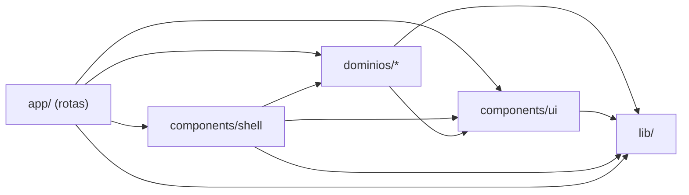

# HUB-MDC: site (pasta `web/`)

Site do HUB-MDC, o hub de sistemas da MDC Assessoria Contábil. É um app **Next.js 16** (App Router) em que **todas as
telas rodam no navegador** (`"use client"`) e conversam direto com o **Supabase** (banco, login, arquivos, funções).
React 19, Tailwind 4, TypeScript estrito. O endereço público é `mdcassessoria.com/hub-mdc` (por isso o `basePath`
`/hub-mdc` em `next.config.ts`).

Antes de mexer, leia também `docs/03-estrutura-do-codigo.md` (estrutura do repositório inteiro) e
`docs/08-convencoes.md` (regras de nome, de tela para público leigo e checklist). Tudo em português: nomes,
comentários, mensagens e commits.

> Este Next.js tem mudanças em relação ao que muita gente conhece. Antes de criar layout, grupo de rota ou usar uma
> API nova, consulte `node_modules/next/dist/docs/` (veja `AGENTS.md`).

---

## 1. Comandos

Rode sempre de dentro de `web/`.

| Comando | Para quê |
| --- | --- |
| `npm install` | Instala as dependências (Node 22) |
| `npm run dev` | Abre o site em `http://localhost:3000/hub-mdc` |
| `npm run verificar` | **Antes de todo commit:** tipos (`tipos`), lint (`lint`), testes (`teste`) e build, nessa ordem |
| `npm run telas` | **Depois do build:** abre as 25 rotas num Chromium com o Supabase simulado e falha se alguma tela quebrar |
| `npm run teste` | Só os testes (Vitest, arquivos `*.test.ts` ao lado do código) |
| `npm run format` | Formata com o Prettier (linhas de até 140 caracteres) |

`npm run telas` não acessa o banco de verdade: toda chamada ao Supabase é respondida com os dados de
`scripts/telas/dados-exemplo.mjs`. Opções: `ROTAS=/tarefas,/config npm run telas` (só algumas rotas) e
`FOTOS=/tmp/telas npm run telas` (salva uma captura de cada tela).

Se você **mover ou renomear uma página** e o `npm run tipos` acusar erro em `.next/types/...`, são tipos gerados pelo
build anterior: apague com `rm -rf .next` e rode de novo.

---

## 2. Pastas

```
web/
├── next.config.ts         basePath /hub-mdc, redirecionamentos de endereços antigos, cabeçalhos de segurança
├── eslint.config.mjs      regras de lint, inclusive a regra de dependência entre pastas (seção 3)
├── vitest.config.ts       testes: src/**/*.test.ts, ambiente node
├── scripts/
│   ├── verificar-telas.mjs       o "npm run telas"
│   └── telas/                    dados de exemplo do Supabase simulado e o balancete de exemplo
└── src/
    ├── app/                      ROTAS: uma pasta por endereço, cada uma com page.tsx
    │   ├── layout.tsx            layout raiz (fontes, globals.css, metadados)
    │   ├── globals.css           cores da marca (variáveis CSS) e classes base: btn, cartao, entrada, tabela…
    │   ├── (hub)/                grupo das telas da equipe (o nome entre parênteses NÃO entra no endereço)
    │   │   ├── layout.tsx        monta OrgProvider + Moldura uma vez só para todas as telas do grupo
    │   │   ├── page.tsx          /            Início
    │   │   ├── tarefas/          /tarefas, /tarefas/relatorio
    │   │   ├── config/           /config      (abas em config/_abas/)
    │   │   ├── clientes/         /clientes/importar
    │   │   ├── societario/       /societario, /societario/[id], /societario/painel
    │   │   ├── demonstrativos/   /demonstrativos, [id], importar, riscos, certificado
    │   │   ├── atendimento/      /atendimento, /atendimento/portal
    │   │   ├── vencimentos/      /vencimentos
    │   │   ├── comercial/        /comercial (funil), [id], leads, contratos, modelo
    │   │   └── hub/acessos/      /hub/acessos  Pessoas e acessos (pedaços em hub/acessos/_componentes/)
    │   ├── login/                /login   (fora do grupo: sem menu, sem organização)
    │   ├── portal/               /portal  Portal do Cliente (fora do grupo: o cliente não é da equipe)
    │   └── tv/                   /tv      Painel TV (fora do grupo: tela cheia, monta o próprio OrgProvider)
    │
    ├── components/
    │   ├── ui/                   peças de tela SEM regra de negócio: Modal, Abas, Aviso (+ useAviso), Carregando,
    │   │                         EstadoVazio, Etiquetas, MultiSelecao, Icone
    │   └── shell/                a moldura do HUB: Moldura, MenuLateral, BarraSuperior, BuscaRapida (Ctrl+K),
    │                             Sino (notificações), Guarda (bloqueia ferramenta não liberada) e navegacao.ts
    │
    ├── dominios/                 REGRAS DE NEGÓCIO, um assunto por pasta
    │   ├── organizacao/          OrgProvider (useOrg: sessão, organização, membros, setores, clientes, permissões), tipos
    │   ├── tarefas/              tipos, useTarefas (tempo real), componentes/ TarefaEditor, PainelTV, Badges, RitmoSemanal
    │   ├── clientes/             tipos, nomeCliente, importação do Domínio, "Colar lista", grupos
    │   ├── acessos/              tipos (níveis ver/operar/gerir, ferramentas do HUB), convite, texto do histórico
    │   ├── portal/               permissões do Portal do Cliente, componentes/ de gestão dos acessos de clientes
    │   ├── societario/           processos.ts: tipos, fases, colunas do quadro, órgãos
    │   ├── demonstrativos/       balancete/ (leitura, classificação, resumo, índices, fragilidades), cálculos das
    │   │                         demonstrações, períodos, tendência, parecer, repositório (banco), componentes/
    │   ├── comercial/            CRM: crm.ts (etapas, valores, variáveis do contrato) e contratoPdf.ts
    │   ├── atendimento/          chat.ts (conversas e mensagens) e componentes/ChatMensagens
    │   └── vencimentos/          tipos de vencimento (certificado, procuração, alvará…)
    │
    └── lib/                      INFRAESTRUTURA e utilitários que não sabem nada do negócio
        ├── supabase.ts           cliente do Supabase (endereço e chave publicável)
        ├── database.types.ts     tipos gerados do banco (não edite à mão; veja docs/07)
        ├── exigir.ts             lê a resposta do Supabase e lança o erro já traduzido
        ├── useConsulta.ts        hook de leitura de dados da tela (dados, erro, carregando, recarregar)
        ├── erros.ts              traduzirErro: mensagem de erro em português para o usuário
        ├── caminho.ts            caminho("/x") → "/hub-mdc/x" para endereços montados à mão
        ├── datas.ts, formato/    "hoje" no fuso da organização; formatação de data, dinheiro (brl) e números
        ├── texto.ts, markdown.ts semAcento; Markdown simples → HTML
        ├── identidade.ts         dados oficiais da MDC (CNPJ, telefone, responsável técnico) para PDFs e Excel
        ├── marca.ts              logo da organização (Storage) para PDFs e para a TV
        ├── armazenamentoLocal.ts preferências do navegador (CHAVES + useEstadoLembrado)
        ├── useAgora.ts           horário atual que se atualiza sozinho
        └── arquivos/             armazenamento (Storage), excel, relatorioPdf (papel timbrado), planilha (SheetJS), baixar
```

Pastas que começam com `_` (como `config/_abas` e `hub/acessos/_componentes`) **não viram rota** no App Router: são
o lugar dos pedaços de uma tela grande que só ela usa.

---

## 3. Regra de dependências



- **`app` → `dominios` → `lib`.** Uma tela usa domínios e utilitários; um domínio usa utilitários.
- **`components/ui` → `lib`.** As peças de tela não conhecem domínio: recebem tudo por props.
- **Nada em `lib/` importa de `dominios/`, `components/` ou `app/`.**
- `dominios/` não importa `app/` nem `components/shell/`. Um domínio pode usar outro (ex.: `tarefas` usa
  `organizacao` e `clientes`), **sem ciclos**. Hoje: `organizacao → acessos, clientes`; `tarefas → organizacao,
  clientes`; `portal → acessos, clientes, organizacao`.

O ESLint (`eslint.config.mjs`, regra `no-restricted-imports`) **barra** os imports proibidos acima; o erro diz qual
é a regra.

---

## 4. Onde fica cada coisa

| Quero mudar… | Arquivo |
| --- | --- |
| Item do menu lateral, abas de um módulo, qual módulo fica ativo em cada rota | `components/shell/navegacao.ts` |
| O que aparece enquanto a organização carrega, quem é redirecionado para o Portal | `dominios/organizacao/OrgProvider.tsx` |
| Permissão de ver uma ferramenta (`pode("tarefas", "operar")`) | `useOrg().pode` em `OrgProvider.tsx`; a regra de verdade está no banco (RLS) |
| Nomes de situação/prioridade de tarefa | `dominios/tarefas/tipos.ts` |
| Regimes e segmentos de cliente | `dominios/clientes/tipos.ts` |
| Leitura do Excel de balancete do Domínio | `dominios/demonstrativos/balancete/leitura.ts` |
| Regras que classificam as contas em grupos | `dominios/demonstrativos/balancete/classificacao.ts` |
| Índices (liquidez, margens, prazos) e a faixa de alerta | `dominios/demonstrativos/balancete/indices.ts` |
| Fragilidades e conferências do balancete | `dominios/demonstrativos/balancete/fragilidades.ts` |
| Balanço, DFC, termômetro de saúde | `dominios/demonstrativos/calculosDemonstracoes.ts` |
| Gravar/recalcular balancete no banco | `dominios/demonstrativos/repositorio.ts` |
| Gráficos e painel do balancete | `dominios/demonstrativos/componentes/` |
| Permissões do Portal do Cliente | `dominios/portal/permissoes.ts` (atenção: `app/(hub)/atendimento/portal/page.tsx` ainda tem uma cópia) |
| Etapas do funil, variáveis do contrato | `dominios/comercial/crm.ts` |
| Telefone, CNPJ, responsável técnico da MDC | `lib/identidade.ts` |
| Formato de dinheiro, data, índice | `lib/formato/` (`brl`, `fmtData`, `fmtIndice`…) |
| Cores da marca, botões, cartões, tabelas | `app/globals.css` |
| Exportar Excel / PDF de relatório | `lib/arquivos/excel.ts`, `lib/arquivos/relatorioPdf.ts` |

**Cálculo que também roda no servidor.** A função `supabase/functions/demonstrativo-pdf` usa uma **cópia** de
partes de `dominios/demonstrativos/balancete/`, `calculosDemonstracoes.ts`, `lib/texto.ts` e `lib/formato/`. Ao
mudar esses arquivos, rode `sh scripts/sync-funcoes.sh` na raiz do repositório e confira o `git diff` da função.

---

## 5. Padrão de uma tela

Exemplo enxuto (a tela real `app/(hub)/comercial/contratos/page.tsx` usa o mesmo molde). Ele compila e passa no lint:

```tsx
// Tela de Contratos do CRM: lista os contratos da organização com filtro por situação.
"use client";

import { useCallback, useMemo, useState } from "react";
import { useOrg } from "@/dominios/organizacao/OrgProvider";
import type { Contrato } from "@/dominios/comercial/crm";
import { supabase } from "@/lib/supabase";
import { exigir } from "@/lib/exigir";
import { useConsulta } from "@/lib/useConsulta";
import { traduzirErro } from "@/lib/erros";
import { Aviso, useAviso } from "@/components/ui/Aviso";
import { Carregando } from "@/components/ui/Carregando";
import { EstadoVazio } from "@/components/ui/EstadoVazio";

export default function PaginaContratos() {
  const { org } = useOrg(); // organização atual (o layout do grupo já carregou)
  const [status, setStatus] = useState("");
  const { aviso, mostrar } = useAviso();

  // 1) LER: useConsulta + exigir. A função vai num useCallback com as dependências da consulta.
  const { dados, erro, carregando, recarregar } = useConsulta(
    useCallback(async () => exigir(await supabase().from("crm_contratos").select("*").eq("org_id", org.id)) as Contrato[], [org.id]),
  );
  const lista = useMemo(() => (dados ?? []).filter((c) => !status || c.status === status), [dados, status]);

  // 2) GRAVAR: sempre lendo o erro (exigir lança com a mensagem traduzida), avisando e recarregando depois.
  async function cancelar(id: string) {
    try {
      exigir(await supabase().from("crm_contratos").update({ status: "cancelado" }).eq("id", id));
      mostrar("Contrato cancelado.");
      recarregar();
    } catch (e) {
      mostrar(traduzirErro(e), "erro");
    }
  }

  // 3) MOSTRAR: componentes de ui/ para erro, carregando e lista vazia (que ensina o próximo passo).
  if (carregando && !dados) return <Carregando />;
  return (
    <div className="space-y-4">
      <h1 className="text-xl font-semibold text-[var(--marca)]">Contratos</h1>
      {erro && <Aviso>{erro}</Aviso>}
      {aviso}
      <select className="entrada" value={status} onChange={(e) => setStatus(e.target.value)} aria-label="Situação">
        <option value="">Todos</option>
        <option value="assinado">Assinados</option>
      </select>
      {lista.length === 0 ? (
        <EstadoVazio>Nenhum contrato ainda. Abra uma oportunidade no Funil para gerar o primeiro.</EstadoVazio>
      ) : (
        lista.map((c) => (
          <p key={c.id}>
            {c.numero}{" "}
            <button className="btn-link" onClick={() => void cancelar(c.id)}>
              Cancelar
            </button>
          </p>
        ))
      )}
    </div>
  );
}
```

Regras que valem para toda tela (detalhes em `docs/08-convencoes.md`, seções 8.3 e 8.4):

- **Não** coloque `OrgProvider` nem a moldura na página: o `app/(hub)/layout.tsx` já faz isso.
- Datas "de hoje" com `hojeISO(org.fuso)` (`lib/datas.ts`), nunca `new Date().toISOString().slice(0, 10)`.
- Dinheiro com `brl()` de `lib/formato/moeda.ts`. Mensagens de erro com `traduzirErro` (o `exigir` já usa).
- Janela sobre a tela: `components/ui/Modal`. Abas: `components/ui/Abas`. Mensagem temporária: `useAviso()`.
- Endereço montado à mão (`window.location`, `<a href>`, ``) passa por `caminho()`; `<Link>` e `router` não precisam.
- Tipos, regras e cálculos vão para `dominios/<assunto>/`; a página só compõe. Função pura nova ganha `*.test.ts` ao lado.
- Arquivo passando de ~400 linhas é sinal para dividir (pedaços só daquela tela em `_componentes/` ao lado do `page.tsx`).
- Todo arquivo novo começa com um comentário curto dizendo para que serve.

---

## 6. Como criar uma tela nova

1. **Rota.** Crie `src/app/(hub)/<modulo>/<tela>/page.tsx` (tela da equipe). Fora do grupo só telas sem menu e sem
   organização da equipe (como `/login`, `/portal`, `/tv`).
2. **Módulo e menu.** Em `components/shell/navegacao.ts`:
   - se é um módulo novo, acrescente o tipo em `Modulo`, o prefixo da rota em `MODULO_POR_PREFIXO` e o título/abas em `NAV`;
   - se é uma aba de um módulo existente, acrescente `{ href, nome }` nos `links` do módulo (use `minimo: "operar"`
     ou `"gerir"` para esconder de quem só vê, ou `gestor: true` para só gestores e administradores).
   - A ferramenta precisa existir em `hub_apps` no banco (é o que libera o módulo para cada pessoa); veja `docs/05`.
3. **Domínio.** Tipos e regras em `src/dominios/<modulo>/` (crie a pasta se não existir). Componentes que só esse
   assunto usa vão em `src/dominios/<modulo>/componentes/`.
4. **Tela.** Siga o padrão da seção 5 e as regras de tela para público leigo (`docs/08-convencoes.md` 8.3: linguagem
   simples, filtros fáceis, exportar PDF e Excel, tela vazia que ensina, celular).
5. **Endereço antigo.** Se o módulo é novo, inclua o prefixo na lista de `redirects` do `next.config.ts`.
6. **Verificação de telas.** O `npm run telas` encontra a rota sozinho. Se ela tem parâmetro (`[id]`), acrescente
   um id de exemplo em `IDS_EXEMPLO` (`scripts/telas/dados-exemplo.mjs`); se usa tabela ou RPC nova, acrescente
   dados de exemplo em `TABELAS`/`RPCS` (senão o script avisa "sem dados de exemplo"). Para testar cliques (abrir
   janela, trocar aba), acrescente uma entrada em `INTERACOES` (`scripts/verificar-telas.mjs`).
7. **Conferir e documentar.** `npm run verificar && npm run telas`; atualize o capítulo do módulo em `docs/` no
   mesmo commit e rode a auditoria (`CLAUDE.md`, item 7).
